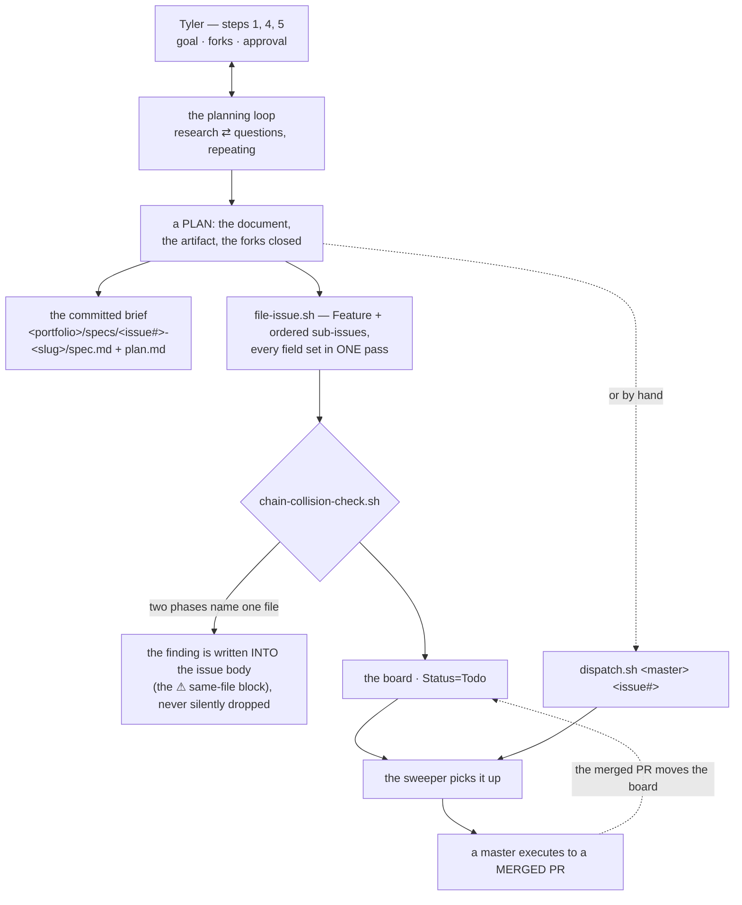

> Mirrored verbatim from `utopia-models/knowledge` `wi/components/agent-architect.md` by the allowlisted publish pipeline. Edit it there, not here.

```yaml
component: agent-architect
serves: all
runs-on: novaserver (architect) — primary; host-eth (WSL `kxdev`) — peer
adrs: [4063, 6924, 7148]
owns:
  - _infra/scripts/file-issue.sh
  - _infra/scripts/chain-collision-check.sh
```

# agent-architect — the one agent that plans, files and dispatches, and never executes

## WHAT IT IS

`agent` (GitHub `kxagent`), registry class **`architect-agent`**. It runs the planning loop **with
Tyler in the foreground**, writes and curates specs and doctrine, files the Feature and its ordered
sub-issues, and dispatches masters onto them. It is the only agent that does those things and the
only one that **never executes a dispatched issue**.

Stop it and the masters keep executing whatever is already filed, then go idle: the board stops being
refilled. Its output is not code — it is *ordered, dispatchable work with a committed brief beside it*.

It was `master-agent` in the registry until #6946 flipped it, and the rename was the point: calling
the planner a master hid the actual architecture, and the OCC now branches on a predicate
(`isMasterClass()`) rather than on the literal string, so the flip dropped it off no surface.

## WHERE IT RUNS

**One Architect, two hosts** (knowledge#10499, decisions 2 and 5). **Primary: novaserver**, unix user
`architect` (`/home/architect`, knowledge#10285) — Tyler drives it from his phone over Remote Control, in
the persistent tmux sessions listed in `_infra/persistent-sessions.tsv` (`persistent-sessions.md`).
**Peer: the ETH laptop**, WSL user `kxdev` (`host-eth.md`) — the same identity, rules and memory, there so
Tyler can still talk to the Architect when novaserver is down. With novaserver down the peer can plan,
file issues and push; it cannot read Infisical or dispatch, because both live on novaserver (decision 7:
no laptop secrets cache). Neither host is a dispatch target: lane `agent` is undispatchable.

**A third host is one command** (knowledge#10563). `git clone https://github.com/utopia-models/brain-agent.git ~/.claude && bash ~/.claude/bootstrap.sh` rebuilds the Architect on any Linux user from GitHub alone; the runbook is brain-agent's `BOOTSTRAP.md`. The GitHub token is never stored: `hooks/sessionstart-gh-token.sh` reads `GITHUB_TOKEN_1000XAGENT` from the vault at every session start and exports it as `GH_TOKEN`, so a rotation reaches every host on its next session. With the vault gone, gh's own login (`gh auth login`) is the fallback.

## HOW IT WORKS TODAY



**Filing is a script, not a habit.** `file-issue.sh` sets title, body, lane, priority, portfolio,
parent and blocked-by **in one pass** — an unfielded issue is unroutable, because dispatch routes on
Lane. It refuses an empty acceptance section, refuses a parked-portfolio title, and enforces the
lane placeholder set; two of its guards carry their own regression tests, in `owns:` above.

**`chain-collision-check.sh` is why a wave is safe to fan out.** Worktrees prevent *tree* collisions,
never *merge* collisions: two phases editing one file in parallel means last PR wins. The check runs
at FILING time and writes its findings into each issue body, so the master who draws that phase reads
the collision instead of discovering it. This very issue carries such a block.

**It is not reachable by the sweeper, and that is structural, not a gap.** The sweeper's `MASTERS`
list is a hardcoded string on novaserver; the Architect (unix user `architect` on novaserver since knowledge#10285) is never dispatched, and the
OCC excludes it from the dispatchable set by KEY (`agentKey !== "agent"`) rather than by class — so
both tests hold whichever class value it carries. Consequences worth stating plainly: a dispatch it
never starts is invisible.

**Watching a running dispatch is the failure, not the diligence.** Verification moved off the
Architect and onto the master's own acceptance criteria plus the auto-filed VERIFY task. Polling a run
collapses fleet throughput to one plan at a time.

## BOUND VALUES

<!--[[[cog
m.exists("_infra/scripts/file-issue.sh _infra/scripts/chain-collision-check.sh")
m.value("architect-agent", "wi/registry/organization.yaml", r"class: (architect-agent)")
m.value("kxagent", "wi/registry/organization.yaml", r"github_account: (kxagent)\s")
m.calls("_infra/scripts/file-issue.sh", "chain-collision-check.sh")
]]]-->
- ✅ `_infra/scripts/file-issue.sh`
- ✅ `_infra/scripts/chain-collision-check.sh`
- ✅ `architect-agent` — still live in `wi/registry/organization.yaml` (`class: (architect-agent)`)
- ✅ `kxagent` — still live in `wi/registry/organization.yaml` (`github_account: (kxagent)\s`)
- ✅ `chain-collision-check.sh` — still called by `_infra/scripts/file-issue.sh`
<!--[[[end]]]-->

## DETERMINE CURRENT STATE

Everything about this agent is off-git from here — it runs as the unix user `architect` on novaserver
(knowledge#10285), with a peer as `kxdev` on ETH.

```bash
sed -n '/^  agent:/,/^  [a-z]/p' wi/registry/organization.yaml
gh api users/kxagent/events/public --jq '[.[0].created_at, .[0].type]'
python3 -c "import json;print(json.load(open('_infra/occ-feeds/usage/agent.json'))['account'])"
bash _infra/scripts/file-issue.sh --help 2>&1 | head -20      # the filing contract, as it is today
sudo -n -u architect tmux ls                                    # primary: its live sessions on novaserver
tailscale status | grep -E '\seth-1\s'                          # peer: is the laptop's WSL host up
```

## KNOWN BROKEN

- 🔴 **Its own reference doc still says its class is wrong.**
  `wi/work/reference/win/master-agent.md` reads *"**Class:** `master-agent` today, and
  that is known to be wrong … the `architect-agent` class exists for it (#6944) and it is flipped onto
  it in W3 (#6946)"*. The flip **has happened**: measured this session,
  `grep -n 'class: architect-agent' wi/registry/organization.yaml` → `496`.
  The doc describes a pending change that is already done, which reads as a live defect to anyone
  grounding on it.
- 🔴 **The registry id for this component is `master-agent`.**
  `wi/registry/components.yaml` still carries `- id: master-agent` with
  `doc: wi/work/reference/win/master-agent.md` — an id that names the class this agent
  was *moved off*. It also collides head-on with the masters' component id (`agent-master`), which is
  PLAN-256's open item 1. Renaming a registry id is not this doc's to do; it is recorded here so the
  next reader does not re-derive it.
- ⚠ **A new plan started in the same session overwrites the previous plan file** — the slug is memoized
  per session, so one plan = one file = one session. Stated in `master-agent.md` since 2026-08-01 and
  never re-graded; nothing in this repo binds it, because the behaviour lives in the Architect's own
  skills on its box.
- ⚠ **`file-issue.sh` and `chain-collision-check.sh` are indexed here because nothing else claims
  them**, not because the Architect is the only caller. If a `spec-plan-brief-format` or
  `planning-loop` component doc lands with a better claim on the filing contract, this `owns:` block
  is the thing to move.
