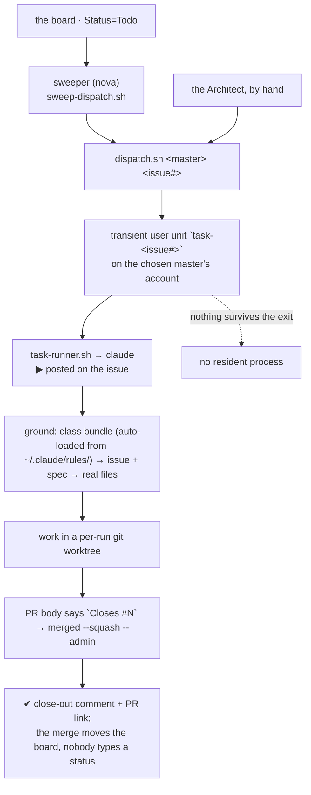

> Mirrored verbatim from `utopia-models/knowledge` `wi/components/agent-master.md` by the allowlisted publish pipeline. Edit it there, not here.

```yaml
component: agent-master
serves: all
runs-on: novaserver
adrs: [3562, 6924, 7167]
owns:
  - _infra/scripts/mute-agent-notifications.sh
  - _infra/scripts/verify-master-token-shape.sh
  - _infra/scripts/user-unit-resolve.sh
```

# agent-master — the four interchangeable executors

## WHAT IT IS

The registry class `master-agent`, and its four instances: **`win` · `nova` · `cloud` · `dust`**.
One component doc, not four, because **they are interchangeable — any board issue, any portfolio.**
The lane on an issue names the BOX that will run it, never a specialty; routing by subject matter is
the thing the doctrine exists to kill.

Stop all four and the board stops being a queue and becomes a list: nothing else in the fleet turns a
`Status=Todo` row into a merged PR. The Architect plans and files; the sweeper starts; **only a master
executes.**

They differ in mechanical facts only — unix user, uid, GitHub account, brain repo, `secret_scope`,
and `autonomous:`. Nothing else about them is per-instance, and the four reference docs this one
replaces exist mostly to say so.

## HOW IT WORKS TODAY

A master has **no process between runs**. `dispatch.sh` starts a transient systemd `--user` unit named
`task-<issue#>`; the run announces `▶` on the issue, works, opens a PR, merges it, and exits with
`✔`/`✘`. Liveness is the close-out comment and nothing else — there is no daemon to check.



**What differs per instance — the whole of it:**

| | `win` | `nova` | `cloud` | `dust` |
|---|---|---|---|---|
| uid | 1003 | 1000 | 1002 | 1001 |
| GitHub | `kxagent2` | `kxagent3` | `kxagent4` | `kxagent5` |
| brain repo | `brain-win` | `brain-nova` | `brain-cloud` | `brain-agent-dust` |
| `secret_scope` | `[ALL]` | registry | registry | `dmv-research` |
| `autonomous` | true | true | true | 🔴 **false** |

`autonomous: false` on `dust` is an **axis, not a lane** — it is dispatched exactly like the other
three and simply has no 24×7 self-directing routine. `secret_scope: [ALL]` on `win` is why credential
matters route there; it changes which *secrets* that account can read, never which *issues* it can be
given.

Two facts about the boxes that are routinely mistaken for lanes, and are not:

- **Most of novaserver's always-on services happen to run as the unix user `nova`** — ttyd, the OTA
  feed, occ-redirect, both Actions runners, the publish timers. That decides which account can
  *verify* those units (no master has sudo over another), never which issues `nova` is dispatched onto.
- **The fleet's own machinery is installed under `win`.** A change to it reaches every master's next
  run. That is a property of what is installed there, not a specialty.

**Two files here exist only because these are ACCOUNTS, not just processes.**
`mute-agent-notifications.sh` sweeps the thread subscriptions a master creates by *working* — posting
`▶`/`✔` auto-subscribes its GitHub account, and `kxagent4`'s primary email is Tyler's personal
address, so every later comment on that thread would mail him. It rides `reconcile-board.service` as a
third `ExecStart`, not a new timer. `verify-master-token-shape.sh` asks each master's token for its
own `x-oauth-scopes` header rather than reading a registry field, because a stored copy of a scope set
is exactly the thing that drifts.

## BOUND VALUES

<!--[[[cog
m.exists("_infra/scripts/mute-agent-notifications.sh _infra/scripts/verify-master-token-shape.sh _infra/scripts/user-unit-resolve.sh")
m.value("win nova cloud dust", "_infra/scripts/sweep-dispatch.sh", r'MASTERS="([^"]+)"')
m.value("win nova cloud dust", "_infra/scripts/dispatch.sh", r'DISPATCH_QUOTA_MASTERS:-([^}]+)}')
m.value("master-agent", "wi/registry/organization.yaml", r"class: (master-agent)")
]]]-->
- ✅ `_infra/scripts/mute-agent-notifications.sh`
- ✅ `_infra/scripts/verify-master-token-shape.sh`
- ✅ `_infra/scripts/user-unit-resolve.sh`
- ✅ `win nova cloud dust` — still live in `_infra/scripts/sweep-dispatch.sh` (`MASTERS="([^"]+)"`)
- ✅ `win nova cloud dust` — still live in `_infra/scripts/dispatch.sh` (`DISPATCH_QUOTA_MASTERS:-([^}]+)}`)
- ✅ `master-agent` — still live in `wi/registry/organization.yaml` (`class: (master-agent)`)
<!--[[[end]]]-->

## DETERMINE CURRENT STATE

Every fact about a master that matters at step 1 is off-box: which login it runs on, whether a
run holds it, what it last did. Run these; never quote an answer out of this doc.

```bash
grep -n 'MASTERS=' _infra/scripts/sweep-dispatch.sh          # the dispatchable set, hardcoded
bash _infra/scripts/dispatch.sh --account win                # which Claude login this box runs on
bash _infra/scripts/sweep-dispatch.sh --explain              # why any queued issue is held
gh api users/kxagent2/events/public --jq '.[0].created_at'   # last observable work (per account)
systemctl --user list-units 'task-*' --all --no-legend       # a live run, ON that master's account
bash _infra/scripts/user-unit-resolve.sh                     # every user unit on every master resolves
```

🔴 `systemctl --user` needs the owning user's session bus: run as another account it reports a healthy
box as empty, which is how 44 timers once read as zero.

## KNOWN BROKEN

- 🔴 **`master-nova.md` states an identity the doctrine contradicts.** It reads *"nova dispatches under
  a GitHub App identity (`utopia-models-fleet`), not a plain user account — so it has no mentions
  inbox."* `_process/identity-and-scope.md:24` reads *"All four run their own
  durable PAT ambiently (#3928: the 1-hour App token 401'd between mints and could not read the
  user-scoped mention inbox; App token is env-only now)."* Both cannot be true. Measured this session:
  `grep -n 'gh-app-token' _infra/scripts/dispatch.sh` → one hit, at line 1145, and it is a *fallback*
  (`GH_TOKEN="${_tok:-${GH_TOKEN:-}}"`). Settle it on the box, not from a doc:
  `env -u GH_TOKEN -u GITHUB_TOKEN gh api user --jq .login` as each master.
- 🔴 **The registry still carries five rows for what is one component.**
  `wi/registry/components.yaml` holds `master-agent` · `master-win` ·
  `master-nova` · `master-cloud` · `master-dust`, and `master-agent` is **the Architect**, not a
  master — its `class:` in `organization.yaml` is `architect-agent`. The id and the class disagree,
  which is the naming collision PLAN-256's own brief raises as its open item 1 (`agent-master` vs
  `master-agent`). Nothing here can fix it: the registry ids are not this doc's to rename.
- ⚠ **`master-cloud.md` reports two units in `failed` state "on 2026-08-01"** — a dated observation of
  `proactive-audit.service` and `historical-regression.service` that nothing has re-graded since.
  A month-old failure list is a claim about a moment, not about the box. Re-read it:
  `systemctl --user list-units --state=failed --no-legend` **as `cloud`**.
- ⚠ **The four per-master usage feeds are read here but owned elsewhere.**
  `_infra/occ-feeds/usage/{win,nova,cloud,dust}.json` is where a master's live account and quota
  actually are; the publisher and its timer belong to the feed components, so this doc deliberately
  claims neither and points at the command instead.
