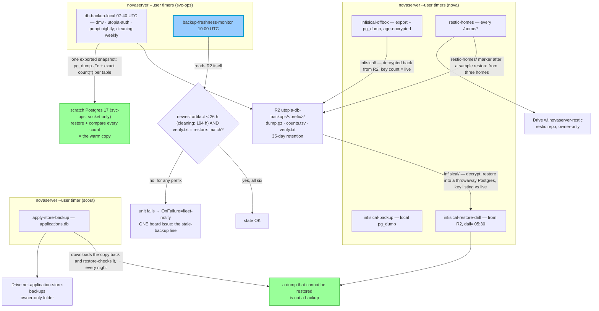

> Mirrored verbatim from `utopia-models/knowledge` `wi/components/backup-mechanism.md` by the allowlisted publish pipeline. Edit it there, not here.

```yaml
component: backup-mechanism
serves: all
runs-on: novaserver
adrs:
  - wi/work/specs/10536-offbox-backups/decisions/0001-restic-on-drive.md
  - wi/work/specs/10536-offbox-backups/decisions/0002-age-identity-escrow.md
owns:
  - db-backup-local.service
  - infisical-backup.service
  - infisical-restore-drill.service
  - infisical-offbox.service
  - restic-homes.service
  - backup-freshness-monitor.service
  - apply-store-backup.service
  - _infra/backup/
  - _infra/ansible/roles/backup/
```

# backup-mechanism — the org's durability layer

## WHAT IT IS

Everything that makes the org's state survivable: nightly database dumps to cold R2, the Infisical vault
encrypted to R2 and decrypted back every night, every `/home/*` on novaserver in a restic repository on
Drive, the NET application store's nightly copy to Drive, and a monitor whose only job is to notice when a
backup **did not happen**. Nothing here is reconstructible from git — that is the definition of what it covers.

The database half runs in ONE place: the `svc-ops` service user on novaserver (`--user` timers, converged
hourly by `ansible-pull` from `_infra/svc-ops/` and `_infra/systemd/`). The three GitHub Actions workflows
that used to duplicate it (`backup-neon`, `backup-dmv-supabase`, `backup-dmv-data` in `utopia-models/utopia`)
were deleted on 2026-10-24 (utopia-models/utopia#601, knowledge#10096): GitHub refused to start them
("recent account payments have failed"), and when they did run the scheduler fired them 5-6 h late.



**Each database, each night (`_infra/svc-ops/ops/db-backup-local.sh`):** a `psql` coprocess opens a
`REPEATABLE READ` transaction and exports its snapshot; `pg_dump -Fc --snapshot=<it>` dumps, and the SAME
transaction then counts every ordinary table with `count(*)` (extension-owned tables left out, as pg_dump
leaves their data out; `row_security=off`, so an RLS-hidden row is an error, not an undercount). Because both
read one snapshot, a write during the dump cannot make them disagree. `pg_restore --list` must print a TOC.
Then the dump is restored (`--no-owner --no-acl`) into `<db>_new` in a scratch Postgres 17 that svc-ops runs
itself (`~/.local/share/db-restore`, unix socket, port 5499, no TCP) and the same count query runs there:
every source line must reappear exactly. On a match `<db>_new` replaces `<db>`, so the scratch cluster always
holds last night's restore-proven copy of each database — the warm copy, never a primary. Supabase dumps name
extensions and roles a vanilla Postgres lacks; those statements error and are skipped
(`restore-errors-skipped` in verify.txt, 20 for dmv on 2026-10-24), and the count compare is the verdict.
A failed connection is retried in rounds (4 × 600 s, #9403).

**cleaning is dumped weekly, not nightly** (`BACKUP_WEEKLY`, default `cleaning`): the business was shut down
on 2026-10-24 (#10106), so nothing writes it; it stays on Neon's free plan (5 GB of transfer a month); and
branch main is about 0.5 GB logical. A nightly full dump would spend the month's allowance in about ten days
and take the database down again — the backup would become the burn. A weekly database is dumped only when
its last restore-verified dump on nova is at least 7 days old (less 2 h of timer jitter) or missing, and the
monitor gives it 7 d + 26 h (194 h). If cleaning is revived and written to again, drop it from
`BACKUP_WEEKLY` and its `:194` in the monitor.

**The freshness monitor grades the sink.** `backup-freshness-monitor.sh` lists each prefix in R2 and fails
unless the newest `*.dump.gz` is under its limit (26 h, or a per-database `label:prefix:hours`) and the `verify.txt` beside it starts `restore: match`. A
failed unit fires `OnFailure=fleet-notify`, which upserts ONE board issue — that issue is the stale-backup
line where Tyler looks. It runs at 10:00 UTC because a missed 07:40 run crosses 26 h at 09:40. Before
#10096 it read Actions run lists and the backup log for 2 of the 3 databases it claimed, and cleaning was in
no backup at all.

**`apply-store-backup` is the one backup here that is not Postgres, not R2 and not nova's**
(knowledge#8256). The NET application store is a SQLite file under scout's `0750` home, and it — with the
submission JSONs it is loaded from, on the same disk — is the only record of what each job application
sent. `apply-store-backup.timer` (scout's `--user` manager; the unit files are in `brain-agent-net`) runs
knowledge's `net/work/_tools/apply-store-backup.sh`: SQLite's online backup API from a read-only
connection, gzip, upload to the Drive folder behind manifest key `net.application-store-backups`, Drive's
sha256 against the local one, then **the restore drill in the same run** — the copy is downloaded back and
`apply_store.py restore-check` grades it (`integrity_check`, row counts, every stored document against its
own sha256) before anything older is pruned. The copy is megabytes, so the drill costs seconds and there
is no reason to give it a slower timer of its own. Three choices are written where they can be re-read, in
the script's header: **why Drive and not R2** (the R2 keys are in an Infisical project scout's scope
excludes, and Drive is where scout already writes this pipeline's evidence), **why the folder must be
owner-only** (its parent is shared outside the org; the script re-reads the permission list every run and
refuses to upload otherwise), and **what the retention costs**. A failed run is a failed unit, and scout's
`OnFailure` drop-in files one board issue.

## OFF THE BOX — the vault and the homes (knowledge#10536)

novaserver is the only box holding the fleet (#10314), so until 2026-10-30 one disk loss took everything
the database half does not cover. **Measured that morning, before this change:** the Infisical pg_dump was
local only — `backup-infisical.sh` had logged `off-box push SKIPPED — no R2 creds` every night since July —
the logical export was plaintext JSON in `~/.claude/private`, and no home directory had any copy anywhere.
Two units close it, both nova `--user` timers whose scripts are in this repo (`_infra/backup/`), run from
nova's ansible-pull clone so they always execute main:

**`infisical-offbox`** takes a fresh logical export (every project in the map, through the same
`infisical-export.sh`) and the newest local pg_dump, encrypts both with age, and uploads them to
`utopia-db-backups/infisical/`. Then it **restores from the sink**: it downloads both back, decrypts with the
identity in Infisical (`fleet-infra/BACKUP_AGE_IDENTITY`), requires each project's key count to equal what
`infisical-get.sh --keys` lists live, and requires the pg_dump to hash to the local file. That line is the
`verify.txt` the freshness monitor grades. The identity's second copy is a file in an owner-only Drive
folder (`wi.backup-break-glass`) — a key kept only inside the store it recovers recovers nothing (ADR 0002).

**`restic-homes`** backs up every `/home/*` to a restic repository on Drive (`wi.novaserver-restic`,
through rclone as the service account impersonating tyler@) — Drive and not R2 because the utopia R2
account already holds 185 GB, far past its free 10 GB (ADR 0001). Skipped: caches and build output (the
`EXCLUDES` list in the script) and, in every home, **the tracked side of each clone that is clean and
pushed** — no modification, no untracked file, no stash, no local branch or worktree HEAD ahead of a
remote. Ignored files in those clones (a `.env`, a local SQLite store) are still backed up, because git
cannot give them back. That scan runs as each home's owner, never root: git executes a repository's own
`core.fsmonitor`. After the backup: `restic check` reading a slice of the pack data, then a **restore of a
random file sample from three homes** into a scratch directory, each compared by sha256 with the live
file; the verdict goes to `utopia-db-backups/restic-homes/` for the monitor.

**Recovery from total box loss**, in order: Tyler's Google login → the age identity in
`wi.backup-break-glass` → R2 (Cloudflare login) `infisical/infisical-<date>.export.json.age` → every secret,
including `RESTIC_HOMES_PASSWORD` → `restic restore` from `wi.novaserver-restic`.

**Installed by `roles/backup`** (knowledge#10612): every nova and svc-ops unit in the table below except
`apply-store-backup` is a file in `_infra/systemd/`, installed into the account that runs it by the `backup` play in
`_infra/ansible/site.yml` — each account's own hourly ansible-pull converges its half, and
`ansible-playbook -i _infra/ansible/inventory.yml _infra/ansible/site.yml --tags backup --check --diff` reports
drift for both. The role also refuses to start a timer whose `ExecStart` script is missing and proves every secret
the scripts read at run time (`RESTIC_HOMES_PASSWORD`, `BACKUP_AGE_IDENTITY`, the R2 keys) is readable in Infisical,
by byte count only. Walkthrough: `_infra/ansible/ANSIBLE-FOR-TYLER.md` § The `backup` role. The role also installs
nova's `crm-backup` timer (the Twenty CRM's Postgres, a docker volume restic never sees, age-encrypted to the Drive
folder behind manifest key `wi.crm-backups`, #10924); it is documented in `wi/components/crm.md` and is not a row in
the table below, which is the 2026-10-30 measurement.

**Every backup timer on the box, 2026-10-30** (the probe is below; this table is the measurement on the day
it was written, not a standing claim):

| timer | account | cadence | destination | restore proof | a failure |
|---|---|---|---|---|---|
| `db-backup-local` | svc-ops | daily 07:40 | R2 `supabase/` `neon/` | scratch Postgres, per-table counts | OnFailure → board |
| `backup-freshness-monitor` | svc-ops | daily 10:00 | reads R2 | grades every prefix | OnFailure → board |
| `infisical-backup` | nova | daily | local `~/infisical-backups` | `pg_restore -l` | OnFailure → board |
| `infisical-export` | nova | daily | local `~/.claude/private` | — | OnFailure → board |
| `infisical-restore-drill` | nova | daily 05:30 | reads R2 `infisical/` | decrypt, throwaway Postgres, key listing vs live (`restore-drill.sh --vault`) | OnFailure → board |
| `infisical-offbox` | nova | daily 05:15 | R2 `infisical/` | decrypt from R2, key counts vs live | OnFailure → board + monitor |
| `restic-homes` | nova | daily 02:30 | Drive restic repo | sample restore, sha256 vs live | OnFailure → board + monitor |
| `apply-store-backup` | scout | daily | Drive `net.application-store-backups` | `restore-check` | scout's OnFailure → board |

## RPO AND RTO — the timed restore drill

`_infra/backup/restore-drill.sh` restores the two off-box backups into scratch and times it, repeatably:

- **the Infisical vault** — the newest R2 night whose `verify.txt` is `restore: match`: export and pg_dump
  downloaded, decrypted with the age identity from Infisical, the pg_dump restored into a throwaway
  `postgres:16-alpine`; then the key listing three ways — every live key name (`infisical-get.sh --keys <project>
  prod /`) looked up in the decrypted export and in the restored database's `secrets_v2`;
- **one whole agent home** (default `/home/scout`: the NET application store, irreplaceable) — `restic restore
  latest --include /home/<agent> --verify` from the Drive repository into a root-only scratch directory, every
  file the snapshot lists checked on disk at its size, and a 200-file sample sha256-compared with the live file.

**RPO** = now − the time the newest restorable copy was taken (the export's upload; the restic snapshot's time).
**RTO** = wall-clock from the first download to the verified restore. `--vault` alone is what
`infisical-restore-drill.timer` runs nightly; the whole drill is on demand (`--home <agent>` picks another home).

**Measured 2026-10-30 08:39–08:41 UTC** (win@novaserver, knowledge#10612; the output is on the issue):

| backup | RPO at drill time | RTO | what was restored and proven |
|---|---|---|---|
| restic homes (`/home/scout`) | **4 h 08 m 39 s** (snapshot `1fe231af`, 2026-10-30 04:31:07 UTC) | **1 m 25 s** | 111,555 files, 7.21 GB, every one on disk at its size, restic `--verify` clean, 186/186 sampled files sha256-equal to live (14 changed since, skipped) |
| Infisical vault | **1 h 13 m 31 s** (export uploaded 2026-10-30 07:25:47 UTC) | **28 s** | export decrypts and lists every live key name (fleet-infra 332/333 — one key added after the export); the restored pg_dump lists 55/55, 72/75, 327/333, 10/10 (it is the 04:17 dump, three hours older than the export) |

What these numbers mean: the measured RPO is the age on the morning the backups were first run; the **design
RPO** is one night — restic at 02:30 and the vault at 05:15, so a loss just before the next run loses up to ~24 h
of home changes and ~24 h of vault changes. The RTO is one home of 7 GB; the whole box (57 GB, 12 homes) scales
with the bytes, and the vault is always first because the restic password is in it.

## BOUND VALUES

The database half's scripts ARE in this repo (`_infra/svc-ops/ops/db-backup-local.sh`,
`backup-freshness-monitor.sh`), and so are the off-box half's (`_infra/backup/`), and their schedule, age limit, retention and retry numbers are read from
those files and `_infra/systemd/{db-backup-local,backup-freshness-monitor}.timer`, never restated as truth here. `infisical-backup` and `infisical-export` run `brain-nova` files under nova's `~/.claude/`; `infisical-restore-drill` runs this repo's `_infra/backup/restore-drill.sh --vault`. (`apply-store-backup`'s target IS in this repo — `net/work/_tools/apply-store-backup.sh`, run from scout's knowledge clone — and its numbers are stated only there.) An out-of-repo absolute
path is refused by `cog_machinery` on purpose — it stats differently per account on a `0750` home. The
`units:` list above is the binding that *should* carry this, and it cannot yet: see the first finding.

The off-box half's numbers, bound to the files that hold them (`python3 _infra/scripts/docs-cog.sh`):

<!--[[[cog
m.exists("_infra/backup/infisical-offbox.sh _infra/backup/restic-homes.sh _infra/backup/restic-home-excludes.py _infra/backup/restore-drill.sh _infra/ansible/roles/backup/defaults/main.yml")
m.value("05:15:00", "_infra/systemd/infisical-offbox.timer", r"OnCalendar=\*-\*-\* (\S+) UTC")
m.value("02:30:00", "_infra/systemd/restic-homes.timer", r"OnCalendar=\*-\*-\* (\S+) UTC")
m.value("07:40:00", "_infra/systemd/db-backup-local.timer", r"OnCalendar=\*-\*-\* (\S+) UTC")
m.value("05:30:00", "_infra/systemd/infisical-restore-drill.timer", r"(?m)^OnCalendar=\*-\*-\* (\S+)$")
m.value("scout", "_infra/backup/restore-drill.sh", r'RESTORE_DRILL_HOME:-([^}]+)}')
m.value("200", "_infra/backup/restore-drill.sh", r'RESTORE_DRILL_SAMPLE:-([^}]+)}')
m.value("35", "_infra/backup/infisical-offbox.sh", r"(?m)^RETENTION_DAYS=(\d+)")
m.value("infisical", "_infra/backup/infisical-offbox.sh", r'(?m)^PREFIX="([^"]+)"')
m.value("restic-homes", "_infra/backup/restic-homes.sh", r'(?m)^R2_PREFIX="([^"]+)"')
m.value("nova win scout", "_infra/backup/restic-homes.sh", r'RESTIC_SAMPLE_HOMES:-([^}]+)}')
m.value("1%", "_infra/backup/restic-homes.sh", r'RESTIC_CHECK_SUBSET:-([^}]+)}')
m.value("1-mkNq4kY5fwsRS32wv4F3Z0vv8aah90V", "_infra/drive-manifest.yaml", r'wi\.novaserver-restic:\n\s+id: "([^"]+)"')
m.value("1-mkNq4kY5fwsRS32wv4F3Z0vv8aah90V", "_infra/backup/restic-homes.sh", r'(?m)^DRIVE_FOLDER="([^"]+)"')
m.value("infisical:infisical homes:restic-homes", "_infra/svc-ops/ops/backup-freshness-monitor.sh", r'cleaning:neon/cleaning:194 ([^}]+)}')
]]]-->
- ✅ `_infra/backup/infisical-offbox.sh`
- ✅ `_infra/backup/restic-homes.sh`
- ✅ `_infra/backup/restic-home-excludes.py`
- ✅ `_infra/backup/restore-drill.sh`
- ✅ `_infra/ansible/roles/backup/defaults/main.yml`
- ✅ `05:15:00` — still live in `_infra/systemd/infisical-offbox.timer` (`OnCalendar=\*-\*-\* (\S+) UTC`)
- ✅ `02:30:00` — still live in `_infra/systemd/restic-homes.timer` (`OnCalendar=\*-\*-\* (\S+) UTC`)
- ✅ `07:40:00` — still live in `_infra/systemd/db-backup-local.timer` (`OnCalendar=\*-\*-\* (\S+) UTC`)
- ✅ `05:30:00` — still live in `_infra/systemd/infisical-restore-drill.timer` (`(?m)^OnCalendar=\*-\*-\* (\S+)$`)
- ✅ `scout` — still live in `_infra/backup/restore-drill.sh` (`RESTORE_DRILL_HOME:-([^}]+)}`)
- ✅ `200` — still live in `_infra/backup/restore-drill.sh` (`RESTORE_DRILL_SAMPLE:-([^}]+)}`)
- ✅ `35` — still live in `_infra/backup/infisical-offbox.sh` (`(?m)^RETENTION_DAYS=(\d+)`)
- ✅ `infisical` — still live in `_infra/backup/infisical-offbox.sh` (`(?m)^PREFIX="([^"]+)"`)
- ✅ `restic-homes` — still live in `_infra/backup/restic-homes.sh` (`(?m)^R2_PREFIX="([^"]+)"`)
- ✅ `nova win scout` — still live in `_infra/backup/restic-homes.sh` (`RESTIC_SAMPLE_HOMES:-([^}]+)}`)
- ✅ `1%` — still live in `_infra/backup/restic-homes.sh` (`RESTIC_CHECK_SUBSET:-([^}]+)}`)
- ✅ `1-mkNq4kY5fwsRS32wv4F3Z0vv8aah90V` — still live in `_infra/drive-manifest.yaml` (`wi\.novaserver-restic:\n\s+id: "([^"]+)"`)
- ✅ `1-mkNq4kY5fwsRS32wv4F3Z0vv8aah90V` — still live in `_infra/backup/restic-homes.sh` (`(?m)^DRIVE_FOLDER="([^"]+)"`)
- ✅ `infisical:infisical homes:restic-homes` — still live in `_infra/svc-ops/ops/backup-freshness-monitor.sh` (`cleaning:neon/cleaning:194 ([^}]+)}`)
<!--[[[end]]]-->

## DETERMINE CURRENT STATE

The database backups — timers, the last run, and the monitor's verdict on R2:

```
ssh nova@<host> "sudo -n -u svc-ops bash -c 'export XDG_RUNTIME_DIR=/run/user/\$(id -u); \
  systemctl --user list-timers db-backup-local.timer backup-freshness-monitor.timer --all --no-legend; \
  tail -6 ~/.claude/logs/db-backup-local.log; head -2 ~/.claude/state/db-backup/*.verify.txt; \
  bash ~/.claude/ops/backup-freshness-monitor.sh'"
ssh nova@<host> "systemctl --user list-timers infisical-backup.timer infisical-restore-drill.timer --all --no-legend"
```

The timed restore drill — the vault and one whole home into scratch, RPO and RTO printed (about two minutes):

```
bash _infra/backup/restore-drill.sh                 # from any agent's knowledge checkout on novaserver
bash _infra/backup/restore-drill.sh --vault         # the vault only — what the nightly timer runs
```

Whether the box matches the role (changed=0 is the answer):

```
ansible-playbook -i _infra/ansible/inventory.yml _infra/ansible/site.yml --tags backup --check --diff
```

The off-box half — nova's timers with their last result, the last verdict of each, and the restic snapshots:

```
ssh nova@<host> 'systemctl --user list-timers infisical-backup.timer infisical-export.timer \
  infisical-restore-drill.timer infisical-offbox.timer restic-homes.timer --all --no-legend; \
  systemctl --user show -p Id,Result,ExecMainExitTimestamp infisical-offbox.service restic-homes.service; \
  tail -3 ~/.claude/logs/infisical-offbox.log ~/.claude/logs/restic-homes.log'
ssh nova@<host> 'bash ~/.cache/ansible-pull/knowledge/_infra/backup/restic-homes.sh --snapshots'
# a restore into scratch, on demand: N files from each sampled home, sha256 against the live file
ssh nova@<host> 'bash ~/.cache/ansible-pull/knowledge/_infra/backup/restic-homes.sh --restore-sample 10'
```

The application store's copy — the timer, the copies Drive holds, and whether the newest one restores:

```
ssh nova@<host> "sudo -n -u scout XDG_RUNTIME_DIR=/run/user/\$(id -u scout) systemctl --user list-timers \
  apply-store-backup.timer --all --no-legend"
ssh nova@<host> "sudo -n -u scout bash ~scout/dev/utopia-models/knowledge/net/work/_tools/apply-store-backup.sh --list"
ssh nova@<host> "sudo -n -u scout bash ~scout/dev/utopia-models/knowledge/net/work/_tools/apply-store-backup.sh --restore-check"
```

## KNOWN BROKEN

- 🔴 **`backup-mechanism` has no `components.yaml` row, so none of its units are in the daily
  `verify-unit-execstart.py` sweep.** The `owns:` list above names them, but `m.units()` can only
  assert a binding that exists in the registry. Until a row exists, nothing proves those four
  `ExecStart` targets are still on disk — the exact shape of the `reap-orphan-claude` failure (a timer
  firing for 24 days against a deleted script).
- 🔴 **Nothing watches `apply-store-backup` for a run that never STARTED.** A run that fails announces
  itself (`OnFailure` → one board issue) and a missed fire is caught up (`Persistent=true`), but a timer
  that is disabled or deleted is silent: the freshness monitor's population is the R2 prefixes (four databases,
  `infisical`, `restic-homes`), and scout's Drive copy is not one of them. The probe above is the only reader.
