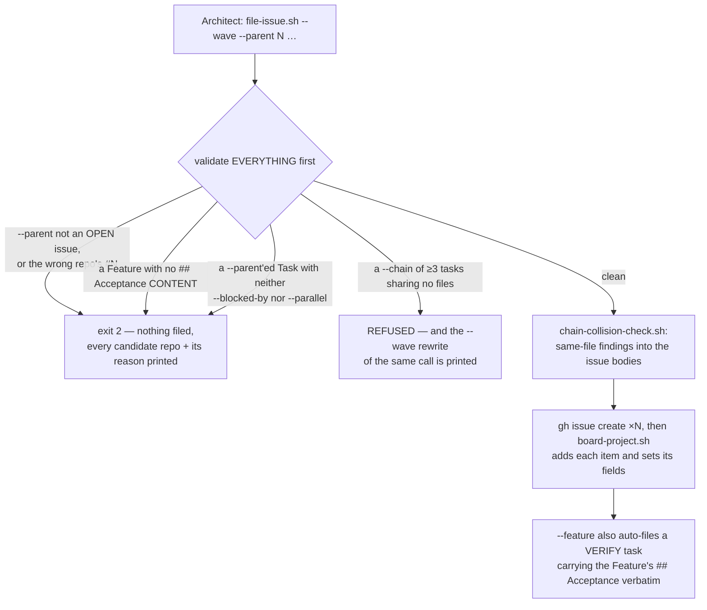

> Mirrored verbatim from `utopia-models/knowledge` `wi/components/board-cli.md` by the allowlisted publish pipeline. Edit it there, not here.

```yaml
component: board-cli
serves: all
runs-on: everywhere — plain bash in this repo, run from the Architect's box, from any master's dispatched run, and from CI's stubbed-`gh` harnesses
adrs: []
owns:
  - _infra/scripts/file-issue.sh
  - _infra/scripts/board-project.sh
  - _infra/scripts/shared-board-helpers.sh
  - _infra/scripts/chain-collision-check.sh
  - _infra/tests/file-issue-parent-probe.sh
  - _infra/tests/file-issue-parked-title.sh
  - _infra/scripts/test-file-issue-shape-check.sh
```

# board-cli — the write path onto the board, and every refusal it makes before writing

## WHAT IT IS

Five scripts that put work **onto** the board and read structure **off** it. `board` is the tracker;
`sweeper` is its one consumer; this is the door in. It runs on no timer and holds no state — it is called,
it validates, it writes, it exits.

Its real product is not the `gh issue create` call, which is trivial. It is the **set of things it refuses
to file**, because a malformed filing is not discovered until a master is already running against it, and
by then it costs a session.

## HOW IT WORKS TODAY

| script | what it is |
|---|---|
| `file-issue.sh` | files a Feature, a Task, or a whole plan in ONE call. Every body is validated before any issue is created, so partial completion stops existing. With `--porcelain` (#10775) stdout is only the filed URL(s), or ONE `ERROR:` line naming every failing criterion and its reason — for a caller that greps the output |
| `board-project.sh` | a drop-in for `gh project item-add` / `item-edit` that speaks raw ProjectV2 GraphQL — same argv, one word changed at the call site |
| `shared-board-helpers.sh` | the title conventions (`VERIFY`, parked tags) that `dispatch.sh`, `verify-verdict.sh` and `sweep-dispatch.sh` all read |
| `feature-progress.sh` | Feature + sub-issue completion for N Features in **one** GraphQL call |
| `chain-collision-check.sh` | at filing time, says which phases of a chain touch the same file |



**`--parent` is checked before anything is filed, and a number that RESOLVES is not a parent (#5539).**
The named issue must be an ISSUE (`repos/…/issues/N` serves PRs too) and **OPEN**, and when the caller
passes `--parent-title` it must carry that title — the one fact that tells `knowledge#256` from
`peptide-shop#256`. The old probe asked only whether the number returned an id, which every number does in
every repo: on 2026-08-14 four P1 blockers meant for `peptide-shop#256` were filed into `knowledge` under
a CLOSED issue, silently, while the Feature they existed to hold open read 13/13.

**A Feature with no acceptance content is refused ahead of `gh issue create` (#4530)**, rather than
shipping a verifier that cannot fail. The heading matcher reads `##`/`###` + *Acceptance* in any case with
an optional suffix — `## Acceptance — read from the live surface` used to match nothing and shipped an
empty VERIFY (#4458). `--allow-empty-acceptance` files it anyway and tells the VERIFY task, in its own
body, that deriving the criteria is its first job.

**`--chain` linearizes, and a chain of ≥3 tasks whose bodies share no files is now REFUSED (#6961)** with
the `--wave` rewrite printed. Doctrine had warned about that in prose since #6459 and PLAN-227 filed as a
9-deep chain anyway, *after* the warning was written. 🔴 The invariant is about the **submission**, never
"disjoint files means parallelizable" — a migration before its backfill is a correct chain over disjoint
files — so `--allow-serial` files it and the negative half of the suite is the half that matters.

**`chain-collision-check.sh` does not stop a filing.** `--chain` already files task *k* `blocked_by` task
*k-1*, so the ordering invariant holds by construction and refusing would strand a whole plan to enforce
something already true. What it adds is a DIRECT edge where the ordering was only transitive, a loud
warning, and a durable note in the colliding issue bodies — so whoever is about to set
`DISPATCH_IGNORE_BLOCKERS=1` sees the hazard on the board instead of discovering it in a merge.

🔴 **ONE DEFINITION of the parked-title predicate, and it is NOT in `shared-board-helpers.sh`.** It is the
jq `def parked_title:` in `sweep-dispatch.sh` — the thing that actually refuses to dispatch — which this
library READS and runs rather than translates. It carried a perl twin under a header promising the two
could not drift; measured 2026-08-28 on five titles, they disagreed on two.

🔴 **Probe `file-issue.sh` with its own harnesses, never with the live board.** #4612/#4614 were
`Integration probe` Features filed live 17 seconds apart, neither carrying `--test-fixture`, so the
sweeper had nothing to hold on and dispatched #4614 as a full master run. A live-board probe also files a
VERIFY it cannot answer, and closing that VERIFY makes the Feature read **1/1, 100% complete with zero
work done**. Every harness in `owns:` stubs `gh`: no network, no board, no token.

**Read it live:** `bash _infra/scripts/file-issue.sh --help` for the current usage block,
`bash _infra/scripts/feature-progress.sh` for every open Feature's n/n in one call.

## BOUND VALUES

<!--[[[cog
m.exists("_infra/scripts/file-issue.sh _infra/scripts/board-project.sh _infra/scripts/shared-board-helpers.sh _infra/scripts/chain-collision-check.sh")
m.exists("_infra/tests/file-issue-parent-probe.sh _infra/tests/file-issue-parked-title.sh _infra/scripts/test-file-issue-shape-check.sh")
m.calls("_infra/scripts/file-issue.sh", "board-project.sh", "shared-board-helpers.sh", "chain-collision-check.sh")
m.calls(".github/workflows/probes.yml", "_infra/tests/file-issue-parent-probe.sh", "_infra/tests/file-issue-parked-title.sh", "_infra/scripts/test-file-issue-shape-check.sh")
m.calls("_infra/scripts/shared-board-helpers.sh", "sweep-dispatch.sh")
m.value("PVT_kwDOEZ-Tjc4Bb8OG", "_infra/scripts/board-project.sh", r"BOARD_PROJECT_ID:-(PVT_\S+)\}")
]]]-->
- ✅ `_infra/scripts/file-issue.sh`
- ✅ `_infra/scripts/board-project.sh`
- ✅ `_infra/scripts/shared-board-helpers.sh`
- ✅ `_infra/scripts/chain-collision-check.sh`
- ✅ `_infra/tests/file-issue-parent-probe.sh`
- ✅ `_infra/tests/file-issue-parked-title.sh`
- ✅ `_infra/scripts/test-file-issue-shape-check.sh`
- ✅ `board-project.sh` — still called by `_infra/scripts/file-issue.sh`
- ✅ `shared-board-helpers.sh` — still called by `_infra/scripts/file-issue.sh`
- ✅ `chain-collision-check.sh` — still called by `_infra/scripts/file-issue.sh`
- ✅ `_infra/tests/file-issue-parent-probe.sh` — still called by `.github/workflows/probes.yml`
- ✅ `_infra/tests/file-issue-parked-title.sh` — still called by `.github/workflows/probes.yml`
- ✅ `_infra/scripts/test-file-issue-shape-check.sh` — still called by `.github/workflows/probes.yml`
- ✅ `sweep-dispatch.sh` — still called by `_infra/scripts/shared-board-helpers.sh`
- ✅ `PVT_kwDOEZ-Tjc4Bb8OG` — still live in `_infra/scripts/board-project.sh` (`BOARD_PROJECT_ID:-(PVT_\S+)\}`)
<!--[[[end]]]-->

## DETERMINE CURRENT STATE

```
bash _infra/scripts/file-issue.sh --help               # the full flag grammar, and the gates it enforces
bash _infra/scripts/feature-progress.sh <feature#>     # what the filer produced, read back as n/m
bash _infra/scripts/chain-collision-check.sh --help    # the same-file check filing runs
```

🔴 **Exercise a filing change with `--test-fixture`, never with a real issue.** The label is held out
of dispatch by `sweep-dispatch.sh`, so a probe cannot be picked up and burned as work.


## KNOWN BROKEN

- 🔴 **`board-project.sh` exists because `gh project` refuses client-side on a correctly-scoped token.**
  Bounded to the decided 5-scope master shape, `gh project item-edit` answers *"your authentication token
  is missing required scopes [read:org read:discussion]"* and `item-add --owner <org>` answers *"unknown
  owner type"*. **The underlying API needs neither scope** — the same two writes as raw GraphQL return 200,
  because the item is addressed by node id rather than by owner login. So the shim is permanent unless `gh`
  changes: every board write in the fleet routes through it, and a call site that reverts to `gh project`
  breaks only on a properly-bounded token, which is the hardest kind of break to reproduce.
- ⚠ **`--plan` is accepted and ignored (knowledge#10109).** It used to write `gh:<feature#>` onto a plan's
  registry entry as the Feature was created (#5660). The plan registry is retired and the Plan issue is the
  record now, so the flag only consumes its argument — an old caller that still passes `--plan PLAN-<N>`
  files normally and nothing is stamped anywhere.
- ⚠ **The week stamp resolves live and is allowed to be absent.** An unreadable iteration field, or a date
  no iteration covers, warns and files the issue anyway — see `board`'s KNOWN BROKEN for why an iteration
  id can never be hardcoded.
- ⚠ **`parent-issue:` is not a valid `gh` search qualifier.** It does not error; it silently returns ZERO,
  which reads as "this Feature has no sub-issues" and is indistinguishable from a real empty. That false
  reading cost a full re-measurement. `feature-progress.sh` uses the `subIssues` connection instead, and
  anything else asking this question must too.
- ⚠ **No `components.yaml` row exists for this component**, so `m.units()` cannot be asserted here and the
  scripts sit outside the daily `verify-unit-execstart.py` sweep. They are timer-less, so there is no
  ExecStart to prove — the `guard.yml` harnesses above are the whole enforcement, and they run only on a PR.
