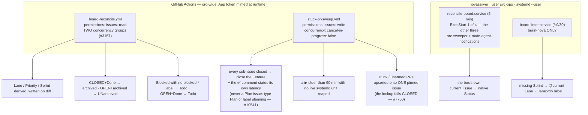

> Mirrored verbatim from `utopia-models/knowledge` `wi/components/board-integrity.md` by the allowlisted publish pipeline. Edit it there, not here.

```yaml
component: board-integrity
serves: all
runs-on: GitHub Actions on the org's self-hosted runners (`board-reconcile.yml`, `stuck-pr-sweep.yml`) plus two `Type=oneshot` user timers on novaserver under `svc-ops` (`nova` until knowledge#9201; installed by `_infra/ansible/roles/svc_ops`)
adrs: []
owns:
  - .github/workflows/board-reconcile.yml
  - .github/workflows/stuck-pr-sweep.yml
  - reconcile-board.service
  - board-linter.service
```

# board-integrity — the maintenance layer that keeps the tracker honest

## WHAT IT IS

`board` is a GitHub product with no opinion about the fleet's conventions: Projects V2 cannot make a field
required, a parent issue cannot close itself, a dropped webhook leaves a closed issue reading `Todo`, and a
`▶` with no live run behind it looks exactly like work in progress. **This component is everything the
fleet added on top so those states heal rather than accumulate.**

It is deliberately separate from `board` (the tracker), `board-cli` (the write path in) and `sweeper` (the
one consumer of `Status=Todo`). Stop it and nothing breaks loudly — the board simply drifts, which is the
worst failure mode available, because every downstream decision is made from it.

## HOW IT WORKS TODAY

Four mechanisms, two substrates. **Nothing here is a resident process** — each is a scheduled oneshot that
reads the board and writes only on diff.

| mechanism | where | cadence | what it heals |
|---|---|---|---|
| `board-reconcile.yml` | GitHub Actions | issue/PR events + `11,41 * * * *` | derives Lane · Priority · Sprint; closed→Done backstop; archives and **un**archives |
| `stuck-pr-sweep.yml` | GitHub Actions | `17,47 * * * *` + the `feature-closer` dispatch | closes n/n Features; surfaces stuck PRs; reaps stale `▶` runs |
| `reconcile-board.service` | novaserver, `svc-ops` | 5 min | heals the native Status field from the box's local `current_issue` |
| `board-linter.service` | novaserver, `svc-ops` | `*:0/30` | Definition-of-Ready: auto-assigns `@current` Sprint, syncs Lane from the `lane:<x>` LABEL |



**ONE pinned stuck-PR issue is an INVARIANT, and it is enforced by failing closed.** The sweep asks
which copy is open before deciding PATCH-or-POST, and until 2026-09-09 it asked the **search index** and
read the answer as `jq -r '.items[0].number // empty'` — so a throttled search, a 422 and a genuinely
empty world all produced the same value, and the else-arm of that test creates an issue. #5981 was open
continuously from 2026-08-16 and being PATCHed correctly; the ticks at 13:45 and 13:55 on 2026-09-09 made
#7748 and #7750 anyway, and four dispatched runs went at two of them. The lookup now reads the
**non-indexed** `GET /repos/:o/:r/issues?state=open` (paged, `.pull_request == null` — that endpoint
serves PRs too), makes **no board change at all** when the read comes back malformed, and closes every
copy but the oldest. Each arm emits a `::notice::` naming the issue it touched, because the old code
decided PATCH-or-POST and logged nothing: a duplicate creation and a healthy first-create were
byte-identical in the run log, and the only witness was the board. Pinned by
`_infra/tests/stuck-pr-upsert-fails-closed.sh` in `probes.yml` — seven scenarios against the shipped step
body, `curl` doubled on PATH, carrying its own mutation control.

**Why the closer lives in `stuck-pr-sweep.yml` and not in `board-reconcile.yml`.** The reconciler declares
`permissions: issues: read` and contains no comment or close call anywhere — it physically cannot post.
The sweep already holds `issues: write`, already mints the org token, already runs on a cron. Extended,
not replaced.

**Both Actions self-provision.** They mint a GitHub App installation token at runtime from `FLEET_APP_ID`
+ `FLEET_APP_PRIVATE_KEY` rather than carrying a static secret — the durable path, and the fix for the
`FLEET_SWEEP_TOKEN` that was **never set**, so every run silently fell back to the repo-scoped
`GITHUB_TOKEN`, every non-`knowledge` repo answered `{"message":"Not Found"}`, and the sweep had zero
successful runs, ever.

**The event path must never touch a `Doing` item (#3157).** A Doing item has no timestamps, so it cannot
tell a run that is STARTING from one that is STRANDED, and guessing erased every dispatch's Doing. That is
why the reconciler carries TWO concurrency groups rather than one: the scheduled sweep owns the healing
and must not be collateral damage in an issue-event storm.

**The stale-Doing "vanished-run" sweeper was DELETED, not instrumented (#3569)** — it depended on the
scheduler's own liveness, which is indistinguishable from a dead one (GitHub reported `state: active`
through a 62-hour window in which every run in this repo failed at `startup_failure`), and measured over
100 settled dispatches, 31 looked vanished by marker alone and **31 of 31 had already shipped a merged
PR**. The reaper that remains is keyed on a live-unit probe, not on a marker.

**Read the live state — every number here is off-git and rots:**

| you want | run |
|---|---|
| did the reconciler actually run? | `gh run list --workflow=board-reconcile.yml -L 10` |
| did the sweep? | `gh run list --workflow=stuck-pr-sweep.yml -L 10 --json conclusion,createdAt,runnerName` |
| the two svc-ops timers | `sudo -n -u svc-ops XDG_RUNTIME_DIR=/run/user/$(id -u svc-ops) systemctl --user list-timers reconcile-board.timer board-linter.timer`, run as `nova` |
| why the linter exited non-zero | `sudo -n -u svc-ops XDG_RUNTIME_DIR=/run/user/$(id -u svc-ops) journalctl --user -u board-linter.service -o cat` |
| the sweep against one fixture | `gh workflow run stuck-pr-sweep.yml -f autoclose_only=<issue#>` |
| is the pinned issue still exactly ONE? | `gh issue list --repo utopia-models/knowledge --search '"STUCK PRs" in:title' --state open --json number --jq 'length'` — anything but `1` (or `0`, when no PR is stuck) is #7750 recurring |

🔴 **Read `gh run list`'s `runnerName` before reading a log.** `runs-on: [self-hosted, linux, x64]` matches
three org runners owned by different unix users with different sudo, and a red conclusion frequently names
the runner rather than the code.

## BOUND VALUES

<!--[[[cog
m.exists(".github/workflows/board-reconcile.yml .github/workflows/stuck-pr-sweep.yml _infra/tests/stuck-pr-upsert-fails-closed.sh")
m.units("sweeper")
m.value("11,41 * * * *", ".github/workflows/board-reconcile.yml", r"cron: '([0-9,]+ \* \* \* \*)'")
m.value("17,47 * * * *", ".github/workflows/stuck-pr-sweep.yml", r'cron: "([0-9,]+ \* \* \* \*)"')
m.value("false", ".github/workflows/stuck-pr-sweep.yml", r"\n  cancel-in-progress: (\w+)")
m.value("read", ".github/workflows/board-reconcile.yml", r"permissions:\n  issues: (\w+)")
m.value("90", ".github/workflows/stuck-pr-sweep.yml", r"minutes a ▶ must be old before it can be reaped \(default (\d+)\)")
]]]-->
- ✅ `.github/workflows/board-reconcile.yml`
- ✅ `.github/workflows/stuck-pr-sweep.yml`
- ✅ `_infra/tests/stuck-pr-upsert-fails-closed.sh`
- ⚙️ `user@svc-ops:reconcile-board.service` — ExecStart target proven daily by `verify-unit-execstart.py` (#4742)
- ✅ `11,41 * * * *` — still live in `.github/workflows/board-reconcile.yml` (`cron: '([0-9,]+ \* \* \* \*)'`)
- ✅ `17,47 * * * *` — still live in `.github/workflows/stuck-pr-sweep.yml` (`cron: "([0-9,]+ \* \* \* \*)"`)
- ✅ `false` — still live in `.github/workflows/stuck-pr-sweep.yml` (`\n  cancel-in-progress: (\w+)`)
- ✅ `read` — still live in `.github/workflows/board-reconcile.yml` (`permissions:\n  issues: (\w+)`)
- ✅ `90` — still live in `.github/workflows/stuck-pr-sweep.yml` (`minutes a ▶ must be old before it can be reaped \(default (\d+)\)`)
<!--[[[end]]]-->

## DETERMINE CURRENT STATE

```
gh api repos/utopia-models/knowledge/actions/workflows \
  --jq '.workflows[] | select(.path|test("board-reconcile|stuck-pr-sweep")) | .name + " " + .state'
gh run list -R utopia-models/knowledge --workflow board-reconcile.yml -L 3 --json conclusion,createdAt
sudo -n -u svc-ops XDG_RUNTIME_DIR=/run/user/$(id -u svc-ops) systemctl --user list-timers reconcile-board.timer board-linter.timer --all --no-legend   # as nova on novaserver
```

Both halves must answer: a workflow can be `active` with its schedule silently not firing, and a
`oneshot` timer reads `inactive (dead)` between ticks while perfectly healthy — the timer's NEXT/LAST
columns are the liveness signal, never the service's state.


## KNOWN BROKEN

- 🔴 **There is no `components.yaml` row for `board-integrity`, so half of what it owns is bound by
  nothing.** `m.units("sweeper")` above is what actually holds `reconcile-board.service` inside the daily
  `verify-unit-execstart.py` sweep — and it is bound there under a **different component**, because the
  sweeper rides this unit's drop-in. `board-linter.service` is bound by **no** row at all: nothing proves
  its ExecStart target exists, which is exactly the class of failure `verify-unit-execstart.py` was built
  for after `reap-orphan-claude.timer` fired for 24 days against a deleted script.
- 🔴 **`board-linter.sh`'s own header claims a GitHub Actions twin that does not exist.** Measured this
  session: `ls .github/workflows/board-linter.yml` → *No such file or directory*, while the script's line 4
  still reads *"Twin of `.github/workflows/board-linter.yml` — kept in PARITY"*. Anyone triaging a linter
  failure goes looking for a workflow to compare against and finds nothing. The script is also
  **`brain-nova` only** — `GET /repos/utopia-models/brain-<x>/contents/ops/board-linter.sh` is 404 on
  brain-agent, brain-win, brain-cloud and brain-dust — after a header that used to claim it was
  byte-identical across the brains (#6647).
- 🔴 **Both box-side mechanisms live outside this repo, and cannot be bound by `cog`.**
  `reconcile-board-status.sh` and `board-linter.sh` are `~/.claude/ops/` scripts on svc-ops' 0750 home
  (copied from `brain-nova`; that directory is not a git checkout). The
  `owns.files` above therefore names only the two workflows — the other half of this component is
  unreachable from CI and is graded solely by the probes in the table above.
- ⚠ **The board's terminal state is eventually-consistent by design.** Archiving is attempted on the close
  event and only *guaranteed* by the scheduled sweep; `cancel-in-progress` killed 25 of the last 30 event
  runs (2026-08-05T06:59Z). A handful of closed-but-still-listed items at any moment is correct behaviour,
  not a defect to file.
- ⚠ **The GitHub cron under-delivers and always has.** `17,47 * * * *` asks for 48 runs/day and delivered
  23.9 over a measured 120.6 h window — 49.8%, worst gap 11 h 26 m, every run green. That is why
  `feature-closer` exists in front of it. Never size a threshold off a cron expression.
