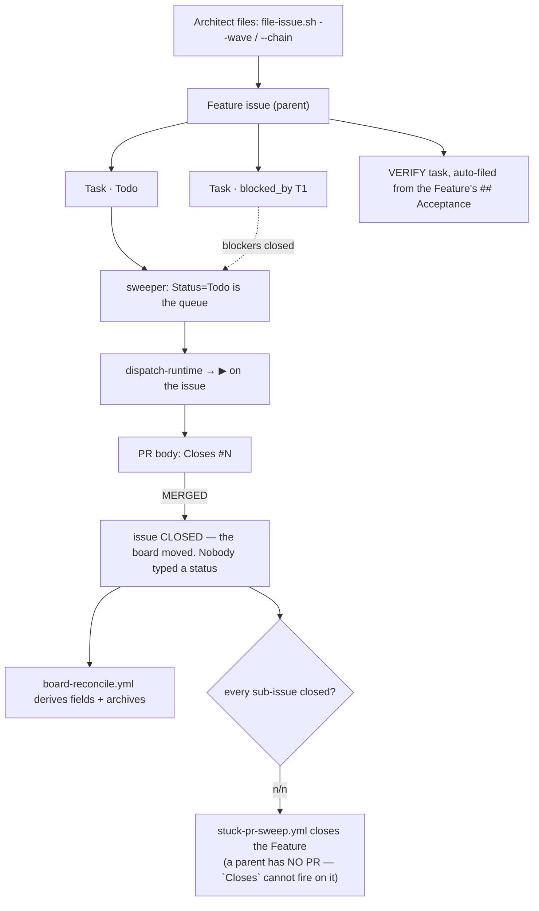

> Mirrored verbatim from `utopia-models/knowledge` `wi/components/board.md` by the allowlisted publish pipeline. Edit it there, not here.

```yaml
component: board
serves: all
runs-on: github.com — issues in `utopia-models/knowledge`, Projects V2 org project #1 (`PVT_kwDOEZ-Tjc4Bb8OG`)
adrs: []
owns:
  - PVT_kwDOEZ-Tjc4Bb8OG
```

# board — the ONE tracker, and the only thing allowed to be one

## WHAT IT IS

Work exists here or it does not exist. A sub-project is a **Feature** issue with ordered **Task**
sub-issues; **status derives from a merged PR whose body says `Closes #N`** and nobody ever types one.
If this surface is wrong, the fleet works on the wrong thing — there is no second list to cross-check
against, deliberately, and creating one is the fence this component exists to hold.

🔴 **`owns:` names one thing, the org project's node id, and no file — that is the fact rather than an
omission.** The board is a GitHub product; the fleet holds no file that *is* it, so what this component
partitions off is the project itself (`gh api graphql` in DETERMINE CURRENT STATE reads the id back).
Everything in-git that touches it belongs to a neighbour, and the
partition is exactly three ways: **`board-cli`** owns the write path in, **`board-integrity`** owns the
mechanisms that keep it honest, **`sweeper`** owns the one consumer of `Status=Todo`.

## HOW IT WORKS TODAY

An agent's entire board job is **assign-self + a title (+ an optional `P#` label)**. Every other field is
derived on GitHub's runner by `board-reconcile.yml` (owned by `board-integrity`) and written only on diff,
so agents make zero field calls and cannot cause an agent-side rate-limit outage.

| field | derived from |
|---|---|
| Lane | the primary assignee's login — the lane names the **BOX**, never the portfolio |
| Priority | the `P#` label, default P2 |
| Sprint | `@current` if unset; a deliberate one is never clobbered |
| Status | native project workflows own it; the Action is the closed→Done backstop on the scheduled path only |
| archived | `CLOSED` + `Done` → off the board · `OPEN` + archived → **unarchived** back onto it |
| `Week` / `Cycle` | 🔴 **UI-managed only — never written by API** (see below) |



**Two ordering shapes, and they are not interchangeable.** `--chain` linearizes: task *k* is filed
`blocked_by` task *k-1*, so exactly one issue is dispatchable. `--wave` files every task in a group
`blocked_by` every task of the **previous** group and nothing else — never a sibling — so a whole group
starts at once. PLAN-205's fifteen phases, designed as five waves, were filed as a 14-deep chain with one
dispatchable issue (#6459). If two phases can run at once, the shape is `--wave`.

**`Week` and `Cycle` are read-only to every script.** The `iterations` list element is
`ProjectV2Iteration`, whose complete input set is `startDate` · `duration` · `title` — **there is no `id`
field**, and `ProjectV2IterationFieldIterationInput` does not exist. So any API write to
`iterationConfiguration` mints new ids and orphans every assignment; on 2026-08-24 the Portfolio field lost
all 84. Reproduce the introspection rather than trusting this paragraph:

```
gh api graphql -f query='{ a: __type(name:"ProjectV2IterationFieldIterationInput"){name}
                           e: __type(name:"ProjectV2Iteration"){kind inputFields{name}} }'
```

`a` comes back `null`; `e.inputFields` has no `id`. The FIELD id is durable and is the only id worth
hardcoding; an ITERATION id rotates the moment Tyler edits the field in the UI, which is why
`file-issue.sh` resolves the current iteration live on every filing and treats it as advisory.

**Read the board, never recall it** — every count and every option list below rots, so this doc states the
command instead of the answer:

| you want | run |
|---|---|
| open issues | `gh api repos/utopia-models/knowledge/issues --jq 'length'` |
| Feature n/n rollups, one GraphQL call | `bash _infra/scripts/feature-progress.sh` |
| one issue, with comments | `gh api repos/utopia-models/knowledge/issues/<n>` |
| the live Lane / Status / iteration options | `gh api graphql` against `PVT_kwDOEZ-Tjc4Bb8OG` |

🔴 `gh issue view` currently fails with a Projects-classic GraphQL deprecation error — use `gh api`.
`gh api` prints its errors to **stdout**, so validate the shape of what you captured, not merely that it
is non-empty.

## BOUND VALUES

The board itself is off-git and nothing here can bind it. What CAN be bound is the one constant every
fleet script uses to address it — five files carry it, and they must not drift apart.

<!--[[[cog
m.value("PVT_kwDOEZ-Tjc4Bb8OG", "_infra/scripts/file-issue.sh", r"PROJ=(PVT_\S+)")
m.value("PVT_kwDOEZ-Tjc4Bb8OG", "_infra/scripts/task-runner.sh", r"PROJ=(PVT_\S+)")
m.value("PVT_kwDOEZ-Tjc4Bb8OG", "_infra/scripts/dispatch.sh", r"PROJ=(PVT_\S+)")
m.value("PVT_kwDOEZ-Tjc4Bb8OG", "_infra/scripts/sweep-dispatch.sh", r"PROJ=(PVT_\S+)")
m.value("PVT_kwDOEZ-Tjc4Bb8OG", "_infra/scripts/board-project.sh", r"BOARD_PROJECT_ID:-(PVT_\S+)\}")
]]]-->
- ✅ `PVT_kwDOEZ-Tjc4Bb8OG` — still live in `_infra/scripts/file-issue.sh` (`PROJ=(PVT_\S+)`)
- ✅ `PVT_kwDOEZ-Tjc4Bb8OG` — still live in `_infra/scripts/task-runner.sh` (`PROJ=(PVT_\S+)`)
- ✅ `PVT_kwDOEZ-Tjc4Bb8OG` — still live in `_infra/scripts/dispatch.sh` (`PROJ=(PVT_\S+)`)
- ✅ `PVT_kwDOEZ-Tjc4Bb8OG` — still live in `_infra/scripts/sweep-dispatch.sh` (`PROJ=(PVT_\S+)`)
- ✅ `PVT_kwDOEZ-Tjc4Bb8OG` — still live in `_infra/scripts/board-project.sh` (`BOARD_PROJECT_ID:-(PVT_\S+)\}`)
<!--[[[end]]]-->

## DETERMINE CURRENT STATE

```
gh api graphql -f query='{organization(login:"utopia-models"){projectV2(number:1){id title}}}'   # the id in `owns:`
gh issue list -R utopia-models/knowledge --state open --limit 100 --json number | jq length
bash _infra/scripts/feature-progress.sh <feature#>     # n/m plus every open sub-issue
bash _infra/scripts/sweep-dispatch.sh --explain        # one line per Todo issue and why it is held
```

The board is off-git and every count on it changes by the minute, so no number is stated here — the
commands above are the reading. `--explain` is the one to run first when the queue looks stuck:
it prints the predicate that held each candidate.


## KNOWN BROKEN

- 🔴 **Saying you are NOT closing an issue closes it.** GitHub matches a keyword immediately followed by
  an issue reference anywhere in a PR body or commit message and does not read the words around it. A
  sentence of the form *"this does NOT `<keyword>` `#1234`"* is a closing reference. Measured twice on
  2026-08-14 on one issue: first by a PR whose entire point was that it must stay open, then by the
  follow-up PR **documenting the trap**, which fired it by quoting the sentence into its own body.
  Recovery is two steps and only the first is obvious — a close sets Status to `Done`, and `gh issue
  reopen` does not undo that, leaving `OPEN` + `Done`, the one state no fleet selector reads. So:
  `gh issue reopen <n>` **and** set Status to `Todo`, then read both back. Refer without acting as
  `Refs #N`, and keep any illustration on a placeholder number, which is why this entry says `#1234`.
- 🔴 **The terminal state is eventually-consistent, not instant.** Archiving is *attempted* on the close
  event and *guaranteed* by the scheduled `CLOSED` sweep; `cancel-in-progress` killed 25 of the last 30
  event runs (measured 2026-08-05T06:59Z). Expect a handful of closed-but-still-listed items at any
  moment. Filing "Done is stuck at zero" off a single read is the #3157 false alarm.
- ⚠ **A Feature never closes ITSELF — but a CHILD's PR closes it if that body names the parent number.**
  `task-runner.sh` *attests* an n/n Feature, `stuck-pr-sweep.yml` closes it, and an unattested n/n is
  surfaced, never closed — yet GitHub's keyword parser ignores the parent/child relation, so PR #7513
  closed Feature #7500 over its open `VERIFY` child #7504 (2026-09-04, → the `parent-closed` stall
  #7514). A closed parent is not evidence the closer ran. Detail: `wi/work/reference/win/board.md`.
- ⚠ **`board-reconcile.yml`'s header still cites a contract file that does not exist.** It names
  `FLEET/swe-org/board-schema.yaml`; `find . -name 'board-schema*'` returns nothing. The workflow body is
  the contract — do not go looking for that file.
- ⚠ **Nothing gates main.** Branch protection and rulesets both 403 on this plan tier, in every repo. A
  red check is information; a merge is never a human gate.
