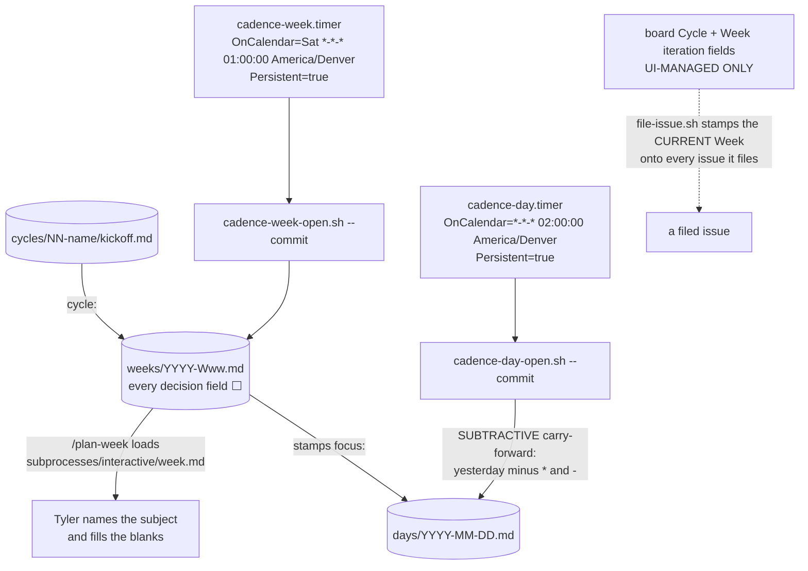

> Mirrored verbatim from `utopia-models/knowledge` `wi/components/cadence.md` by the allowlisted publish pipeline. Edit it there, not here.

```yaml
component: cadence
serves: all
runs-on: novaserver
adrs: []
owns:
  - wi/work/cadence/README.md
  - _infra/scripts/cadence-day-open.sh
  - _infra/scripts/cadence-week-open.sh
  - _infra/systemd/cadence-day.service
  - _infra/systemd/cadence-day.timer
  - _infra/systemd/cadence-week.service
  - _infra/systemd/cadence-week.timer
  - cadence-day.timer
  - cadence-week.timer
```

# cadence — the fleet's units of TIME, orthogonal to its units of work

## WHAT IT IS

Three nested layers of time — **CYCLE** (60 days), **WEEK** (Sat→Fri), **DAY** — each writing
front-matter the layer above greps. They are orthogonal to PLAN / Feature / issue, never nested inside
them: PLAN·Feature·issue say *what* the work is, Cycle·Week·Day say *when*. Stop it and nothing breaks
in the dispatch path — the cadence **gates nothing anywhere** — but Tyler loses the only artifact that
names what a week is about, and `file-issue.sh`'s `Week` stamp has no live iteration to resolve.

## HOW IT WORKS TODAY

| layer | length | artifact | who writes it | board field |
|---|---|---|---|---|
| **CYCLE** | 60 days | `wi/work/cadence/cycles/NN-name/kickoff.md` | a `/plan-cycle` conversation with Tyler | `Cycle` (iteration) |
| **WEEK** | Sat → Fri | `wi/work/cadence/weeks/YYYY-Www.md` | `cadence-week-open.sh`, decided via `/plan-week` | `Week` (iteration) |
| **DAY** | 1 day | `wi/work/cadence/days/YYYY-MM-DD.md` | `cadence-day-open.sh`, append-only | — |



**Both mechanisms are idempotent and gate nothing.** Running either script twice is safe. The timers are
an **OPTIMIZATION, never a dependency** — they run the same code path `/plan-week` and a hand
invocation run. Each service does a `git pull --rebase -X ours` first and commits its own output.

🔴 **Three states everywhere, never two:** `⬜` unknown · `✅`/`*` done · `❌`/`-` deliberately not
done. **`⬜` is not a miss** — a gap contributes `nil`, never zero, and is never backfilled.

🔴 **A WEEK NAMES A SUBJECT. IT NEVER LISTS PLANS.** The week file is written on Saturday and names
what the week is *about* — `SF`, `Network`, `Research`. On Saturday those plans do not exist. The
reference runs one direction only, backwards from the plan to the week; a week file that enumerates
plans is asserting a future it cannot know. That backward reference is mechanical: `file-issue.sh`
stamps the board's **current** `Week` iteration onto every issue it files, resolved live at filing time
because an iteration id rotates whenever the field is edited.

🔴 **`Cycle` and `Week` are UI-MANAGED ONLY — never write either by API.** An API write mints new
iteration ids and orphans every existing assignment. Read them; never roll them forward by script.

🔴 **The timezone lives in the `OnCalendar` suffix and must stay there.** `Timezone=` is *not* a systemd
key — systemd 255 answers `Unknown key name 'Timezone' in section 'Timer', ignoring` — so a unit
carrying it silently inherits the box's `Etc/UTC`. For the week timer that means firing at 19:00
**Friday** Denver: early, and on the wrong day. Read the comment block in either `.timer` before editing
one.

**The full front-matter schema for all three layers is §6 of PLAN-219's plan document**
(`https://github.com/utopia-models/knowledge/blob/b9b4874b1c5a5821b9b31b36cb3a0d8c4a765dc8/wi/work/plans/documents/2026-08/2026-08-24-plan-219-cadence-seasons-weekly-sprints-and-a-planned-day-for-tyler.md` — the plan registry is retired, so it lives only at that SHA). Neither the cadence
README nor this doc restates it — one copy, in the document that decided it.

## BOUND VALUES

Re-derived from the repo by `docs-cog.sh --check` on every PR.

<!--[[[cog
m.exists("wi/work/cadence/README.md _infra/scripts/cadence-day-open.sh _infra/scripts/cadence-week-open.sh _infra/systemd/cadence-day.service _infra/systemd/cadence-day.timer _infra/systemd/cadence-week.service _infra/systemd/cadence-week.timer")
m.value("02:00:00 America/Denver", "_infra/systemd/cadence-day.timer", r"\nOnCalendar=\*-\*-\* (.+)")
m.value("Sat *-*-* 01:00:00 America/Denver", "_infra/systemd/cadence-week.timer", r"\nOnCalendar=(.+)")
m.calls("_infra/systemd/cadence-day.service", "cadence-day-open.sh")
m.calls("_infra/systemd/cadence-week.service", "cadence-week-open.sh")
]]]-->
- ✅ `wi/work/cadence/README.md`
- ✅ `_infra/scripts/cadence-day-open.sh`
- ✅ `_infra/scripts/cadence-week-open.sh`
- ✅ `_infra/systemd/cadence-day.service`
- ✅ `_infra/systemd/cadence-day.timer`
- ✅ `_infra/systemd/cadence-week.service`
- ✅ `_infra/systemd/cadence-week.timer`
- ✅ `02:00:00 America/Denver` — still live in `_infra/systemd/cadence-day.timer` (`\nOnCalendar=\*-\*-\* (.+)`)
- ✅ `Sat *-*-* 01:00:00 America/Denver` — still live in `_infra/systemd/cadence-week.timer` (`\nOnCalendar=(.+)`)
- ✅ `cadence-day-open.sh` — still called by `_infra/systemd/cadence-day.service`
- ✅ `cadence-week-open.sh` — still called by `_infra/systemd/cadence-week.service`
<!--[[[end]]]-->


## DETERMINE CURRENT STATE

| question | command |
|---|---|
| are the timers installed, on which box | `bash _infra/scripts/mechanism-liveness.sh cadence-day` · `… cadence-week` |
| when do they next fire | `sudo -n -u nova systemctl --user list-timers 'cadence-*'` |
| did the last run succeed | `sudo -n -u nova systemctl --user status cadence-day.service` |
| which day / week files exist | `ls wi/work/cadence/days/` · `ls wi/work/cadence/weeks/` |
| what the board's live Cycle/Week iterations are | read them in the board UI — never by API write |

Measured this session with the first probe, and quoted because a unit's box is not derivable from this
repo:

```
bash _infra/scripts/mechanism-liveness.sh cadence-day
   BOX     ON-DISK              WIRED-IN               EVENTS         SYSTEMD-UNIT
   nova    -                    -                      -              cadence-day.service(static),cadence-day.timer(enabled)
```

`cadence-week` answers the same way. Every other box — `win`, `dust`, `cloud`, `sf`, `agent` — reports
`-` in every column, which is correct: this is a one-box mechanism.

## KNOWN BROKEN

- 🔴 **The day series has gaps, and the timer cannot be the whole explanation.** Measured 2026-10-31:
  `ls wi/work/cadence/days/` holds 57 files from `2026-08-24` to `2026-10-30`, and 11 days in that range
  have no file: `2026-08-29`, `08-31`, `09-01`, `09-03`, `09-07`, `09-10`, `09-17`, `09-21`, `10-10`,
  `10-12`, `10-13`. `Persistent=true` is set, so a box that was down catches up on the next start; a gap
  **between** two present days is not that. The carry-forward is subtractive, so a missing day is not a
  lost day — the next run carries from whatever file it finds — but the series is not the record it
  reads as.
- 🔴 **This component has no row in `wi/registry/components.yaml`**, so its two
  units are in **no** `units:` binding and `verify-unit-execstart.py --all` never proves their ExecStart
  targets exist. Measured: `grep -c 'id: cadence' wi/registry/components.yaml`
  → `0`. That is the #4742 failure shape exactly — present, running, and outside the daily sweep — and
  it is why this doc's BOUND VALUES uses `m.exists` on the unit FILES rather than `m.units`, which
  would only be able to report the missing row.
- ⚠ **No CYCLE mechanism exists.** `cycles/` holds one hand-written `01-sf-offer/kickoff.md`; there is
  no `cadence-cycle-open.sh` and no `/plan-cycle` skill on any box this session could read. The layer
  is real in the schema and manual in practice.
