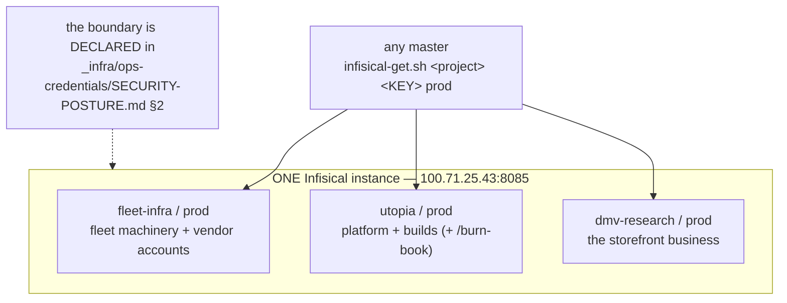

> Mirrored verbatim from `utopia-models/knowledge` `wi/components/credential-domains.md` by the allowlisted publish pipeline. Edit it there, not here.

```yaml
component: credential-domains
serves: all
runs-on: novaserver
adrs: []
owns:
  - _infra/ops-credentials/SECURITY-POSTURE.md
```

# credential-domains — the projects, and which entity each one is for

## WHAT IT IS

`infisical` is one instance. **`credential-domains` is the split inside it**, one project per
entity whose secrets must not mingle:

| project | the entity it scopes |
|---|---|
| `fleet-infra` | the fleet's own machinery — the boxes, the tunnels, the vendor accounts, the agent identities |
| `utopia` | the Utopia platform and its builds: the OCC, the phone, R2, the creatives surface |
| `dmv-research` | the DMV Research business — dmvresearch.shop and everything that serves it |

Environment is `prod` in every one; the path within a project (`/`, or a folder like `/burn-book`) is a
second, finer boundary.

**Why it is a component and not a footnote:** adding another entity, or moving a credential from one
business to another, is a real decision with real blast radius — and it is the boundary an auditor asks
about first. The instance is `infisical`'s question; *which project* is this one's.

## HOW IT WORKS TODAY



**The projects are the only enforced part; the naming convention is not.** A key's project says which
entity owns it, and there is no rule that a key name repeats it — `dmv-research` holds
`VERCEL_DMV_RESEARCH_TOKEN` while `fleet-infra` holds the plain `VERCEL_TOKEN`, and both are correct.

🔴 **A missing key looks exactly like a missing capability, and usually is not.**
`identity-and-scope.md`'s reflex applies here specifically: before writing "the fleet does not hold X",
list the key names in **every** project — the fleet has escalated for a credential that was already
in the vault under a name the run did not guess.

**The boundary is declared, not derived.** `_infra/ops-credentials/SECURITY-POSTURE.md` §2 is the one
place that says what each project is *for*. Nothing enforces it: any master's read path can reach every
one (see KNOWN BROKEN), so the split is a convention held up by that document.

## BOUND VALUES

<!--[[[cog
m.exists("_infra/ops-credentials/SECURITY-POSTURE.md")
m.units("credential-domains")
]]]-->
- ✅ `_infra/ops-credentials/SECURITY-POSTURE.md`
- 🔴 `credential-domains` — **no such row** in `wi/registry/components.yaml`
<!--[[[end]]]-->

The project names are deliberately **not** bound: they are Infisical state, not repo state, and the
probe below is the claim. A `cog` assertion pointed at the posture doc's own table would bind prose to
prose.

## DETERMINE CURRENT STATE

🔴 **Never hardcode a per-project key list into a doc, a script or a second registry.** The key set is
off-git and changes without a commit. Read it:

```bash
# key NAMES only — never values — for one project
bash ~/.claude/scripts/infisical-get.sh --keys fleet-infra prod /
# how many keys each domain holds, right now
for p in fleet-infra utopia dmv-research; do
  printf '%s: %s\n' "$p" "$(bash ~/.claude/scripts/infisical-get.sh --keys "$p" prod / | grep -c .)"
done
# which domain holds a given credential
for p in fleet-infra utopia dmv-research; do
  bash ~/.claude/scripts/infisical-get.sh --keys "$p" prod / | grep -i vercel | sed "s|^|$p: |"
done
```

## KNOWN BROKEN

- 🔴 **`SECURITY-POSTURE.md` §3 describes an isolation the read path does not have.** It states *"Each
  agent authenticates as its own machine-identity … and can read only its scoped projects. No shared root
  credential is used at runtime."* Measured this session: `~/.claude/scripts/infisical-get.sh` resolves a
  **shared admin token** (`systemd-creds decrypt --name=infisical-admin-token`, with a vault-file
  fallback), and from `cloud` that token listed key names in **every** project. The project split is
  an organisational boundary today, not an access-control one.
- 🔴 **The posture doc's `_Last verified: 2026-07-03_` inventory is stale.** It names `VERCEL_UTOPIA_TOKEN`
  and `WIN_GITHUB_TOKEN` as present at `utopia/prod`; this session,
  `infisical-get.sh --keys utopia prod / | grep -cE '^(VERCEL_UTOPIA_TOKEN|WIN_GITHUB_TOKEN)$'` returned
  `0`. Neither exists.
- 🔴 **Its 2026-07-30 teardown claim is also stale.** The doc states the telegram bot token and chat list
  were removed *"entirely"*; `infisical-get.sh --keys fleet-infra prod / | grep TELEGRAM` returns
  `TELEGRAM_SCOUT_CHAT_ID` (renamed from `TELEGRAM_SF_CHAT_ID` 2026-09-26, matching the `sf`→`scout` agent
  rename — PLAN-321) and `TELEGRAM_BOT_TOKEN` today — re-added for the always-on agent (`sf`, now `scout`),
  with the doc never updated. A dated verification line in a hand-maintained inventory is the failure mode
  this whole component doc refuses to repeat. Measured 2026-09-26: `TELEGRAM_SCOUT_CHAT_ID` has NO live
  code or systemd-unit consumer found by grep or a live SSH check on novaserver — likely dormant, not
  wired to anything that reads it, whatever the Telegram-machinery claim in
  `net/work/specs/notify-and-daily-review/spec.md` states.
- ⚠ **§2 still describes `fleet-infra` as holding "NATS, monitoring, Cloudflare, comms".** NATS is dead.
- ⚠ **There is no `credential-domains` row in `components.yaml`**, so the boundary appears on no registry
  surface.
