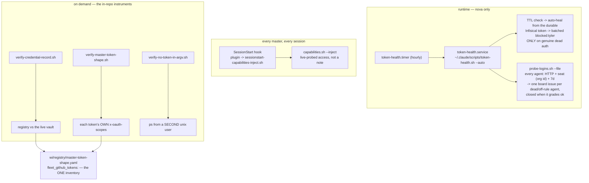

> Mirrored verbatim from `utopia-models/knowledge` `wi/components/credential-health.md` by the allowlisted publish pipeline. Edit it there, not here.

```yaml
component: credential-health
serves: all
runs-on: novaserver
adrs: [6154]
owns:
  - _infra/scripts/verify-credential-record.sh
  - _infra/scripts/verify-no-token-in-argv.sh
  - wi/registry/master-token-shape.yaml
  - _infra/scripts/probe-logins.sh
  - token-health.service
  - token-health.timer
```

# credential-health — is the credential ALIVE, is the record TRUE, and did it leak

## WHAT IT IS

The layer that answers three different questions about a credential, none of which `infisical` answers:

| question | who answers it |
|---|---|
| is this token still **live**, and can it be healed without a human? | `token-health.service` on svc-ops |
| is every agent's Claude login **live and on its rule seat**? | `probe-logins.sh --file`, run by the same service (knowledge#10216) |
| does the **record** of what we hold match what we actually hold? | `verify-credential-record.sh` · `verify-master-token-shape.sh` |
| did a credential **leak** into a world-readable place? | `verify-no-token-in-argv.sh` |

Its reason for existing is `doctrine/credentials.md`'s **forbidden default**: an agent writing *"I don't
have access"* without reading the registry first. That sentence is a claim about the world, and this
component is the set of commands that turn it into a measurement.

🔴 **A scope list is a measurement, and this component refuses to store one (#4549).** Six hand-maintained
per-brain copies of "what scopes does this token hold" had no writer and aged into fiction at different
rates — one token was recorded with 20 scopes while holding 21, and its `cannot:` denied two abilities it
had. The registries keep DECISIONS (what a token *may* hold); the instruments below read the token.

## HOW IT WORKS TODAY



**The runtime half is one box, not the fleet.** Measured this session with
`bash _infra/scripts/mechanism-liveness.sh token-health.sh`: `token-health.sh` is on disk on **nova only**
and is driven by `token-health.service`; win, dust, cloud, sf and agent have neither the script nor the
unit. It heals nova's own credential and escalates only on genuine dead auth.

**The login detector covers every agent (knowledge#10216).** The same hourly `token-health.service` (on svc-ops
since #9201) then runs `probe-logins.sh --file`: for each novaserver agent in `wi/registry/organization.yaml` it
sends one 5-token haiku call with the agent's own token (read and handed to curl on stdin inside that user's
shell, via `ssh nova@…` + `sudo -n -u`; an agent probing itself runs in its own shell with no hop, knowledge#10445), and grades HTTP code and `anthropic-organization-id` against Tyler's
rule — `axes.is_master` agents on nova@ (`05fc1756…`), every other agent on tyler@ (`62f6acd0…`), `service_users`
with no login. A 401 on an expired access token whose refresh token exists is not graded DEAD yet: the probe starts
one fresh `claude` as that agent (which refreshes on start) and re-probes, and grades DEAD only if that fails
(knowledge#10686). Each dead or off-rule agent gets ONE open issue titled `[login-detector] <agent>: …` (found by
that title on the live board, so nothing is stored), lane = `agent` (the Architect runs the login runbook;
masters never stage a login — Tyler, 2026-10-25, knowledge#10215), parented under
the lowest standing-hygiene Feature with room (GitHub caps a parent at 100 sub-issues). An agent that grades
ok has its issue commented and closed. Read it by hand: `bash _infra/scripts/probe-logins.sh` (one line per
agent: seat, want, HTTP, 7d, verdict — no token text); `--tsv` prints the same grading machine-readable (`agent, verdict, http, 7d, seat, status`), which `dispatch.sh` reads to call an HTTP 401 `login-expired` (no reset time) instead of showing the account's weekly reset (#10774). `probe-logins.sh --whoami` is the network-free half: the
account, tier, plan and credentials state each user holds right now, read from its own files (knowledge#10399).

**The session half is the one that actually reaches every master.** `capabilities.sh --inject` runs at
SessionStart on win, nova, dust, cloud and agent. `sf` has neither.

🔴 **Corrected 2026-09-08 (#7696): its output is a CACHE THAT PRINTS ITS OWN AGE, not a live probe, and
that is the fix rather than a regression.** The injecting hook is registered with a 15s timeout; the old
`--inject` ran `stale && probe` inline over six network calls, and **a hook that times out injects
NOTHING** — silence indistinguishable from a healthy session. It also made any downstream age warning
dead code, because `probe()` rewrote the cache before anything could `stat` it. `--inject` now prints
the manifest with `probed <ts>, NhMMm ago`, says so out loud when that exceeds 6h, and spawns a
**detached** re-probe. Doctrine asks for exactly this: *"make it an uncached live read, or make it print
its own age."*

**And the rows themselves changed meaning.** Each is now EXERCISED against the API that owns the
capability, and each records that owning system. The previous set answered questions about local state
and reported them as access: `nats_bus` said YES for a bus deleted 2026-07-23 (it tested whether a seed
FILE resolved), `vercel` said YES off a string-length check that never called Vercel, and `higgsfield`
said NO off `hf auth token` while the API returned 200 for the vaulted key pair in the same minute.
There is a third status now — `? UNTESTED`, meaning the probe could not RUN here — because reporting
"no access" for a missing local binary is the false-blocked conclusion this whole layer exists to
prevent.

**The record half is in this repo, and it is deliberately assertion-shaped.**
`master-token-shape.yaml`'s `fleet_github_tokens:` block carries a `population_rule`, a `population_source`,
a dated `measured:` line that says of itself *"this line is a MEASUREMENT and it rots"*, and two `verify:`
fields naming the commands that answer the question today.

**The leak half is `verify-no-token-in-argv.sh`**, whose whole point (ADR-6154) is that `--box-scan` must
tell a credential apart from a *search* for one — the scanner's own `grep` sits in the same process table
it reads.

## BOUND VALUES

<!--[[[cog
m.exists("_infra/scripts/verify-credential-record.sh _infra/scripts/verify-master-token-shape.sh _infra/scripts/verify-no-token-in-argv.sh wi/registry/master-token-shape.yaml")
m.calls("wi/registry/master-token-shape.yaml", "_infra/scripts/verify-credential-record.sh", "_infra/scripts/verify-master-token-shape.sh")
m.units("credential-health")
]]]-->
- ✅ `_infra/scripts/verify-credential-record.sh`
- ✅ `_infra/scripts/verify-master-token-shape.sh`
- ✅ `_infra/scripts/verify-no-token-in-argv.sh`
- ✅ `wi/registry/master-token-shape.yaml`
- ✅ `_infra/scripts/verify-credential-record.sh` — still called by `wi/registry/master-token-shape.yaml`
- ✅ `_infra/scripts/verify-master-token-shape.sh` — still called by `wi/registry/master-token-shape.yaml`
- 🔴 `credential-health` — **no such row** in `wi/registry/components.yaml`
<!--[[[end]]]-->

## DETERMINE CURRENT STATE

Four measurements and one liveness read; none of them consults a stored scope list:

```bash
# the record vs the live vault
bash _infra/scripts/verify-credential-record.sh
# every master token's own scopes, from GitHub
bash _infra/scripts/verify-master-token-shape.sh
# no credential on any argv, read as a different unix user
bash _infra/scripts/verify-no-token-in-argv.sh --box-scan
# Google Workspace access, end to end
bash ~/.claude/scripts/google-cred-healthcheck.sh
# where each piece actually runs
bash _infra/scripts/mechanism-liveness.sh token-health.sh capabilities.sh google-cred-healthcheck.sh
# every agent's Claude login: seat, HTTP, 7d use (no token printed)
bash _infra/scripts/probe-logins.sh
```

## KNOWN BROKEN

- 🔴 **`google-cred-healthcheck.sh` is present on three boxes and wired on none.**
  `bash _infra/scripts/mechanism-liveness.sh google-cred-healthcheck.sh` this session: on disk under
  `scripts` on win, nova and cloud; absent on dust, sf and agent; `WIRED-IN` is `-` on all six. Its own
  header says *"Run in preflight + the proactive audit"* — nothing runs it. It passes when invoked by hand,
  which is exactly the present-and-dead shape `mechanism-liveness.sh` was written to expose: wire it or
  delete it, but do not leave it claiming a preflight it is not part of.
- ⚠ **Healing is still one box; DETECTION is every agent.** `token-health.sh`'s auto-heal and batched
  escalation cover the three Linux masters' TTL only. A dead or off-seat login on any agent is now filed
  within the hour by `probe-logins.sh --file` (knowledge#10216) — first run 2026-10-25 filed win and nova
  (on tyler@, rule nova@) and dust (empty accessToken).
- ⚠ **`sf` is outside the session half too.** `capabilities.sh` is neither present nor wired on `sf`, so the
  one always-on agent starts with no probed access picture.
- ⚠ **`credential-registry.yaml` — the file doctrine tells every agent to read FIRST — is gitignored and
  per-brain.** It lives at `~/.claude/config/credential-registry.yaml` in each brain repo, so there are as
  many copies as there are agents and nothing reconciles them. The in-git half (`master-token-shape.yaml`)
  is the only copy `verify-credential-record.sh` can grade.
  🔴 **Measured 2026-09-08: it is worse than divergent — on this box it is the ONLY readable copy.**
  `wc -l /home/{win,nova,cloud,dust}/.claude/config/credential-registry.yaml` returns 314 lines for `win`
  and *unreadable/absent* for the other three, and win's copy still records `CF_API_TOKEN_UTOPIA` as
  `🔴 DEAD/REVOKED — verified 2026-07-12` for a token that returned HTTP 200 on 2026-09-08. Doctrine also
  cites it as `wi/registry/credential-registry.yaml`; **there is no such file in this repo.** What a
  credential OPENS moved into Infisical's own `secretMetadata` under #7694 for exactly this reason —
  `infisical-get.sh --usage` / `--capabilities`, written from the one committed source
  `wi/registry/capability-map.yaml`. Reading `status:` out of the per-box registry answers "what did some
  box record whenever someone last edited it", never "is this credential live"; the capability's own
  `probe:` answers that, now.
- ⚠ **There is no `credential-health` row in `components.yaml`**, so this component appears on no registry
  surface and its one unit is in no sweep.
- ⚠ **`verify-master-token-shape.sh` is partitioned to `agent-master`, not here.** It landed in that doc's
  `owns:` first and a thing belongs to exactly one component, so it is named in this doc's probes and not
  in its `owns:`. If the boundary is re-drawn, move it — do not list it twice.
