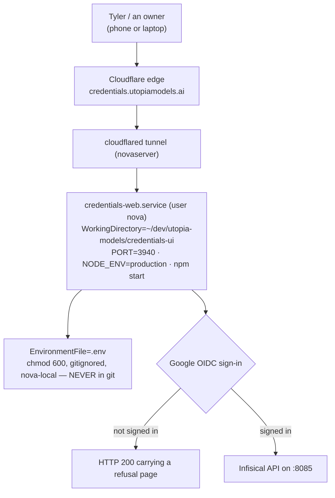

> Mirrored verbatim from `utopia-models/knowledge` `wi/components/credentials-web.md` by the allowlisted publish pipeline. Edit it there, not here.

```yaml
component: credentials-web
serves: all
runs-on: novaserver
adrs: []
owns:
  - credentials-web.service
  - 0.0.0.0:3940
```

# credentials-web — the human face of the vault

## WHAT IT IS

An admin UI over `infisical`, at **`credentials.utopiamodels.ai`**. It exists because Infisical's own UI
was judged too raw for the people who actually need it: Tyler and the owners see real secret values, add
and edit credentials, and read the per-agent access matrix without learning projects, environments and
paths.

🔴 **It is a view, not a second store.** Infisical remains the one store. A master reads through
`infisical-get.sh` and never through this UI — if a run ever "checks the credentials page", that run is
doing it wrong.

Its source is a **separate private repo**, `utopia-models/credentials-ui`, and it is the fleet's clearest
example of a surface that is neither Vercel nor in this repo: it deploys as a systemd user unit straight
onto novaserver.

## HOW IT WORKS TODAY



**Its own secrets are nova-local, not vaulted.** The unit reads an `EnvironmentFile` inside the checkout,
`chmod 600` and gitignored. That is the deliberate shape: the thing that fronts the vault cannot depend on
the vault to boot.

**Sign-in is Google OIDC**, configured from a client id/secret pair held in the `utopia` Infisical project
(`infisical-get.sh --keys utopia prod / | grep CREDENTIALS_UI` names them; the values are never printed).

**The tunnel is what makes it public, and that is intentional** — Tyler reaches it from his phone, so its
protection is its own auth, not the tailnet. Contrast `infisical` itself, which is firewalled to the
tailnet and reachable by no browser off it.

🔴 **Read the body, not the status code.** Signed out, this app answers **HTTP 200 with a refusal page** —
a 200 here means "the tunnel and the process are alive", never "a human is authenticated" and never "the
backend is reachable".

## BOUND VALUES

Everything this component runs on is off-repo: the source is another repository, the unit and its
`EnvironmentFile` live under `nova`'s home. So the only claim bindable from here is the registry's
`units:` field — the field CI executes — and it is empty:

<!--[[[cog
m.units("credentials-web")
]]]-->
- 🔴 `credentials-web` — no `units:` binding, so nothing proves its ExecStart target still exists (#4742)
<!--[[[end]]]-->

## DETERMINE CURRENT STATE

Four questions, and none of them is answered by the first status code alone (see HOW IT WORKS TODAY):

```bash
# public surface, through Cloudflare
curl -s -o /dev/null -m8 -w '%{http_code}\n' https://credentials.utopiamodels.ai/
# the app itself, on the box
curl -s -o /dev/null -m5 -w '%{http_code}\n' http://127.0.0.1:3940/
# the unit
ssh nova@localhost 'systemctl --user status credentials-web.service --no-pager'
# what is deployed
gh repo view utopia-models/credentials-ui --json pushedAt,defaultBranchRef
```

## KNOWN BROKEN

- 🔴 **`components.yaml`'s `credentials-web` row carries no `units:` binding**, so
  `credentials-web.service` is outside `verify-unit-execstart.py`'s daily sweep. Measured this session,
  same shape as `infisical`'s row.
- 🔴 **The older reference doc's liveness test is the wrong test.** It reads *"Public hostname returned 200
  on 2026-08-01… resolving 200 proves the tunnel and the app"* — and then correctly warns that a broken
  backend renders an empty matrix. Both halves are in tension: a 200 is returned by the signed-out refusal
  page too, so the status code alone distinguishes none of the three states (tunnel up / app up / Infisical
  reachable). Grade this surface by its body.
- ⚠ **A dated "returned 200" line is a measurement, and it rots.** This doc states no such date on purpose:
  the `curl` above is the claim.
- ⚠ **An exit-143 (SIGTERM) failure alert is usually collateral, not a crash.** The process is a
  `next-server` owned by `nova`, the same unix user the nova master's dispatched runs execute as (each
  master is its own unix user on novaserver), so a nova run that cleans up its own preview with a class-wide `pkill -f next-server` kills this too.
  `Restart=always` brings it back in ~6s and fleet-notify files the failure (#8180, 2026-09-29: a sibling
  run's `pkill -f 'next-server' -u nova` at 16:48:53.214Z, exit 143 the same second). Find the killer by
  grepping the box's session transcripts for the kill at that timestamp, not the app's logs. Since
  fleet-doctrine 0.73.0 (`utopia-models/fleet-plugins#93`) `pretooluse-broad-kill-guard.sh` refuses a
  pkill/killall aimed at a whole process class or user on every master.
- 🔴 **Anything this surface displays is a real secret value.** Never screenshot it into an issue, never
  paste it into a commit, never pipe it to a log. That is the one hard stop, and this is the one component
  in the fleet that renders secrets to a screen by design.
