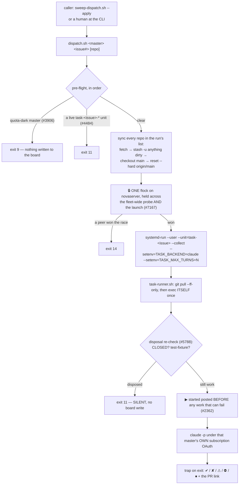

> Mirrored verbatim from `utopia-models/knowledge` `wi/components/dispatch-runtime.md` by the allowlisted publish pipeline. Edit it there, not here.

```yaml
component: dispatch-runtime
serves: all
runs-on: novaserver, `sudo -u <master>` from `nova` for win/nova/cloud/dust (`agent` is not a dispatch target). The run itself is a transient `systemd-run --user` unit on the master's own account
adrs: []
owns:
  - _infra/scripts/dispatch.sh
  - _infra/scripts/task-runner.sh
  - _infra/tests/dispatch-fleet-claim-race.sh
  - _infra/tests/task-runner-disposal-recheck.sh
  - _infra/tests/task-runner-stopped-marker.sh
  - _infra/tests/task-runner-marker-bodies.sh
  - _infra/tests/task-runner-standing-brief.sh
```

# dispatch-runtime — the fleet's entire agent runtime, in two scripts

## WHAT IT IS

`dispatch.sh` **starts** a run; `task-runner.sh` **is** the run. That is the whole runtime. There is no
daemon, no queue, no watchdog and nothing resident between runs: **starting a run IS the assignment**, and
**liveness IS the close-out comment** the run posts on its issue. Stop these two scripts and the fleet does
not degrade — it stops, because nothing else in the org can begin a unit of work.

**A public, scrubbed extraction lives at `utopia-models/dispatch-runtime`** (knowledge#9570): `dispatch.sh`,
`sweep-dispatch.sh`, `task-runner.sh`, the race test and the sweeper's systemd units, with hosts, IPs, account
names, repo names and personal names replaced by placeholders, gitleaks-clean. It is a **snapshot of
2026-10-22, not a mirror**: nothing syncs it, so it drifts from these scripts by design. It exists for
readers (the docs site's GitHub icon, tyleryouk.com); never read it as the runtime's current state.

The one thing it deliberately is **not** is a scheduler. Choosing *which* issue and *which* master is
`sweeper`'s job, which calls in here; a human at the CLI calls in through the same door.

## HOW IT WORKS TODAY



**Three pre-flight guards, and every one of them fails OPEN.** A false block stops the fleet, which is
worse than a wasted run — so an unreadable file, an unreachable box, an unparseable JSON or an untakeable
lock all mean *proceed, and say so on stderr*. None of the three writes a board comment, for one shared
reason: ⛔ and ⏸ are terminal to `sweep-dispatch.sh`'s predicates 6 and 8, so a glyph posted by a *refusal*
would permanently unqueue an issue whose only problem is transient.

| guard | refuses when | exit | escape hatch |
|---|---|---|---|
| quota (#3906) | the master's own `~/.claude/state/quota-status.json` says `exhausted: true` with a `resetsAt` still ahead | `9` | `DISPATCH_IGNORE_QUOTA=1` |
| duplicate, same master (#4484) | a `task-<issue>.service` (or a `DISPATCH_ALLOW_DUPLICATE` `task-<issue>-dup-*` copy) is already `--state=active` on that box | `11` | `DISPATCH_ALLOW_DUPLICATE=1` |
| fleet claim (#7167) | the flock-held probe finds a live run for this issue on **any** master | `14` | — |

**Only the third has no window.** A read-then-act check has 26-27 s between the read and the launch
(#6960's timings), and two dispatchers reading the board in the same second both pass it. The zero-entropy
unit name `task-<issue>` closes that for one master, because that master's systemd user manager refuses
to start a second unit with the same name, but a user manager is per-USER, so `task-7124.service` under `cloud` and under `nova` are two different names.
The `flock` on novaserver is what covers the cross-master case, because both dispatch paths (the sweeper
running locally as `nova`, and a hand dispatch arriving over ssh) execute the claim as the same unix user
on the same box. Proven against real systemd, with a mutation control, by
`_infra/tests/dispatch-fleet-claim-race.sh`.

**The last-moment disposal re-check is inside the run, not before it (#5788).** Every gate that asks "is
this still work?" from `dispatch.sh` runs too early: the unit start, the `exec` re-entry, the clone sync
and the credential decrypts all sit after that read. On #5788 the pre-flight read the issue at 14:36:01 —
correct, and already doomed; `test-fixture` landed at 14:36:03 and the issue closed at 14:36:05, and ▶ was
posted at 14:36:15. So `disposal_recheck()` asks the same two questions (CLOSED, `test-fixture`) from
inside the run, immediately before the ▶ post. Deliberately not the sweeper's whole `HOLD_LABELS` set:
`backlog` on a hand-dispatched issue is a judgement a human may legitimately override.

**There is no backend selection.** `dispatch.sh` passes the literal `--setenv=TASK_BACKEND=claude`; #6723
deleted `resolve_backend()` along with the alternate provider it chose between. The variable survives as
the fleet's *"am I inside a dispatched run"* signal, which is what every board-keyed gate exempts on.

**`task-runner.sh` self-updates before it does anything else** — `git pull --ff-only`, then `exec` itself
exactly once. Never mutate a script a running bash is still reading.

**The brief opens with the portfolio's standing block (#9524).** `file-issue.sh` ends every body it files
with `**Portfolio:** <slug>`; the runner reads that line and prepends the `[standing:<slug>]` line that the
fleet-doctrine plugin's `standing-line.sh` builds from `<portfolio>/STANDING.yaml` in the run's workspace,
and logs it to the run's journal. No line, an unknown value, no plugin or no file → the brief is unchanged.
Graded by `_infra/tests/task-runner-standing-brief.sh`.

**A run's scratch trees are the run's to remove (#10459).** The brief tells the model that a repo copy is a
`git worktree add` off the box's existing clone (a `--filter=blob:none` clone only when the box has none),
placed under `~/scratch-<issue#>`. On exit `release_workspaces` calls `release_scratch`, which deletes
`~/scratch-<issue#>` and every `~/work-*` that did not exist when the run started, then prunes the worktree
entry from the source clone. 🔴 A tree with a live process inside it (its cwd) is kept and named on stderr;
whatever was not pushed is abandoned by contract. `disk-guard`'s scratch arm is the backstop for a run that
died before the trap ran.

**Read the live state, don't recall it:**

| you want | run |
|---|---|
| which masters are dark right now | `_infra/scripts/dispatch.sh --quota` (table) · `--quota-dark` (names) · `--capacity` (dark + reason, then live masters by 7-day headroom; the sweeper's one call, #10774) |
| would this dispatch be refused? | `--preflight-quota <master>` (0/9) · `--preflight-duplicate <master> <issue#>` (0/11) |
| what is live for an issue | `_infra/scripts/dispatch.sh --live-units <master> <issue#>` |
| every run on this box, now | `systemctl --user list-units --state=active 'task-*'` |
| what one run actually did | `journalctl --user -u task-<issue>.service -o cat` |

## BOUND VALUES

<!--[[[cog
m.exists("_infra/scripts/dispatch.sh _infra/scripts/task-runner.sh _infra/tests/dispatch-fleet-claim-race.sh _infra/tests/task-runner-disposal-recheck.sh _infra/tests/task-runner-stopped-marker.sh _infra/tests/task-runner-marker-bodies.sh")
m.calls("_infra/scripts/task-runner.sh", "_infra/scripts/verify-verdict.sh", "disposal_recheck")
m.calls("_infra/scripts/dispatch.sh", "setenv=TASK_BACKEND=claude", "flock")
m.value("200", "_infra/scripts/task-runner.sh", r"TASK_MAX_TURNS:-(\d+)")
m.value("200", "_infra/scripts/dispatch.sh", r"DISPATCH_MAX_TURNS:-(\d+)")
m.value("45", "_infra/scripts/dispatch.sh", r"DISPATCH_CLAIM_WAIT:-(\d+)")
]]]-->
- ✅ `_infra/scripts/dispatch.sh`
- ✅ `_infra/scripts/task-runner.sh`
- ✅ `_infra/tests/dispatch-fleet-claim-race.sh`
- ✅ `_infra/tests/task-runner-disposal-recheck.sh`
- ✅ `_infra/tests/task-runner-stopped-marker.sh`
- ✅ `_infra/tests/task-runner-marker-bodies.sh`
- ✅ `_infra/scripts/verify-verdict.sh` — still called by `_infra/scripts/task-runner.sh`
- ✅ `disposal_recheck` — still called by `_infra/scripts/task-runner.sh`
- ✅ `setenv=TASK_BACKEND=claude` — still called by `_infra/scripts/dispatch.sh`
- ✅ `flock` — still called by `_infra/scripts/dispatch.sh`
- ✅ `200` — still live in `_infra/scripts/task-runner.sh` (`TASK_MAX_TURNS:-(\d+)`)
- ✅ `200` — still live in `_infra/scripts/dispatch.sh` (`DISPATCH_MAX_TURNS:-(\d+)`)
- ✅ `45` — still live in `_infra/scripts/dispatch.sh` (`DISPATCH_CLAIM_WAIT:-(\d+)`)
<!--[[[end]]]-->

## DETERMINE CURRENT STATE

```
bash _infra/scripts/sweep-dispatch.sh --explain              # what would be dispatched, and what is held
for M in win nova cloud dust; do sudo -n -u $M XDG_RUNTIME_DIR=/run/user/$(id -u $M) systemctl --user list-units 'task-*' --all --no-legend; done   # runs in flight, as nova
sudo -n -u svc-ops XDG_RUNTIME_DIR=/run/user/$(id -u svc-ops) systemctl --user cat reconcile-board.service   # the whole sweeper wiring
```

A run leaves nothing resident between invocations, so there is no daemon to check: the transient
`task-<issue>` unit while it lives, and the ▶/✔/✘ comment on the issue afterwards, are the
only liveness the runtime has.


## KNOWN BROKEN

- 🔴 **The always-loaded doctrine states the wrong runaway cap.**
  `README.md` reads *"`--max-turns` = the runaway cap, default 80"*. Measured this
  session: `grep -n 'TASK_MAX_TURNS:-' _infra/scripts/task-runner.sh` → `MAXT="${TASK_MAX_TURNS:-200}"`,
  and `dispatch.sh:2254` → `TURNS="${DISPATCH_MAX_TURNS:-200}"` with the reason beside it (*"11/27 runs
  hit 80"*). The number in the portfolio map is 2.5× low and is read by every master on every session.
  The `m.value("200", …)` assertions above are this doc's half of the fix; the `CLAUDE.md` sentence is
  owned by that file and is not edited from here.
- ⚠ **`components.yaml`'s `dispatch-runtime` row carries no `units:` binding, and correctly so.** Every
  run's unit is *transient* (`systemd-run --user --collect`), so there is no installed ExecStart for
  `verify-unit-execstart.py` to prove daily. That means this component is outside the one registry field
  CI actually executes — the two `_infra/tests/` harnesses above are the substitute, and they are gated in
  `guard.yml` rather than run by a timer.
- ⚠ **A `rc=0` from `claude -p` is not a shipped artifact, and an armed auto-merge is not a merge.** The
  runner's ✔ says the process exited cleanly, nothing more; the completion signal is a **merged** PR whose
  body carries `Closes #<issue>`. A run that exits with its PR still open has not finished, and 15 of them
  stacked up unnoticed once on exactly that confusion.
- ⚠ **The pre-flight clone sync stashes another agent's uncommitted work.** `reset --hard origin/main`
  runs on the master's shared clone with a `git stash push -u` in front of it, so an interactive session's
  edits survive only as a stash entry nobody is told about. Check `git stash list` before re-doing work
  that vanished mid-run.
