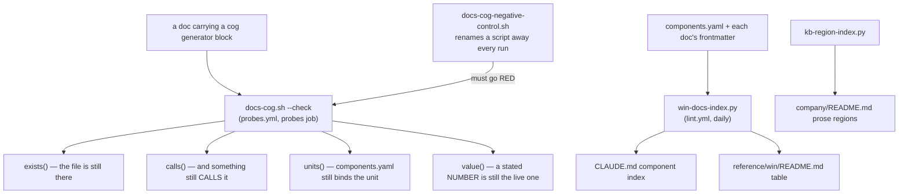

> Mirrored verbatim from `utopia-models/knowledge` `wi/components/doc-integrity.md` by the allowlisted publish pipeline. Edit it there, not here.

```yaml
component: doc-integrity
serves: all
runs-on: novaserver
adrs: [6044, 6554, 182, 4886]
owns:
  - _infra/scripts/docs-cog.sh
  - _infra/scripts/cog_machinery.py
  - _infra/scripts/win-docs-index.py
  - _infra/scripts/kb-region-index.py
  - _infra/scripts/test-win-docs-index-independence.sh
  - _infra/scripts/test-kb-region-index-detects-drift.sh
  - _infra/tests/docs-cog-negative-control.sh
```

# doc-integrity — the machinery that stops a document outliving what it describes

## WHAT IT IS

The checks that make a doc's factual claims fail CI when they stop being true: `cog` assertions inside
each doc, the generated component indexes, and the generated prose regions. `knowledge-base` grades a
doc's SHAPE; this grades the facts a doc chooses to bind (paths, callers, units and stated numbers). Turn it off and nothing breaks — which is the point: the failure it
prevents is silent by construction, and its motivating incident ran for 24 days without anyone noticing.

## HOW IT WORKS TODAY

**The incident that defines the component.** `reap-orphan-claude.timer` fired every 15 minutes for 24
days — roughly 2,300 invocations — against a script that had been **deleted**, while THREE committed docs
described it as live working machinery. Nothing noticed, because nothing READ those docs. A doc naming
`_infra/scripts/x.sh` is making a claim about the filesystem, and until #4858 that claim outlived the
file for free.



**Four assertions, and only one of them checks a VALUE.** `exists`, `calls` and `units` all check
PRESENCE — a doc can pass every one of them while stating a number that is simply wrong, which
`sweeper.md` did for weeks after #6962 deleted the constants it claimed. `value(claim, path, pattern)`
closes that: `pattern` carries exactly one capture group, and the two failure shapes are kept distinct
because they have different fixes — **STALE** (the pattern matches nothing: the constant is gone, rewrite
the claim) and **DRIFTED** (it matches with a different value: update the number).

**Every path is resolved relative to the repo root, and an absolute path is REFUSED.** Master homes are
0750, so `/home/nova/...` is False from every account except nova's; generated text that differs by *who
ran the generator* would fail `--check` forever, for the wrong reason. Off-box machinery is bound
instead by `components.yaml:units:`, which `verify-unit-execstart.py` executes on the box.

**The file list is DISCOVERED, never enumerated.** `docs-cog.sh` runs `git grep -lE '^<!--\[\[\[cog'`,
anchored at column 0 — deliberately, because a doc that QUOTES a cog block (this mechanism's own
evidence files do) is not a doc that carries one, and an unanchored match once handed `cog` an evidence
file and killed the check with its own proof.

**Generating and linting are separate verdicts** (#5251). Generate mode writes the blocks and reports the
prose rules as advisory; only a violation that would splice a MALFORMED row stops the write. Before that
split, one doc twelve lines over the cap made both indexes unregenerable while `lint.yml` said *"run
win-docs-index.py and commit"* — a deadlock with a false claim inside it.

**Two sinks, two questions.** `reference/win/README.md` answers *"what is every component, who owns it,
when was it verified"*; the root `CLAUDE.md` block answers *"which doc do I read for this id"* and is
capped to one line per row because it is the auto-loaded prefix of every session on every box.

**Where each check runs:** `docs-cog.sh --check` and its negative control are steps of `probes.yml`'s
`probes` job, on every PR and on pushes to `main`. `win-docs-index.py --check` and `kb-region-index.py` are in
`lint.yml`, daily, advisory, and their findings reach the single upserted KB-drift issue.

## BOUND VALUES

<!--[[[cog
m.exists("_infra/scripts/docs-cog.sh _infra/scripts/cog_machinery.py _infra/scripts/win-docs-index.py _infra/scripts/kb-region-index.py")
m.exists("_infra/tests/docs-cog-negative-control.sh _infra/scripts/test-win-docs-index-independence.sh _infra/scripts/test-kb-region-index-detects-drift.sh")
m.calls(".github/workflows/probes.yml", "_infra/scripts/docs-cog.sh _infra/tests/docs-cog-negative-control.sh")
m.calls(".github/workflows/lint.yml", "_infra/scripts/win-docs-index.py _infra/scripts/kb-region-index.py")
m.calls("_infra/scripts/docs-cog.sh", "cog_machinery")
m.value("200", "_infra/scripts/win-docs-index.py", r"MAX_LINES = (\d+)")
]]]-->
- ✅ `_infra/scripts/docs-cog.sh`
- ✅ `_infra/scripts/cog_machinery.py`
- ✅ `_infra/scripts/win-docs-index.py`
- ✅ `_infra/scripts/kb-region-index.py`
- ✅ `_infra/tests/docs-cog-negative-control.sh`
- ✅ `_infra/scripts/test-win-docs-index-independence.sh`
- ✅ `_infra/scripts/test-kb-region-index-detects-drift.sh`
- ✅ `_infra/scripts/docs-cog.sh` — still called by `.github/workflows/probes.yml`
- ✅ `_infra/tests/docs-cog-negative-control.sh` — still called by `.github/workflows/probes.yml`
- ✅ `_infra/scripts/win-docs-index.py` — still called by `.github/workflows/lint.yml`
- ✅ `_infra/scripts/kb-region-index.py` — still called by `.github/workflows/lint.yml`
- ✅ `cog_machinery` — still called by `_infra/scripts/docs-cog.sh`
- ✅ `200` — still live in `_infra/scripts/win-docs-index.py` (`MAX_LINES = (\d+)`)
<!--[[[end]]]-->

## DETERMINE CURRENT STATE

```
bash _infra/scripts/docs-cog.sh --check ; echo "cog rc=$?"
python3 _infra/scripts/win-docs-index.py --check ; echo "index rc=$?"
```

🔴 Read the OUTPUT, not just the exit code — see the first KNOWN BROKEN item. To regenerate rather than
grade, drop `--check` from either: both are the same code path CI runs, deliberately, so a human who
regenerates with different options than CI checks with cannot produce a red nobody can reproduce.

## KNOWN BROKEN

- 🔴 **`win-docs-index.py --check` prints violations and exits 0, while its own usage text says it does
  not.** Measured this session:

  ```
  $ python3 _infra/scripts/win-docs-index.py --check > /tmp/wdi.out 2>&1; echo "rc=$?"
  rc=0
  $ grep -c '✘' /tmp/wdi.out
  27
  $ tail -1 /tmp/wdi.out
  win-docs-index: OK — 81 docs, 76 components, 0 staleness violations
  ```

  The 27 break down as **23** docs over the 200-line cap (`fleet-notify.md` at 674), **2** line-number
  citations, and **2** docs whose last content line is not a `Determine current state:` command.
  The `--check` branch prints prose violations under *"advisory only, not blocking"* and returns 1 only for date, staleness, dead-link or
  dangling-pointer findings. That is a defensible design — but the module's own usage block says
  `--check  validate only; exit 1 on any violation`, and generate mode prints *"Every OTHER violation is
  advisory here and fatal under `--check`"*. Both sentences are false against the code. The consequence
  is not cosmetic: `lint.yml`'s finding 3 fires on `steps.docsindex.outcome != success`, so a green exit
  means **none of the 27 reaches the KB-drift issue** — the one surface that was supposed to carry them.
- 🔴 **`_infra/scripts/verify-docs-wiki-urls.sh` (14.7 kB) is called by nothing.**
  `git grep -n 'verify-docs-wiki-urls'` returns six hits and every one is prose in a plan document or a
  spec's evidence file — no workflow, no timer, no script. It re-derives the published wiki's reading
  list and runs every command block the site carries, and it was written *"to make that a standing
  property instead of a one-off"*. It is the exact shape `calls()` exists to catch — present on disk,
  wired to nothing (#4742) — inside the docs machinery itself. Not in this component's `owns:` because
  its subject is the published site; `site-docs-wiki` is where it should land or be deleted.
- ⚠ **Nothing checks whether a component doc is TRUE.** `kb-lint.py` grades shape, `cog` grades the
  values a doc chose to bind, and the indexes grade generated blocks — the prose between them is
  unguarded. This is stated in the rebuild's own brief and is not a bug to fix here; it is why the
  off-git rule (*name the PROBE, never the answer*) is load-bearing rather than stylistic.
