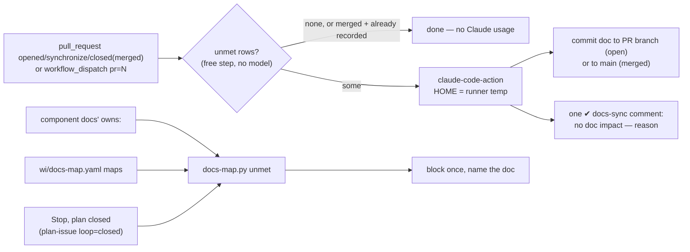

> Mirrored verbatim from `utopia-models/knowledge` `wi/components/docs-sync.md` by the allowlisted publish pipeline. Edit it there, not here.

```yaml
component: docs-sync
serves: all
runs-on: github-actions (self-hosted novaserver runners) · every master box (fleet-doctrine Stop hook)
adrs: [9838]
owns:
  - wi/docs-map.yaml
  - _infra/scripts/docs-map.py
  - .github/workflows/docs-sync.yml
  - _infra/tests/adr-supersede-chain.sh
  - wi/decisions/TEMPLATE.md
```

# docs-sync — docs follow code through a native tool, at the PR and at plan close

## WHAT IT IS

One map and two enforcers that ask the same question: *did this change touch a path a doc covers,
without touching the doc?* Built for PLAN-405 P3 (knowledge#9838) to replace hand updates with tools;
the decision and the alternatives are ADR-9838.

- **`wi/docs-map.yaml`** — the one map, every project in one shape (`context` + `maps`). Most mappings
  are not written in it: each component doc's own `owns:` list is a mapping to that doc.
- **`_infra/scripts/docs-map.py`** — the only reader. `check` (the map is real), `unmet` (which docs a
  change left behind), `context` (a project's context file).
- **PR side** — `.github/workflows/docs-sync.yml`: Claude (`anthropics/claude-code-action`) commits the
  doc update to the PR branch — or to `main` once the PR has merged — or posts one `✔ docs-sync` comment
  with a reasoned "no doc impact".
- **Session side** — fleet-doctrine `scripts/stop-docs-sync.sh` (Stop hook): when a plan closes with an
  unmet mapping, it blocks once and names the doc.
- **ADRs** — `wi/decisions/TEMPLATE.md` is the MADR 4.0.0 shape; superseding edits the old record's
  `superseded_by:`, and `decision-record-linter.sh` reports a one-way chain.

## HOW IT WORKS TODAY



**A mapping is met when ANY of the docs covering a changed path is in the same change.** A script
three component docs own needs one of them touched, not all three. A directory owner over
`wi/components/` itself is skipped, or every doc edit would demand a second one.

**The PR side spends a Claude run only when the free gate finds a left-behind doc.** Most dispatched
PRs are merged within seconds of opening, so the opened-event run is still queued at the close, the
`pr-run-reaper` Worker cancels it, and the head branch is already deleted (#9929). The `closed` event
is the path those PRs take: its run is created after the close, so the reaper leaves it alone; it reads
the PR's state rather than the event's, checks out `main`, takes the file list from the PR itself, and
commits any doc update to `main` before the `✔ docs-sync` comment. A merged PR that already carries a
`✔ docs-sync` comment from its open-side run is skipped. `gh workflow run docs-sync.yml -f pr=<n>`
runs the same logic for one PR by hand (the backfill). The runner is self-hosted because the org's free
hosted minutes were exhausted (measured in ADR-9838). Pushes and comments use the job's
`GITHUB_TOKEN`, so the docs commit does not start the workflow again.

**The session side reads "the plan closed", never infers it**, and scopes to the session's project when
the PLAN-405 state file names one. Its outcome is written to `~/.claude/state/docs-sync/<session>.json`
(`resolved: updated | no-impact | unresolved`).

## BOUND VALUES

<!--[[[cog
m.exists("wi/docs-map.yaml _infra/scripts/docs-map.py .github/workflows/docs-sync.yml _infra/tests/adr-supersede-chain.sh wi/decisions/TEMPLATE.md _infra/scripts/decision-record-linter.sh")
m.value("component_owns: wi/components", "wi/docs-map.yaml", r"(component_owns: \S+)")
m.value("v1.0.260", ".github/workflows/docs-sync.yml", r"claude-code-action@[0-9a-f]{40} # (v[0-9.]+)")
m.value("0.24.2", ".github/workflows/probes.yml", r'LYCHEE_VERSION: "([0-9.]+)"')
]]]-->
- ✅ `wi/docs-map.yaml`
- ✅ `_infra/scripts/docs-map.py`
- ✅ `.github/workflows/docs-sync.yml`
- ✅ `_infra/tests/adr-supersede-chain.sh`
- ✅ `wi/decisions/TEMPLATE.md`
- ✅ `_infra/scripts/decision-record-linter.sh`
- ✅ `component_owns: wi/components` — still live in `wi/docs-map.yaml` (`(component_owns: \S+)`)
- ✅ `v1.0.260` — still live in `.github/workflows/docs-sync.yml` (`claude-code-action@[0-9a-f]{40} # (v[0-9.]+)`)
- ✅ `0.24.2` — still live in `.github/workflows/probes.yml` (`LYCHEE_VERSION: "([0-9.]+)"`)
<!--[[[end]]]-->

## DETERMINE CURRENT STATE

```bash
python3 _infra/scripts/docs-map.py check                       # the map is real
git diff --name-only origin/main...HEAD | python3 _infra/scripts/docs-map.py unmet   # what a PR left behind
gh run list --repo utopia-models/knowledge --workflow docs-sync.yml --limit 5   # PR-side runs
gh secret list --repo utopia-models/knowledge | grep CLAUDE_CODE_OAUTH_TOKEN    # set date of the token
jq -r '.plugins["fleet-doctrine@fleet-doctrine"][0].version' ~/.claude/plugins/installed_plugins.json
ls ~/.claude/state/docs-sync/                                  # session-side outcomes on this box
```

## KNOWN BROKEN

- ⚠ **The session side fires on a state file nobody writes yet.** `loop: closed` arrives with PLAN-405
  P4 (#9839); until then only the step-2 exit marker closes a plan for this hook.
- ⚠ **The token is one master's subscription.** `CLAUDE_CODE_OAUTH_TOKEN` is a `claude setup-token`
  token of the `nova@utopiamodels.ai` login, so PR-side runs draw on the same quota as dispatched work.
  The secret it replaced (2026-07-14) was revoked and nothing had noticed.
- ⚠ **A PR merged during the open-side run**: the close cancels that run (one concurrency group per
  PR) and the closed-event run starts over against `main`, so a doc commit the open run had already
  pushed to the branch only survives if the merge included it.
