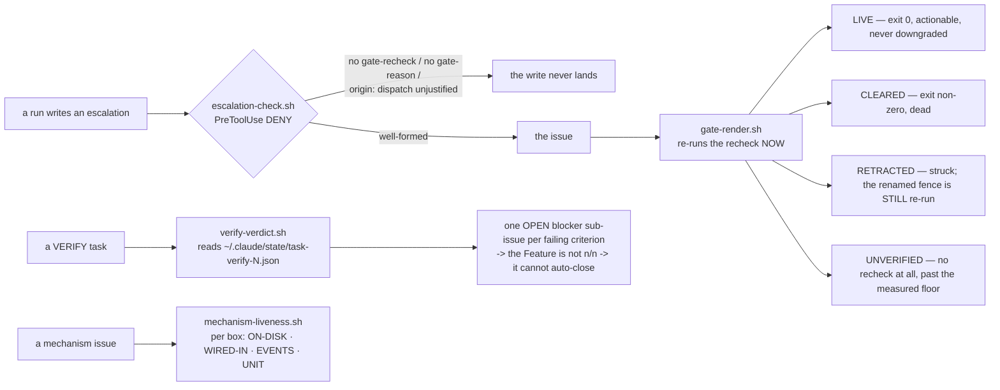

> Mirrored verbatim from `utopia-models/knowledge` `wi/components/escalation-gates.md` by the allowlisted publish pipeline. Edit it there, not here.

```yaml
component: escalation-gates
serves: all
runs-on: everywhere
adrs: [4800]
owns:
  - _infra/scripts/gate-render.sh
  - _infra/scripts/mechanism-liveness.sh
  - _infra/scripts/verify-verdict.sh
  - _infra/tests/gate-render-branches.sh
  - _infra/tests/verify-verdict-remeasure.sh
  - _infra/tests/verify-verdict-prior-verdict.sh
```

# escalation-gates — a claim that blocks work must be re-derivable, or it is not a gate

## WHAT IT IS

The fleet's rule that **no claim which stops work may be prose**, and the four instruments that enforce it
at four different moments. One rule explains all of them: *a claim that blocks work counts only if a command can
re-check it; prose alone never blocks.*

| moment | instrument | what it refuses |
|---|---|---|
| **write** | `escalation-check.sh` | an escalation with no `gate-recheck`, no `gate-reason`, or an `origin: dispatch` quoting none of the three human-only items |
| **read** | `gate-render.sh` | repeating gate prose bare — every claim leaves it wearing a verdict |
| **verify** | `verify-verdict.sh` | a failing VERIFY criterion existing only as a comment |
| **close** | `mechanism-liveness.sh` | "the code is written" standing in for "it executes on the boxes it names" |

🔴 **Boundary with `gate-retractor`.** That component is the *expiry loop* — the 15-minute timer that
re-runs every open issue's `gate-recheck` and strikes the ones that cleared, plus its write-time companion
`escalation-check.sh`, which it owns. This component is the **grammar and the graders**: what a gate must
look like, and the three scripts that read one. Same family, two rows.

## HOW IT WORKS TODAY



**The write gate is the only always-on half**, and it is delivered by the plugin, not by a file in
`~/.claude/scripts/`. Measured this session with `bash _infra/scripts/mechanism-liveness.sh escalation-check.sh`:
`WIRED-IN` reads `plugin→pretooluse-escalation-gate.sh` on **win, nova, dust, cloud and agent**, event
`PreToolUse`; `sf` shows `-` in every column.

**`origin` is the stronger of the two tests.** An escalation's provenance, not its content, decides the
default answer: `origin: interactive` is allowed, `origin: dispatch` is refused unless it quotes one of
`identity-and-scope.md`'s three human-only items verbatim. Tyler, 2026-08-27: *"Any problem that comes
from dispatch, that is for the fleet to handle authoritatively and autonomously."*

**`gate-render.sh`'s floor is a measurement, not a precaution.** `GATE_FLOOR_SECONDS` is the shortest
observed time from a gate being written to it being false (#6850: written 19:21:50Z, false 19:23:34Z). A
claim younger than the floor is reported NOT RE-DERIVED with its age; older, UNVERIFIED. Neither is ever
reported as live — **only a `gate-recheck` exiting 0 makes a gate live.**

**`verify-verdict.sh` turns a verdict into board structure** (ADR-4800). A VERIFY task closing means the
verification was *performed*, and the board reads that as *passed* — two facts, one bit of storage. The
fix invents no new gate: it hands the existing auto-closer an open child it cannot ignore. It also re-runs
each `recheck` immediately before filing, so a criterion that became true in the meantime is recorded as a
measurement instead of a blocker (#6587).

**`mechanism-liveness.sh` grades a population, not a file.** Its roster is derived, never hardcoded — the
set of boxes a mechanism reaches is whatever it reaches. A `-` in `WIRED-IN` is INFORMATION: decide
wire-or-delete, never leave a mechanism present-and-dead.

## BOUND VALUES

<!--[[[cog
m.exists("_infra/scripts/gate-render.sh _infra/scripts/mechanism-liveness.sh _infra/scripts/verify-verdict.sh _infra/tests/gate-render-branches.sh _infra/tests/verify-verdict-remeasure.sh _infra/tests/verify-verdict-prior-verdict.sh")
m.value("104", "_infra/scripts/gate-render.sh", r"GATE_FLOOR_SECONDS=(\d+)")
m.calls("_infra/scripts/gate-retractor.sh", "escalation-check.sh")
m.units("escalation-gates")
]]]-->
- ✅ `_infra/scripts/gate-render.sh`
- ✅ `_infra/scripts/mechanism-liveness.sh`
- ✅ `_infra/scripts/verify-verdict.sh`
- ✅ `_infra/tests/gate-render-branches.sh`
- ✅ `_infra/tests/verify-verdict-remeasure.sh`
- ✅ `_infra/tests/verify-verdict-prior-verdict.sh`
- ✅ `104` — still live in `_infra/scripts/gate-render.sh` (`GATE_FLOOR_SECONDS=(\d+)`)
- ✅ `escalation-check.sh` — still called by `_infra/scripts/gate-retractor.sh`
- 🔴 `escalation-gates` — **no such row** in `wi/registry/components.yaml`
<!--[[[end]]]-->

## DETERMINE CURRENT STATE

The write gate's arming is a population fact; the other three are exercised on demand:

```bash
bash _infra/scripts/mechanism-liveness.sh escalation-check.sh   # is the write gate armed, per box?
bash _infra/scripts/gate-render.sh <issue#>                     # what is that gate claim WORTH, right now?
bash _infra/scripts/test-7019-gate-render.sh                    # the verdict-selection fixtures
bash _infra/tests/gate-render-branches.sh                       # the branch table, exercised
bash _infra/tests/verify-verdict-remeasure.sh                   # re-measure-before-filing, on the shipped bytes
bash _infra/tests/verify-verdict-prior-verdict.sh               # a duplicate run cannot erase the board's verdict
```

## KNOWN BROKEN

- 🔴 **The write gate does not reach `sf`.** `mechanism-liveness.sh escalation-check.sh` this session:
  `sf` is `-` in `ON-DISK`, `WIRED-IN`, `EVENTS` and `SYSTEMD-UNIT`, while the four masters and the
  architect all carry `plugin→pretooluse-escalation-gate.sh`. The one always-on agent — the one most
  likely to write an unattended escalation — is the one box where nothing refuses a malformed one.
- ⚠ **`ON-DISK` is `-` for `escalation-check.sh` on every box, and that is correct, not a fault.** The
  script lives in this repo and is invoked by the plugin's thin wrapper; `mechanism-liveness.sh` looks
  under `~/.claude/hooks/`, `~/.claude/scripts/` and the pinned plugin path. Read the `WIRED-IN` column,
  not `ON-DISK`, when grading this mechanism.
- ⚠ **Only the write half is continuous.** `gate-render.sh`, `verify-verdict.sh` and
  `mechanism-liveness.sh` all run when a run or a human invokes them. Nothing schedules them, so an
  ungraded gate claim sitting in an issue body is graded only when somebody reads it through
  `gate-render.sh` — which is precisely the habit the component exists to create.
- ⚠ **There is no `escalation-gates` row in `components.yaml`**, so none of these four instruments appears
  on a registry surface; `gate-retractor` has a row and they do not.
