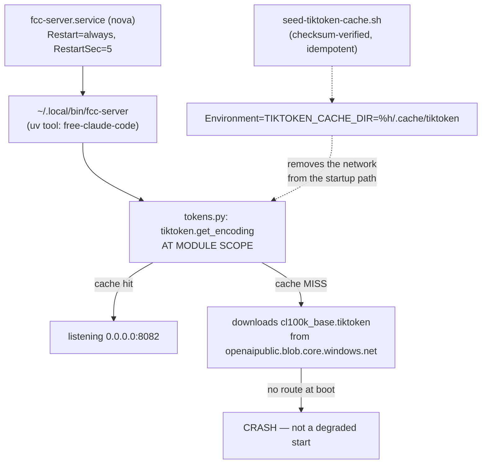

> Mirrored verbatim from `utopia-models/knowledge` `wi/components/fcc-server.md` by the allowlisted publish pipeline. Edit it there, not here.

```yaml
component: fcc-server
serves: all
runs-on: novaserver, unix user `nova`, a `Type=simple` user unit
adrs: [6723, 2165]
owns:
  - _infra/systemd/fcc-server.service
  - fcc-server.service
  - "0.0.0.0:8082"
```

# fcc-server — the OSS-coder proxy that nothing runs on

## WHAT IT IS

`free-claude-code` installed as a `uv` tool on nova's account, serving an Anthropic-shaped API on
`:8082` in front of an OSS model. It exists because of the cost model — **flat subscriptions and
owned hardware only, never a pay-per-use frontier key** — and cheap OSS backends were the sanctioned
rate-limit escape.

🔴 **It is not a dispatch backend, and there is nothing for it to be an alternative to.** ADR-6723
(2026-08-23) settles it: every dispatched run is Claude Code on a Claude subscription, `dispatch.sh`
passes the literal `TASK_BACKEND=claude`, and the resolver that once chose between providers is
deleted. ADR-2165, which reasoned about a second backend, is superseded by it. If this process
stops, no run changes behaviour.

## HOW IT WORKS TODAY



What it reports is the whole of its surface — the two commands are in DETERMINE CURRENT STATE.

**The one behaviour worth carrying forward is the boot race, because the shape recurs.** It
tokenizes at *import*, so a startup with no route is a crash rather than a degraded start. novaserver
rebooted at 13:55:23 on 2026-08-04; the unit started 19 s in with no route and died on
`OSError: [Errno 101] Network is unreachable`; `Restart=always` succeeded on the retry at 13:55:49 —
but the crash had already fired `fleet-notify@` and filed a board issue, and the race was set to run
on every cold boot (#4118).

**Two facts came out of that fix and both generalise to every user unit on this fleet:**

1. **`network-online.target` does not exist in the systemd USER manager.** The unit carried
   `After=network-online.target` and it was a silent no-op — `systemctl --user list-units --all
   network-online.target` reports `LOAD=not-found`. Ordering a `--user` unit behind the network is
   not a knob that exists. Do not reach for it.
2. **tiktoken's default cache is `$TMPDIR`, which a reboot wipes.** Every cold boot re-downloaded a
   1.6 MB blob just to start a tokenizer. The fix removes the network from the startup path instead
   of trying to wait for it.

Proving that fix is *live* rather than merely committed means reading the running process's own
environment — see DETERMINE CURRENT STATE.

```bash
bash _infra/scripts/seed-tiktoken-cache.sh          # idempotent; prints "already seeded"
tr '\0' '\n' < /proc/$(systemctl --user show fcc-server -p MainPID --value)/environ | grep TIKTOKEN
sudo unshare -n -- bash -c 'ip link set lo up; exec sudo -u nova env \
  TIKTOKEN_CACHE_DIR=$HOME/.cache/tiktoken FCC_OPEN_BROWSER=false timeout 40 ~/.local/bin/fcc-server'
```

**Reaching it.** `:8082` binds `0.0.0.0`, so it answers on the tailnet. There is no auth in front of
it. The model and provider it fronts are read from the probe below, never stated here — they change
with the upstream tool's own defaults.

## BOUND VALUES

<!--[[[cog
m.exists("_infra/systemd/fcc-server.service")
m.calls("_infra/systemd/fcc-server.service", "TIKTOKEN_CACHE_DIR")
m.units("fcc-server")
]]]-->
- ✅ `_infra/systemd/fcc-server.service`
- ✅ `TIKTOKEN_CACHE_DIR` — still called by `_infra/systemd/fcc-server.service`
- 🔴 `fcc-server` — no `units:` binding, so nothing proves its ExecStart target still exists (#4742)
<!--[[[end]]]-->

## DETERMINE CURRENT STATE

```bash
curl -s -m5 http://127.0.0.1:8082/          # {"status":"ok","provider":...,"model":...}
ssh nova@100.71.25.43 'systemctl --user is-active fcc-server'
bash _infra/scripts/seed-tiktoken-cache.sh  # idempotent; prints "already seeded"
```

The health endpoint is the whole of its reported surface. A unit that is `active` and an endpoint
that answers are two different facts here, because the crash-and-restart path leaves the first true
for a service that has already filed a board issue.

🔴 **The unit check has to go over `ssh`, not `-M`.** `systemctl --user -M nova@ …` run from any
other master's shell dies with `Failed to connect to bus: Permission denied` — measured from `cloud`,
2026-08-31. Master homes are `0750` and each account has its own session bus.

To prove the boot fix is live rather than merely committed, read the ENVIRONMENT OF THE RUNNING
PROCESS — a unit file on disk says nothing about it:

```bash
ssh nova@100.71.25.43 \
  'tr "\0" "\n" < /proc/$(systemctl --user show fcc-server -p MainPID --value)/environ | grep TIKTOKEN'
```


## KNOWN BROKEN

- 🔴 **The registry row binds the unit under the wrong key, so it is in no sweep.** The
  `fcc-server` row carries `unit: _infra/systemd/fcc-server.service` — singular, and a *path*. The
  field `verify-unit-execstart.py` reads is `units:`, a list of `user@<box>:<unit>` names. The
  generated block above is that gap: the unit exists, the artifact of record exists, and nothing
  proves daily that the ExecStart target is still there. A one-word registry edit closes it.
- ⚠ **A healthy probe here says the proxy is up, not that anything uses it.** Nothing does. Measured
  2026-08-31: `grep -rn "8082" --include='*.sh' --include='*.py' --include='*.yml' --include='*.mjs'
  --include='*.service' .` over the whole repo returns **no lines at all** — not even the unit, which
  takes the port from the tool's default. Under ADR-6723 that is the correct state, not a defect, but
  it means uptime here is not evidence of anything working.
- 🔴 **`wi/work/reference/win/fcc-server.md` ends by telling the reader to run
  `bash _infra/scripts/dispatch.sh --resolve <master>`** for what a master would run on. That flag
  no longer exists — it went with the second-backend architecture in ADR-6723. Run today it is
  parsed as positional arguments and fails pre-flight:
  `dispatch.sh --resolve cloud` → `PRE-FLIGHT FAIL: issue #cloud does not exist`. Four comments
  inside `_infra/scripts/dispatch.sh` still cite `--resolve` as a live dry-run hook
  (`grep -n -- '--resolve' _infra/scripts/dispatch.sh` → 4 hits, all prose). Superseded by this doc.
