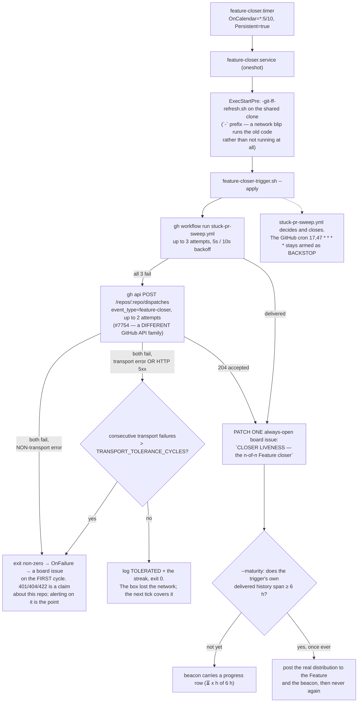

> Mirrored verbatim from `utopia-models/knowledge` `wi/components/feature-closer.md` by the allowlisted publish pipeline. Edit it there, not here.

```yaml
component: feature-closer
serves: all
runs-on: novaserver, unix user `svc-ops` (`nova` until knowledge#9201), a `Type=oneshot` user unit on a 10-minute `OnCalendar` timer
adrs: []
owns:
  - _infra/scripts/feature-closer-trigger.sh
  - _infra/systemd/feature-closer.service
  - _infra/systemd/feature-closer.timer
  - feature-closer.service
```

# feature-closer — the trigger the fleet controls, in front of a cron GitHub half-honours

## WHAT IT IS

A timer that fires `workflow_dispatch` on `stuck-pr-sweep.yml` every ten minutes — falling back to
`repository_dispatch` when GitHub will not accept the first — and publishes its own liveness to the board
while doing it.

**It does not contain the closer.** The decision — *"if every sub-issue is closed, the Feature IS done"* —
lives in `stuck-pr-sweep.yml`, which `board-integrity` owns. This component is only about **who starts
it**, and it exists because the answer used to be GitHub's scheduler, which delivered half of what it was
asked for. Stop this and Features still close, eventually, on a cron whose worst measured gap was
**11 hours 26 minutes** — while every one of those runs reported success.

## HOW IT WORKS TODAY



🔴 **ONE DOOR WAS NEVER ENOUGH, AND RETRYING HARDER CANNOT OPEN A CLOSED ONE (#7754).** On
2026-09-13 at 08:45Z every `POST /repos/utopia-models/knowledge/actions/workflows/319975539/dispatches`
returned **HTTP 500** — three attempts in the unit, a fourth by hand ten minutes later, and
`pr-run-reaper.yml` in the same repo answered 500 to the identical call. The endpoint was up and
validating: a deliberately bad `ref` still answered `422 No ref found`. Nothing on our side was wrong,
and there was no fix to dispatch a master at. In the same minute `POST /repos/utopia-models/knowledge/dispatches`
answered **204**. So the trigger now tries the second door before it gives up, and
`stuck-pr-sweep.yml` listens on `repository_dispatch: types: [feature-closer]`. On that event
`inputs.*` resolves empty and `github.event_name == 'workflow_dispatch'` is false, so a fallback run is
byte-identical to a scheduled one. A fallback delivery is a **success** — the closer ran, the cycle exits
0, no board issue — and the degradation is named in the journal, in `dispatchVia` in the state file, and
in the beacon's `delivery path` row, which is the surface a human actually reads.

**A transport failure is a could-not-check, not a fault (#7543) — and so is an HTTP 5xx (#7754).** Over its first 1353 starts on
novaserver (2026-08-28T00:25:06Z to 2026-09-06T09:35:06Z) it went red **twice**, and both
times the box could not reach the network at all: one dropped dispatch in the single-attempt era, and a
box-wide DNS outage on 2026-09-06 (`ssh: Could not resolve hostname github.com: Temporary failure in name
resolution`) that outlasted all three attempts because they span 35 s. 2 of 1353 is 0.15%, **and neither
was a delivery outage** — the 09:45 cycle dispatched on attempt 1/3. So the exit code, which IS this
unit's alert, now reads the error #7114 was already keeping: a non-transport failure alerts on the first
cycle, a transport failure is tolerated for `TRANSPORT_TOLERANCE_CYCLES` and alerts after. **A 5xx is
classified `transport`, not `real`**: the non-transport arm exists for a claim about THIS repo — 401 (the
token died), 404 (the workflow was deleted), 422 (the ref or the trigger is wrong) — each of which names
something a master can go and fix. A 5xx names nothing on our side, so alerting on the first cycle files
a board issue nobody can act on, which is what #7754 was. The tolerance
is sized to expire strictly inside `STALE_CEILING_MIN`, so a tolerated window can never outlast the
staleness rule the beacon already enforces. Both constants live in the script, with the measurement
written next to them.

**The interval is a measurement, not a precaution.** Closer duration p50 52 s / max 298 s, so a 10-minute
period is 2.0× the worst run ever seen and a cycle cannot overlap its successor; 144 runs/day × 52 s is
8.7% of one of the org's two self-hosted lanes. Five minutes was rejected — 288 runs/day is 17.3% of a
lane for a latency gain smaller than the run-duration spread itself. The derivation lives in the timer
file next to the number.

**The beacon exists so silence cannot read as health.** Every cycle the script rewrites the body of one
always-open board issue with the trigger's last fire time, the age of the closer's newest **successful**
run, what the newest run of all concluded, and the trailing-24 h delivered-gap distribution. Above
`STALE_CEILING_MIN` the first line flips to a red banner naming the number and the conclusion — the two
failures the beacon can see are cured in opposite places, a dead timer on novaserver and a run that fires
but concludes `startup_failure` at GitHub. The point is the **positive** report: if the timer dies, the issue does not
disappear and does not go quiet — its timestamps visibly rot where Tyler looks. Body PATCH only, so
refreshing it notifies nobody.

**It grades completions, not fires.** `concurrency: cancel-in-progress: false` cancels the older *pending*
run when a newer one joins, so during a runner backlog a perfectly-delivering trigger cancels its own
queued predecessors and the closer completes rarely. Counting fires alone would grade the timer and call
it the closer. Both rates are reported side by side — the first measured hour read *trigger delivery
100.0% (6/6 ticks), closer completion 66.7% (4 success, 2 cancelled-while-pending, 0 failed)*.

🔴 **And a SUCCESS, not a terminal state.** `status == "completed"` is GitHub saying the run stopped, not
that it worked: a `startup_failure` creates zero jobs and is `completed` too. The beacon's headline graded
on that until #7420 and printed 🟢 for 28 hours (167 consecutive `startup_failure` runs, GitHub Actions
disabled org-wide over a failed payment) — while `maturity_measure()` in the same file, grading
`conclusion == "success"`, reported `closer completion 0.0%` in a table row directly underneath. **Two
graders in one script disagreed and the wrong one drove the banner.** When two code paths measure the
same thing, the one Tyler reads is the one to check first.

**Every close states its own latency (#7049).** The ✅ auto-close comment carries the last sub-issue's
close time, the Feature's close time, and the difference, computed at the moment it acts — because that is
the one moment both facts are in hand. The parent's `closedAt` has nothing to subtract from it, and the
beacon measures workflow cadence rather than board latency. Grep any close for
`<!-- autoclose-latency -->`; the idempotence marker is `<!-- feature-autoclose -->`.

**Read it live, from either end:**

| you want | run |
|---|---|
| is the closer stale? | `bash _infra/scripts/feature-closer-trigger.sh --measure` — `newestCompletedAgeMin` over the ceiling means the closer, not the board |
| the ≥6 h delivered distribution | `bash _infra/scripts/feature-closer-trigger.sh --maturity` |
| the timer on the box | `sudo -n -u svc-ops XDG_RUNTIME_DIR=/run/user/$(id -u svc-ops) systemctl --user list-timers feature-closer.timer`, run as `nova` (svc-ops' home is 0750) |
| the beacon | the board issue titled `CLOSER LIVENESS — the n-of-n Feature closer (timer-managed)` |

Auth is the running account's **durable PAT** from `~/.config/gh/hosts.yml` (svc-ops' own), never `GH_TOKEN` — that one is the 1-hour App
installation token and is absent under systemd (#3928). The script unsets `GH_TOKEN`/`GITHUB_TOKEN` so it
behaves identically interactively and under the timer.

## BOUND VALUES

<!--[[[cog
m.exists("_infra/scripts/feature-closer-trigger.sh _infra/systemd/feature-closer.service _infra/systemd/feature-closer.timer")
m.units("feature-closer")
m.value("*:5/10", "_infra/systemd/feature-closer.timer", r"OnCalendar=(\S+)")
m.value("true", "_infra/systemd/feature-closer.timer", r"Persistent=(\S+)")
m.value("35", "_infra/scripts/feature-closer-trigger.sh", r"STALE_CEILING_MIN=(\d+)")
m.value("17,47 * * * *", ".github/workflows/stuck-pr-sweep.yml", r'cron: "([0-9,]+ \* \* \* \*)"')
# #7754: the fallback is a STRING MATCH across two files. If these two ever disagree the POST is still
# accepted (204) and starts nothing — a silent non-delivery, the exact failure this unit exists to
# prevent. Anchored with a leading `\n` rather than `^`: `m.value` runs `re.search` WITHOUT
# `re.MULTILINE`, so `^` only ever matches the first byte of the file and every such pattern reports a
# false STALE. The newline is what pins these to column 0 and keeps the prose above from binding.
m.value("feature-closer", "_infra/scripts/feature-closer-trigger.sh", r'\nREPO_DISPATCH_TYPE="([^"]+)"')
m.value("feature-closer", ".github/workflows/stuck-pr-sweep.yml", r'\n    types: \[([a-z-]+)\]')
]]]-->
- ✅ `_infra/scripts/feature-closer-trigger.sh`
- ✅ `_infra/systemd/feature-closer.service`
- ✅ `_infra/systemd/feature-closer.timer`
- ⚙️ `user@svc-ops:feature-closer.service` — ExecStart target proven daily by `verify-unit-execstart.py` (#4742)
- ✅ `*:5/10` — still live in `_infra/systemd/feature-closer.timer` (`OnCalendar=(\S+)`)
- ✅ `true` — still live in `_infra/systemd/feature-closer.timer` (`Persistent=(\S+)`)
- ✅ `35` — still live in `_infra/scripts/feature-closer-trigger.sh` (`STALE_CEILING_MIN=(\d+)`)
- ✅ `17,47 * * * *` — still live in `.github/workflows/stuck-pr-sweep.yml` (`cron: "([0-9,]+ \* \* \* \*)"`)
- ✅ `feature-closer` — still live in `_infra/scripts/feature-closer-trigger.sh` (`\nREPO_DISPATCH_TYPE="([^"]+)"`)
- ✅ `feature-closer` — still live in `.github/workflows/stuck-pr-sweep.yml` (`\n    types: \[([a-z-]+)\]`)
<!--[[[end]]]-->

## DETERMINE CURRENT STATE

```
# as nova on novaserver (the only account with NOPASSWD sudo)
sudo -n -u svc-ops XDG_RUNTIME_DIR=/run/user/$(id -u svc-ops) systemctl --user list-timers feature-closer.timer --all --no-legend
sudo -n -u svc-ops XDG_RUNTIME_DIR=/run/user/$(id -u svc-ops) systemctl --user show feature-closer.service -p ExecStart --value
bash _infra/scripts/feature-progress.sh <feature#>     # n/m — what the closer is deciding on
```

`ExecStart` is the check that matters as much as the timer: it points into svc-ops' knowledge clone, so
the unit runs whatever that clone currently holds rather than what is on `main`.


## KNOWN BROKEN

- 🔴 **A timer can be `active` while every invocation fails.** `systemctl --user is-active
  feature-closer.timer` answers a question nobody should be asking. The honest check is the beacon's own
  timestamp, which is the entire reason the beacon exists.
- ⚠ **The unit files here are the artifact of record, not the running copy.** They are installed under
  `svc-ops`' `~/.config/systemd/user/` and nothing compares the two. `m.units()` above proves only that the
  registry still binds this component into the daily `verify-unit-execstart.py` sweep — which proves the
  ExecStart *target* exists, not that the box's `OnCalendar` matches `_infra/systemd/feature-closer.timer`.
  Read the live one on `svc-ops`' account (0750; `sudo -n -u svc-ops` from `nova`).
- ⚠ **Which runner the sweep lands on used to decide whether it was green (#7114).** `runs-on:
  [self-hosted, linux, x64]` matches all three org runners, but the reaper's probe shells `sudo -n -u
  <master> … systemctl --user`, and `/etc/sudoers.d` grants NOPASSWD only to `nova`. On `novaserver-3`
  (owned by `win`) that sudo is refused, and under `bash -e {0}` the assignment `units="$(sudo …)"` was
  itself the failed command, so the intended warn-and-degrade handler was unreachable: **9 of 25 runs —
  every one on `novaserver-3` — exited 1 seventeen milliseconds in with zero log output** while 16/16 on
  the nova-owned runners passed. Fixed to `units="$(…)" || rc=$?`. The general lesson stands: a red step
  hides every step after it, so `cleanup branches` never ran there either.
- 🔴 **`workflow_dispatch` can 500 for a whole repo, indefinitely, while everything else works.**
  Measured 2026-09-13T08:45–08:55Z (#7754). `gh run list` still showed the scheduled runs, the token was
  fine, the workflow was `state: active`, and a bad `ref` still answered 422 — only event CREATION was
  broken, on two different workflows in the repo. There is no console lever for it and no ticket to file;
  the fallback path is the whole remedy. If the beacon's `delivery path` row is on the fallback for days,
  that is GitHub, not the fleet.
- ⚠ **Both triggers fire, and that is fine.** The GitHub cron is still armed as a backstop; every action
  in the workflow is threshold-gated and idempotent. 50% of a backstop is still a backstop, and it costs
  nothing.
