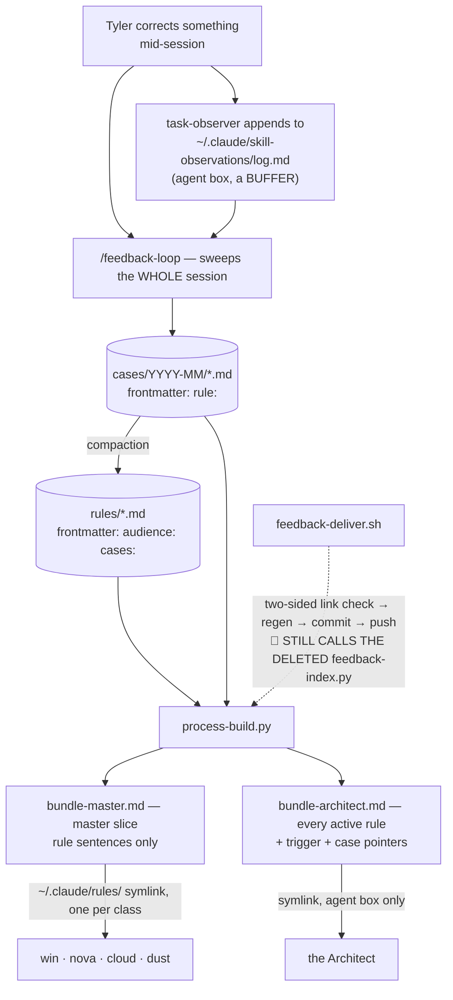

> Mirrored verbatim from `utopia-models/knowledge` `wi/components/feedback-loop.md` by the allowlisted publish pipeline. Edit it there, not here.

```yaml
component: feedback-loop
serves: all
runs-on: knowledge
adrs: []
owns:
  - _process/feedback-corpus.md
  - _process/_generated/bundle-master.md
  - _process/_generated/bundle-architect.md
  - _infra/scripts/process-build.py
  - _infra/scripts/feedback-deliver.sh
  - _infra/tests/feedback-sweep.sh
```

# feedback-loop — a correction given once, loaded where it is about to be repeated

## WHAT IT IS

The corpus that turns Tyler's corrections into behaviour: append-only **cases** (the evidence) compacted
into **rules** (the behaviour), compiled into two generated files that are auto-loaded on every session
in the fleet. Stop it and corrections go back to being write-only — the failure it replaced was 43 files
in a sink declared closed while a skill kept writing to it, plus 91 more scattered across six masters'
private memory dirs where no other master could see them.

## HOW IT WORKS TODAY

**Two tiers, because there are two growth curves.** The read surface attaches to the tier that stops
growing, which is why the corpus can still be loaded whole at thousands of cases.

| | grows | loaded | edited |
|---|---|---|---|
| `cases/<YYYY-MM>/` | ~400/year, forever | **never** | never — append-only evidence |
| `_rules/` | saturates (~40) | via the generated bundles | yes, when compacted |
| `_generated/bundle-master.md` | generated | **every session on every master box** | never by hand |
| `_generated/bundle-architect.md` | generated | **every session on the agent box** | never by hand |



**Two files, because there are two audiences** (#5357). Every rule declares `audience:` — `master`,
`agent` or `all`; absent means `agent`, so an unclassified rule still reaches the Architect and does not
tax four master boxes unread. `bundle-architect.md` carries every active rule with its trigger paragraph and
case pointers. `bundle-master.md` carries the master-facing rule **sentences only**, under a *computed* ceiling:
whatever is left of the master rules-dir budget after the doctrine a master box auto-loads. The
generator **refuses to write** a slice that would breach it, so the budget cannot be exceeded quietly.

🔴 **The symlink polarity is deliberate and load-bearing.** The per-class symlink under
`~/.claude/rules/` is a TRACKED symlink on the agent box and an UNTRACKED one on all four master boxes, and brain-pull is
`git merge --ff-only` — a tracked file landing where an untracked one sits fails silently and stops
every later brain update on that box. So the file four boxes must change is the one that keeps the
path, and only the agent box's symlink is repointed.

**`rule:` on the case and `cases:` on the rule are two halves of one link, and only one is measured.**
The compaction-debt count reads the *case's* `rule:` field, so a rule listing a case that does not name
it back leaves that case counted as unabsorbed forever. `feedback-deliver.sh` refuses to deliver until
both sides agree.

**A case written without YAML frontmatter is invisible to the generator** — the Date/Source/Class prose
line is fine, it just is not frontmatter, and 34 cases in that shape counted as debt no matter what rule
they belonged to.

🔴 **`cases/` is intentionally unbounded and must not be "cleaned up".** Deleting a case is deleting a
fact — the ability to ask *why* a rule exists.

🔴 **No gate enforces compaction, and none should.** A job that polls for compaction debt is polling
wearing a hat. What the counter *alone* bought, measured 2026-08-09: 134 of 145 cases unabsorbed. So
compaction became something a session **does** — three autonomous reviews the same day took it
134 → 124 → 23 — and the byte ceiling remains the backstop that eventually forces the issue by refusing
to generate.

**One corpus is deliberately NOT here:** `wi/work/raw/methods/GENERATION-FEEDBACK.md`, RAW's generation-craft log. Its
lessons are craft applied before one specific act, not behaviour loaded into every session; compacting
them into `bundle-master.md` would tax four masters who never generate anything. Append to it by hand when a render is
rejected, and never cross-post.

## BOUND VALUES

Re-derived from the repo by `docs-cog.sh --check` on every PR.

<!--[[[cog
m.exists("_process/feedback-corpus.md _process/_generated/bundle-master.md _process/_generated/bundle-architect.md _infra/scripts/process-build.py _infra/scripts/feedback-deliver.sh _infra/tests/feedback-sweep.sh")
m.value("30_000", "_infra/scripts/process-build.py", r"\nMASTER_PREFIX_CEILING = (\S+)")
m.calls(".github/workflows/probes.yml", "_infra/scripts/process-build.py")
]]]-->
- ✅ `_process/feedback-corpus.md`
- ✅ `_process/_generated/bundle-master.md`
- ✅ `_process/_generated/bundle-architect.md`
- ✅ `_infra/scripts/process-build.py`
- ✅ `_infra/scripts/feedback-deliver.sh`
- ✅ `_infra/tests/feedback-sweep.sh`
- ✅ `30_000` — still live in `_infra/scripts/process-build.py` (`\nMASTER_PREFIX_CEILING = (\S+)`)
- ✅ `_infra/scripts/process-build.py` — still called by `.github/workflows/probes.yml`
<!--[[[end]]]-->


## DETERMINE CURRENT STATE

| question | command |
|---|---|
| are the generated files current | `python3 _infra/scripts/process-build.py --check` |
| every bundle's size against its budget | `python3 _infra/scripts/process-build.py --check` (its summary lines) |
| how many rules / cases exist right now | `ls _rules/*.md \| wc -l` · `find _rules/cases -name '*.md' \| wc -l` |
| is a correction already logged | `bash _infra/scripts/feedback-deliver.sh --dedup <slug>` |
| does the corpus pass the PR suite | `bash _infra/tests/feedback-sweep.sh` |
| what a master box actually loads | `stat -c '%s %n' _process/_generated/bundle-master.md` and `ls -la ~/.claude/rules/` |

## KNOWN BROKEN

- 🔴 **No rule in the corpus declares `audience: master`, so the master slice is 2 rules out of 30.**
  Measured this session:

  ```
  grep -h '^audience:' _rules/*.md | sort | uniq -c
       27 audience: agent
        2 audience: all
  ```

  (30 files, all of which now declare one.) The two that reach a master box are the two marked `all`.
  The generator's ceiling is a refusal to OVERFLOW, not a floor, so a corpus that has simply never had
  a master-facing rule written looks identical — to `--check`, to `feedback-deliver.sh` and to
  `feedback-sweep.sh` — to one deliberately curated down to two. (The 30,000 B `MASTER_PREFIX_CEILING`
  is bound above; the master bundle is well under it, and 28 of the 30 rules are the reason.)
- 🔴 **`feedback-sweep.sh` still calls `feedback-index.py`, which #7316 deleted, so the PR suite for
  this corpus cannot run.** `process-build.py` replaced the generator; `feedback-deliver.sh` was
  repointed at it in `079a05f12`, and the test harness beside it was not. Measured this session:

  ```
  grep -n 'feedback-index' _infra/scripts/feedback-deliver.sh _infra/tests/feedback-sweep.sh
  _infra/tests/feedback-sweep.sh:25:INDEX="$ROOT/_infra/scripts/feedback-index.py"
  _infra/tests/feedback-sweep.sh:42:  ln -sf "$INDEX"   "$R/_infra/scripts/feedback-index.py"
  _infra/tests/feedback-sweep.sh:79:  python3 "$R/_infra/scripts/feedback-index.py" >/dev/null

  bash _infra/tests/feedback-sweep.sh ; echo EXIT:$?
  ✘ not found: .../_infra/scripts/feedback-index.py
  EXIT:1
  ```

  `feedback-sweep.sh` is a `guard.yml` step, so that red is on every PR — and it is red for a
  missing-file reason, which means it grades NOTHING about the corpus it is named for. Repointing it
  is not a rename: `process-build.py` has a different CLI and writes six bundles (five classes + the peaky agent bundle) rather than two
  files, and the harness symlinks the generator into a synthetic tree.
- ⚠ **Both CI checks are ADVISORY, and `guard.yml` says so in its own comment** — *"it reports, it
  does not gate"*. `guard.yml` runs `_infra/tests/feedback-sweep.sh` and
  `python3 _infra/scripts/process-build.py --check` on every PR, but branch protection is unavailable
  on this plan tier, so a red drift check stops nothing. It is information; read it.
- ⚠ **The upstream buffer is agent-box-only and unreadable from here.**
  `~/.claude/skill-observations/log.md` and the `task-observer` skill live in the Architect's home
  (`/home/architect` on novaserver). From a master box
  there is no way to tell an empty buffer from an absent one, so "no corrections logged" and "capture
  is not running" look the same. The probe is `sudo -n ls -la /home/architect/.claude/skill-observations/` from `nova`.
