> Mirrored verbatim from `utopia-models/knowledge` `wi/components/fleet-health-automation.md` by the allowlisted publish pipeline. Edit it there, not here.

```yaml
component: fleet-health-automation
serves: all
runs-on: novaserver
adrs: [3562]
owns:
  - _infra/scripts/fleet-notify.sh
  - _infra/systemd/fleet-notify@.service
  - _infra/systemd/dropin/50-onfailure.conf
  - fleet-notify@.service
  - disk-guard.service
  - fleet-heal-critical.service
  - sudo-health.service
  - token-health.service
  - nova-ops-integrity.service
  - automerge-reenable-watchdog.service
  - dmv-revenue-integrity.service
```

# fleet-health-automation — the box's own self-heal and alarm layer

## WHAT IT IS

The set of timers that watch **the fleet's own operating conditions** — disk, sudo, tokens, critical
services, the ops tree, auto-merge, DMV's revenue integrity — plus the one notifier every
one of them alarms through. It is a *layer*, not a service: no single unit named
`fleet-health-automation` exists, which is precisely why it had no component row until this doc.

Stop it and the box keeps working right up until it doesn't. The failure it exists against is silent
degradation on shared infrastructure: a disk creeping to 100%, a token that expired, a critical service
that died between dispatches.

## HOW IT WORKS TODAY

**Every alarm in the fleet takes one path: unit fails → `OnFailure=` → `fleet-notify` → ONE board
issue.** That is the whole design. A health timer does not talk to the board itself; it exits non-zero
and lets systemd do the routing. When the unit's issue is already open and a line-start ⛔ sits after
its last line-start `UNBLOCK`, `fleet-notify` writes a journal line instead of another alert comment —
the sweeper reads only `comments(last:25)`, and repeat alerts would scroll the ⛔ out of that window and
get the issue re-dispatched with nothing changed (#10020). It fails open: an unreadable comment list
means the alert goes out.

```mermaid
flowchart LR
    subgraph timers["--user timers on nova (disk-guard · fleet-heal-critical · nova-ops-integrity) and svc-ops (the rest), each a oneshot — read the cadences from list-timers, never from here"]
        DG["disk-guard"]
        FHC["fleet-heal-critical"]
        SH["sudo-health"]
        TH["token-health --auto"]
        NOI["nova-ops-integrity"]
        AMW["automerge-reenable-watchdog"]
        DRI["dmv-revenue-integrity"]
    end
    timers -->|"exit != 0"| DI["service.d/50-onfailure.conf<br/>OnFailure=fleet-notify@%N.service"]
    DI --> FN["_infra/scripts/fleet-notify.sh &lt;unit&gt;<br/>ALWAYS exits 0 — a failing notifier<br/>would trigger its own OnFailure"]
    FN --> B["ONE board issue per unit, upserted"]
    FN -.->|"task-&lt;issue&gt;-&lt;epoch&gt; unit"| X["EXEMPT (#3805) — task-runner.sh<br/>already posts a terminal on the work issue"]
    style FN fill:#9cf,stroke:#09c,stroke-width:3px
    style B fill:#ffd,stroke:#cc0
```



**ENROLMENT is the thing to check, not liveness.** `OnFailure=` is not on the units; it comes from
`~/.config/systemd/user/service.d/50-onfailure.conf`, a *top-level* drop-in applied to every user
service on that account. A box without it fails silently — `win` and `dmv` were never enrolled and
their units failed unnoticed for weeks (#5821). Measured 2026-08-31: nova · win · cloud · dust all
enrolled.

**Two consequences of that drop-in are easy to trip over.** It applies to *your probe unit too*, so a
per-unit `[Unit] OnFailure=` reset does not disarm the production notifier — the top-level drop-in is
applied afterwards and re-adds itself. And `RestartMode=direct` suppresses `OnFailure=` entirely;
plain `Restart=` does not.

**The scripts are not in this repo** — `~/.claude/ops/{disk-guard,nova-ops-integrity}.sh` in `brain-nova`
for the nova half, and copies under svc-ops' `~/.claude/ops/{sudo-health,dmv-revenue-integrity}.sh` and
`~/.claude/scripts/{token-health,automerge-reenable-watchdog}.sh` for the svc-ops half (knowledge#9201), with `fleet-heal-critical` wrapping
`fleet-ctl.sh start-critical` through `runjob.sh`. Only the notifier half is committed here. So this
doc states no thresholds and no cadences: read them from the unit.

**`disk-guard` is the one with published measurements**, and they are measurements rather than caution
— `_diag` retention is 7 days because 3 d reclaims 8.97 GB against 7 d's 8.25 GB, i.e. four extra days
of CI post-mortem cost 0.72 GB; `_work` is only reclaimed at 90% because a wipe forces every repo to
re-clone. It alarms only when it *cannot* get below its ceiling, latched by a state file that a
recovery clears.

## BOUND VALUES

The notifier and the enrolment drop-in are in-git and bound below. Every *health check* this layer runs
is a `brain-nova` file that cannot be bound from here — an absolute out-of-repo path is refused by
`cog_machinery` on purpose, because it stats differently per account on a `0750` home. Those are
covered by the `units:` binding instead, which `verify-unit-execstart.py` executes daily on the box.

<!--[[[cog
m.exists("_infra/scripts/fleet-notify.sh _infra/systemd/fleet-notify@.service _infra/systemd/dropin/50-onfailure.conf")
m.units("fleet-notify")
m.units("disk-guard")
]]]-->
- ✅ `_infra/scripts/fleet-notify.sh`
- ✅ `_infra/systemd/fleet-notify@.service`
- ✅ `_infra/systemd/dropin/50-onfailure.conf`
- ⚙️ `user@nova:fleet-notify@probe.service` — ExecStart target proven daily by `verify-unit-execstart.py` (#4742)
- ⚙️ `user@nova:disk-guard.service` — ExecStart target proven daily by `verify-unit-execstart.py` (#4742)
<!--[[[end]]]-->

## DETERMINE CURRENT STATE

The population and its schedules, then one unit's own config:

```
systemctl --user list-timers --all --no-legend --no-pager    # as nova on novaserver
sudo -n -u svc-ops XDG_RUNTIME_DIR=/run/user/$(id -u svc-ops) systemctl --user list-timers --all --no-legend --no-pager
ssh nova@100.71.25.43 "systemctl --user cat disk-guard.service disk-guard.timer"
ssh nova@100.71.25.43 "cat ~/.claude/state/disk-guard.state; tail -5 ~/.claude/logs/disk-guard.log"
for u in nova svc-ops win cloud dust; do ssh nova@100.71.25.43 \
  "sudo -n -u $u test -f /home/$u/.config/systemd/user/service.d/50-onfailure.conf && echo $u enrolled"; done
```

## KNOWN BROKEN

- 🔴 **Only 2 of this layer's 8 timers carry a `units:` binding in the registry** — `fleet-notify` and
  `disk-guard`. `fleet-heal-critical`, `sudo-health`, `token-health`, `nova-ops-integrity`,
  `automerge-reenable-watchdog` and `dmv-revenue-integrity` have no
  `components.yaml` row at all, so nothing proves their `ExecStart` targets still exist. That is
  exactly the gap `verify-unit-execstart.py` was written to close and the shape of the
  `reap-orphan-claude` failure — a timer firing for 24 days against a deleted script.
- 🔴 **This layer's alarm cannot report a fault in the box it lives on.** Every timer here is a
  `--user` unit on novaserver and every alarm path ends at a board issue filed *from* novaserver, so a
  partitioned or dead box produces silence, not an alert. The off-box half is a different component
  (`novaserver-heartbeat`, a GitHub-*hosted* runner driven by a Cloudflare Worker) and it is the only
  thing that can see this box go dark.
- ⚠ **`fleet-notify` always exits 0 by design**, so a notifier that fails to file leaves no unit-level
  trace either — the failure is invisible on both sides. The task-unit exemption (`task-<n>-<epoch>`)
  widens that: those units never file, correctly, but the same silence covers a genuine notifier bug.
- ⚠ **The volume runs close to the reclaim threshold, and on 2026-09-08 it crossed it (#7628).**
  `df -h /` reached **95%** (17 G free); `disk-guard` alarmed correctly — CRIT, `exit 1`, board issue.
  It was right about the emergency and wrong about where the space was: its per-agent cache list held
  **830 MB** across all four master homes while **19.6 GB of the identical class** sat beside it in
  `~/.npm/_cacache` (15,259 MB) and `~/.bun/install/cache` (~4,300 MB) — package-manager download
  caches, invisible only because they do not live under `~/.cache/`. It also still typed its home list
  as `nova win cloud dmv`, so the renamed `dust` had been skipped in silence since the rename.
  Both fixed (targets added, homes discovered from `/home/*`); the first run after the fix freed
  **7,118 MB**. 🔴 The reading to take from this is not the percentage — it is that **a sweep's target
  list and its subject list are each a claim about the world, and neither announces itself when it
  goes stale.** The guard logged truthful percentages the entire time. Full account and the
  verification: `wi/work/reference/win/disk-guard.md`, *"The list was the mechanism"*.
