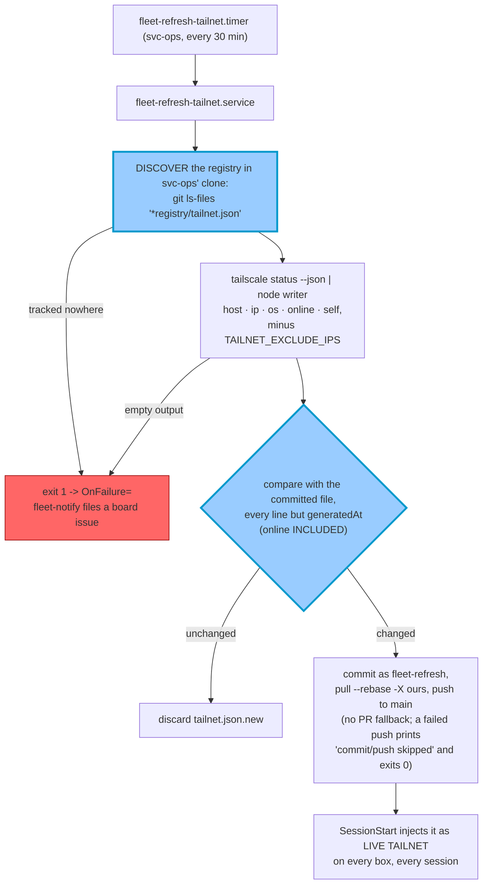

> Mirrored verbatim from `utopia-models/knowledge` `wi/components/fleet-refresh-tailnet.md` by the allowlisted publish pipeline. Edit it there, not here.

```yaml
component: fleet-refresh-tailnet
serves: all
runs-on: novaserver, unix user `svc-ops` (a `systemd --user` oneshot; `nova` ran the brain copy until knowledge#9201)
adrs: []
owns:
  - _infra/scripts/fleet-refresh-tailnet.sh
  - _infra/systemd/fleet-refresh-tailnet.service
  - _infra/systemd/fleet-refresh-tailnet.timer
  - wi/registry/tailnet.json
  - fleet-refresh-tailnet.service
  - fleet-refresh-tailnet.timer
```

# fleet-refresh-tailnet — the discovered tailnet roster

## WHAT IT IS

A oneshot that regenerates `wi/registry/tailnet.json` from live
`tailscale status --json` and pushes it to `main` when the **topology** changes. The file is a
DISCOVERED fact and is never hand-edited: `organization.yaml` says who the fleet is, this says which
machines are actually on the wire.

Stop it and the roster freezes at whatever it last saw — which has happened, for 17 days, while every
session kept reading it as current.

## HOW IT WORKS TODAY

🔴 **The unit runs the REPO copy** (`%h/dev/utopia-models/knowledge/_infra/scripts/fleet-refresh-tailnet.sh`
on svc-ops' account, every 30 minutes by `OnCalendar=*:0/30`; read it with
`sudo -n -u svc-ops XDG_RUNTIME_DIR=/run/user/$(id -u svc-ops) systemctl --user cat fleet-refresh-tailnet.service`).
Everything in this section describes that copy, read from the repo on 2026-10-31.



**The comparison includes `online`, so a device flapping online/offline commits a snapshot.** That is the
churn #1609 removed from the brain copy (see Previous design and KNOWN BROKEN).

**The registry path is DISCOVERED FROM GIT, never written down, because a candidate list broke it
TWICE.** #3732's fix was *"keep the historical candidates as fallbacks"*, which is a list of the renames
that had **already** happened; on 2026-08-31 `cdfea10e8` (#7316) moved
`world-infrastructure/fleet/registry` to `wi/registry` and **all three candidates died in one commit**
(#7359). The script resolves `git ls-files --full-name -- '*registry/tailnet.json'` (falling back to
`*tailnet.json`, then `git ls-tree -r origin/main`) and exits 1 if the file is tracked nowhere, so the
next rename costs nothing.

**It pushes straight to `main`.** It commits into svc-ops' own clone, then `pull --rebase -X ours` before
pushing. There is no `reset --hard` and no PR fallback. Work in a worktree, never in a clone a timer
writes to.

### Previous design: the `brain-nova` copy

Until knowledge#9201 the unit ran `/home/nova/.claude/scripts/fleet-refresh-tailnet.sh` as `nova`. That
copy (still on disk, not run) differs in four ways:

- it ran `git fetch` + `reset --hard origin/main` on nova's shared knowledge clone before regenerating,
  and resolved the registry path after that sync;
- it used a python writer and a **topology signature** that strips `online`, re-sorts by host and ignores
  `generatedAt`, so a flap committed nothing and a device joining or leaving always did (#1609). With
  `online` in the comparison, ~26 of 400 corpus commits (6.5%) had been pure liveness churn;
- every non-success path exited non-zero and reported python's actual stderr (#3732). Before that, the
  registry directory had been renamed out from under the script, `json.dump` raised `FileNotFoundError`
  on **every run for 17 days**, and the snapshot silently stayed frozen;
- when a push to `main` was rejected it fell back to `push-artifact-via-pr.sh` (see FIXED, #9409).

## BOUND VALUES

The repo's copy of the script, both unit files and the snapshot are bound below. The `units:` list is
empty on purpose — this component has no `components.yaml` row, so there is nothing for
`verify-unit-execstart.py` to pick up. That is the first finding below, not an omission here.

<!--[[[cog
m.exists("_infra/scripts/fleet-refresh-tailnet.sh _infra/systemd/fleet-refresh-tailnet.service _infra/systemd/fleet-refresh-tailnet.timer wi/registry/tailnet.json")
m.calls("_infra/scripts/fleet-refresh-tailnet.sh", "TAILNET_EXCLUDE_IPS", "tailnet.json", "*registry/tailnet.json")
m.value("100.125.68.66", "_infra/scripts/fleet-refresh-tailnet.sh", r'\nTAILNET_EXCLUDE_IPS="([^"]+)"')
]]]-->
- ✅ `_infra/scripts/fleet-refresh-tailnet.sh`
- ✅ `_infra/systemd/fleet-refresh-tailnet.service`
- ✅ `_infra/systemd/fleet-refresh-tailnet.timer`
- ✅ `wi/registry/tailnet.json`
- ✅ `TAILNET_EXCLUDE_IPS` — still called by `_infra/scripts/fleet-refresh-tailnet.sh`
- ✅ `tailnet.json` — still called by `_infra/scripts/fleet-refresh-tailnet.sh`
- ✅ `*registry/tailnet.json` — still called by `_infra/scripts/fleet-refresh-tailnet.sh`
- ✅ `100.125.68.66` — still live in `_infra/scripts/fleet-refresh-tailnet.sh` (`\nTAILNET_EXCLUDE_IPS="([^"]+)"`)
<!--[[[end]]]-->

## DETERMINE CURRENT STATE

The timer, what the unit actually runs, and how fresh the snapshot is:

```
# as nova on novaserver (svc-ops' home is 0750)
sudo -n -u svc-ops XDG_RUNTIME_DIR=/run/user/$(id -u svc-ops) systemctl --user list-timers fleet-refresh-tailnet.timer --all --no-legend
sudo -n -u svc-ops XDG_RUNTIME_DIR=/run/user/$(id -u svc-ops) systemctl --user cat fleet-refresh-tailnet.service fleet-refresh-tailnet.timer
sudo -n -u svc-ops XDG_RUNTIME_DIR=/run/user/$(id -u svc-ops) journalctl --user -u fleet-refresh-tailnet -n 5 -o cat
python3 -c "import json;d=json.load(open('wi/registry/tailnet.json'));print(d['generatedAt'],len(d['devices']))"
bash _infra/scripts/mechanism-liveness.sh fleet-refresh-tailnet.sh
```

🔴 **A stale `generatedAt` is NOT evidence of a stopped timer.** The file is only committed when the
topology changes, so a timestamp hours or days old is the healthy no-change case. The journal is the
liveness signal (the repo copy writes no log file); the file is not.

## KNOWN BROKEN

- 🔴 **The copy that runs is the one WITHOUT the de-churn.** The unit moved to svc-ops (knowledge#9201)
  with the committed `ExecStart=%h/dev/utopia-models/knowledge/_infra/scripts/fleet-refresh-tailnet.sh`,
  so the `brain-nova` copy (2026-08-31: `ExecStart=/home/nova/.claude/scripts/fleet-refresh-tailnet.sh`,
  `OnUnitActiveSec=20min`) no longer runs. The repo copy compares everything but `generatedAt`, `online`
  included, so a device flapping online/offline commits a snapshot — the churn #1609 removed. Read
  the live unit with the probe above before trusting either description.
- 🔴 **The two copies have diverged in both directions**, which is why neither is simply "the newer
  one": the `brain-nova` copy has the 17-day-freeze repair (#3732), the topology-signature de-churn
  (#1609), the sync-before-regenerate step (#1246) and a python writer; the repo copy has a
  node writer and a `changed`-flag comparison that still includes the volatile `online` field, so it
  would reintroduce the churn #1609 removed. A repoint that ignores this loses whichever set it drops.
  As of #7359 **both** carry the git-discovered registry path and `TAILNET_EXCLUDE_IPS`, so that axis
  of the divergence is closed.
- ⚠ **`mechanism-liveness.sh fleet-refresh-tailnet.sh` reads ON-DISK only on nova**, and reports the
  `WIRED-IN` column as `plugin→sessionstart-fleet-roster.sh` for all six boxes. That is the *consumer*,
  not the producer — every box reads the roster, one box writes it.

## FIXED

- ✅ **#6244's exclusion now takes effect.** It had been implemented only in the repo copy, which is
  not the copy the unit runs, so `tailnet.json` on `main` still listed
  `"host": "MacBook Pro", "ip": "100.125.68.66"` and every SessionStart on every box injected it.
  #7359 carried `TAILNET_EXCLUDE_IPS` into the `brain-nova` copy; `16afd50b7`
  (`chore(tailnet): refresh snapshot (5 devices) [auto]`, 2026-08-31T14:31Z) is the first snapshot
  without it.
- ✅ **The orphaned fallback PR is gone (#9409).** On 2026-09-17 the `brain-nova` copy's push to main
  was rejected, so it fell back to `push-artifact-via-pr.sh` and opened a `claude/tailnet-auto` PR
  (knowledge#7886). Nothing ever closes that PR once a later direct push replaces it, so it sat open for 33
  days and kept `stuck-pr-sweep.yml` red. It was closed unmerged and its branch deleted, because merging it
  would have rolled `tailnet.json` back. Today's writer is the repo copy, run by svc-ops (`occ` group),
  and it has no PR fallback. To find its commits, run
  `git log -3 --format='%h %an %s' origin/main -- wi/registry/tailnet.json`; they appear as author
  `fleet-refresh`. If a `claude/tailnet-auto` PR appears again, the brain copy is running again.
