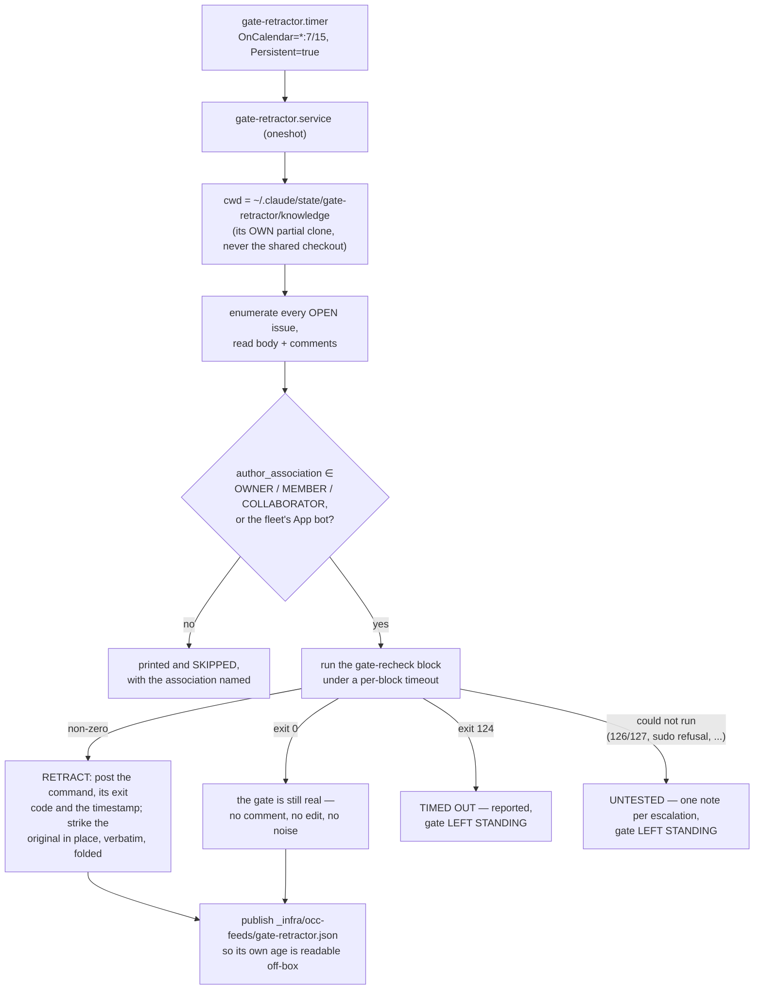

> Mirrored verbatim from `utopia-models/knowledge` `wi/components/gate-retractor.md` by the allowlisted publish pipeline. Edit it there, not here.

```yaml
component: gate-retractor
serves: all
runs-on: novaserver, unix user `svc-ops` (a `systemd --user` timer)
adrs: []
owns:
  - _infra/scripts/gate-retractor.sh
  - _infra/scripts/escalation-check.sh
  - _infra/systemd/gate-retractor.service
  - _infra/systemd/gate-retractor.timer
  - gate-retractor.service
  - gate-retractor.timer
```

# gate-retractor — the thing that stops a resolved gate from still asking for Tyler

## WHAT IT IS

An **expiry mechanism for escalations**. Every escalation written on this board must carry a
```` ```gate-recheck ```` block: a shell command whose exit status IS the gate (`0` = the gate is
still real). This component runs every one of those blocks on a cycle and retracts the escalations
whose condition has cleared.

Its write-time companion is `escalation-check.sh`, a PreToolUse deny that refuses an escalation
carrying no `gate-recheck`, no `gate-reason`, no `origin:`, or an `origin: dispatch` that quotes none
of `identity-and-scope.md`'s three human-only items. **The two halves are one mechanism:** the check
guarantees every gate is machine-readable, which is what makes re-deriving them possible at all.

The decision that shaped it — that the escalation's ORIGIN, not its content, decides the default
answer — is recorded at `wi/work/specs/7017-escalation-expiry/decisions/`, not as an
org-level ADR; hence the empty `adrs:` above.

## HOW IT WORKS TODAY



Four properties that are easy to get wrong, each defended in the script rather than assumed:

- **It never closes an issue.** Whether the WORK is done is a different question from whether a HUMAN
  is still needed, and conflating them is how #5297 was closed 21 seconds before its own run said the
  acceptance was unmet. A retracted escalation leaves its issue open for whoever grades the rest.
- **Timeout is not evidence.** Exit `124` leaves the gate standing and says so. Blindness never
  retracts.
- **A recheck that could not run is UNTESTED, not cleared (#10684).** Exit `126`/`127`, or output
  carrying a sudo refusal, `Permission denied`, `No such file or directory` or `command not found`, is
  checked before the exit-0 branch: the gate is left standing and ONE note is posted on the issue
  (keyed by a marker on the container id). A sudo refusal exits 1, which used to read as "cleared"
  (#10591). A recheck must therefore run as `svc-ops` and stay silent on its clearing path; the heartbeat
  carries an `untested` count.
- **It runs text written on the board, by construction.** The bounds are authorship (org
  OWNER/MEMBER/COLLABORATOR or the App bot) and a per-block `timeout`. There is deliberately no
  sandbox beyond that. `author_association` is not a permission check: MEMBER or COLLABORATOR would also
  admit a read- or triage-only account. Measured 2026-10-31, none exists: the org's
  `default_repository_permission` is `write` and all 8 collaborators on this repo hold `write` or `admin`
  (`gh api repos/utopia-models/knowledge/collaborators --jq '.[].role_name'`), so every admitted author
  can already push code to the repo the retractor would be defending. Granting anyone read or triage
  only would break that, and the script would not notice.

**The clone is the subtle part.** `ExecStart` points at `%h/.claude/state/gate-retractor/knowledge`,
a `--filter=blob:none` partial clone this component owns — never `~/dev/utopia-models/knowledge`,
which is shared with every dispatch on the box and was measured on 2026-08-28 sitting on a peer's
branch where this script does not exist at all (#3432). The clone is fetched and fast-forwarded at
the END of a pass, so the code never changes underneath a running one.

**Grade its own liveness:** `bash _infra/scripts/gate-retractor.sh --liveness`, or read
`_infra/occ-feeds/gate-retractor.json`, which carries its own age.

## BOUND VALUES

<!--[[[cog
m.exists("_infra/scripts/gate-retractor.sh _infra/scripts/escalation-check.sh _infra/systemd/gate-retractor.service _infra/systemd/gate-retractor.timer")
m.units("gate-retractor")
m.value("*:7/15", "_infra/systemd/gate-retractor.timer", r"OnCalendar=(\S+)")
m.value("120", "_infra/scripts/gate-retractor.sh", r"RECHECK_TIMEOUT:-(\d+)")
m.value("900", "_infra/systemd/gate-retractor.service", r"TimeoutStartSec=(\d+)")
]]]-->
- ✅ `_infra/scripts/gate-retractor.sh`
- ✅ `_infra/scripts/escalation-check.sh`
- ✅ `_infra/systemd/gate-retractor.service`
- ✅ `_infra/systemd/gate-retractor.timer`
- ⚙️ `user@svc-ops:gate-retractor.service` — ExecStart target proven daily by `verify-unit-execstart.py` (#4742)
- ✅ `*:7/15` — still live in `_infra/systemd/gate-retractor.timer` (`OnCalendar=(\S+)`)
- ✅ `120` — still live in `_infra/scripts/gate-retractor.sh` (`RECHECK_TIMEOUT:-(\d+)`)
- ✅ `900` — still live in `_infra/systemd/gate-retractor.service` (`TimeoutStartSec=(\d+)`)
<!--[[[end]]]-->

## DETERMINE CURRENT STATE

```
bash _infra/scripts/gate-retractor.sh --liveness
```

Exit `0` = the published heartbeat is fresh · `3` = stale · `1` = the pass could not run. It reads
`_infra/occ-feeds/gate-retractor.json` **from origin/main**, so it answers off-box and from any
account — which is the point: `svc-ops`' home is 0750 and `systemctl --user` there needs `sudo -n -u
svc-ops` from `nova`.

## KNOWN BROKEN

- ⚠ **The unit files in this repo are the artifact of record, not the running copy.** They are
  installed under `svc-ops`' `~/.config/systemd/user/`; nothing compares the two. `m.units()` above
  proves only that the registry still binds this component into the daily `verify-unit-execstart.py`
  sweep — which proves the ExecStart TARGET exists on the box, not that the timer's calendar on the
  box matches `_infra/systemd/gate-retractor.timer`. Read the live one:
  `sudo -n -u svc-ops XDG_RUNTIME_DIR=/run/user/$(id -u svc-ops) systemctl --user cat gate-retractor.timer`,
  run as `nova` (svc-ops' home is 0750).
- ⚠ **A retraction is not a resolution.** The retractor answers only "is a human still needed?" — an
  issue whose escalation it struck can still be wrong about everything else. Nothing here grades the
  work.
