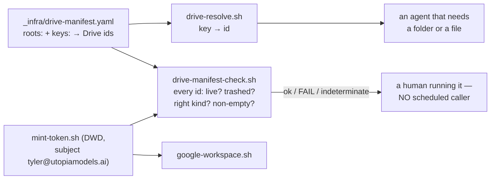

> Mirrored verbatim from `utopia-models/knowledge` `wi/components/google-drive.md` by the allowlisted publish pipeline. Edit it there, not here.

```yaml
component: google-drive
serves: all
runs-on: Google Workspace under `tyler@utopiamodels.ai`, reached with a domain-wide-delegated token
adrs: [4931]
owns:
  - _infra/drive-manifest.yaml
  - _infra/scripts/drive-manifest-check.sh
  - _infra/scripts/drive-resolve.sh
```

# google-drive — where a BODY of media lives, bound to git by id and never by path

## WHAT IT IS

The org's media store. Drive holds the *bodies* — multi-GB video, generated render batches, shoot
dumps, anything an agent produces by the hundred. Git holds text plus the single files a document
cannot be read without. The link between them is `_infra/drive-manifest.yaml`: **logical key → Drive
file id**, and nothing else.

🔴 **The rule that matters is: never mirror a Drive folder into git.** A mirror always drifts, and
it drifted every time it was tried — `Utopia_Creative→design→raw`, a `02_bts-cactus-jack` deleted in
Drive and kept in git, real files living as loose ids the mirrored folders never contained. One
binding, by id, because an id survives a rename and a path does not.

## HOW IT WORKS TODAY



**Resolve, never hardcode.** An agent that needs a Drive location asks the manifest for it:

```bash
bash _infra/scripts/drive-resolve.sh <key>          # key → id
python3 -c "import yaml;d=yaml.safe_load(open('_infra/drive-manifest.yaml'));print(len(d['roots']),'roots',len(d['keys']),'keys')"
```

A file that exists in Drive but not in the manifest is effectively invisible to every master — so a
new binding goes in the same commit as the document that references it, or the reference dangles.

**The gate, and what it can and cannot see.** `drive-manifest-check.sh` walks every id the manifest
declares, roots included, and asks four questions: does it resolve at all · is it trashed · does its
kind match the manifest · and for `must_have_content: true`, does it hold at least one non-trashed
child. It separates **BROKEN** from **COULD-NOT-CHECK** deliberately: no token, a 401, a 429 or a
5xx is *indeterminate* and names no key as dead, because a gate that reports a dead folder when it
merely failed to authenticate sends the next agent hunting a folder that was there the whole time.

**Access is granted, so a failure here is a tooling bug and never an escalation.** Full Workspace
admin is available: mint a scoped token with `bash ~/.claude/scripts/mint-token.sh "<scope-url>"`
(subject `tyler@utopiamodels.ai`) and drive operations through `google-workspace.sh`. Per
`doctrine/credentials.md`, *"I don't have access"* to Workspace is a forbidden conclusion.

**The git↔Drive boundary is a written rule, not a check.** The `no-binaries` CI job was removed on
2026-08-06 (#4638) because it enforced a convention with a red X. The rule now lives in the repo root
`CLAUDE.md` under "Repo rules": single files under ~10 MB that change when the document changes go in
git, beside the document that cites them; bodies of media go in Drive, referenced by manifest key.
Judgement call → commit it, because a file in the wrong place is one `git rm` away and a file nobody
can find is a document that cannot be read.

## BOUND VALUES

<!--[[[cog
m.exists("_infra/drive-manifest.yaml _infra/scripts/drive-manifest-check.sh _infra/scripts/drive-resolve.sh")
m.calls("_infra/scripts/drive-manifest-check.sh", "drive-manifest.yaml")
]]]-->
- ✅ `_infra/drive-manifest.yaml`
- ✅ `_infra/scripts/drive-manifest-check.sh`
- ✅ `_infra/scripts/drive-resolve.sh`
- ✅ `drive-manifest.yaml` — still called by `_infra/scripts/drive-manifest-check.sh`
<!--[[[end]]]-->

The id counts, the folder names and what is trashed are all off-git and change without a commit, so
this doc states the two commands that read them and no number.

## DETERMINE CURRENT STATE

```bash
bash _infra/scripts/drive-resolve.sh <key>            # key → id
DTOK=$(bash ~/.claude/scripts/google-workspace.sh token) bash _infra/scripts/drive-manifest-check.sh
bash _infra/scripts/test-drive-manifest-check.sh      # does it still fail closed, for the right reason
```

🔴 **Read the gate's exit code, not just its output.** `0` every id live · `1` a real disagreement
with Drive · `2` INDETERMINATE (no token, or an API error) — nothing known broken and nothing proven
either. Treating a `2` as a pass is how a dead id survives a check that ran.


## KNOWN BROKEN

- 🔴 **The `creatives` root is TRASHED in Drive, and the manifest still points at it.** Measured
  2026-08-31: `DTOK=... bash _infra/scripts/drive-manifest-check.sh` →
  `FAIL root creatives (1Lr6ReB5r3PlndvazzuKNDM4La8oIo0f_) 'creatives' — TRASHED. Restore it in
  Drive, or repoint the key.` · `── 28 ok · 1 fail · 0 indeterminate (of 29) ──`. Every other id in
  the manifest resolves live.
- 🔴 **The "fail-closed gate" is wired to nothing.** `drive-manifest.yaml`'s own header says a
  deleted folder *"is caught by the FAIL-CLOSED gate (drive-manifest-check.sh), not silently
  hallucinated by an agent"* and *"THE RULES (enforced by drive-manifest-check.sh)"*. No workflow in
  `.github/workflows/`, no systemd unit on nova, and no hook on any master calls it — a repo-wide
  grep finds only the script itself, its own test, `verify-no-token-in-argv.sh`'s inventory and
  prose. It runs when a human types it, which is how the trashed root above sat unreported. This is
  the #4742 pattern exactly: **a check that exists but is not wired is documentation, and
  documentation does not run.**
- ⚠ **The old reference doc states a size that has since doubled** — *"a manifest tracked at
  `_infra/drive-manifest.yaml` (102 lines, verified 2026-08-03)"*. `wc -l` on 2026-08-31 → 210. A
  line count is exactly the kind of fact that should never have been written down; this doc replaces
  it with the `roots`/`keys` count command above.
