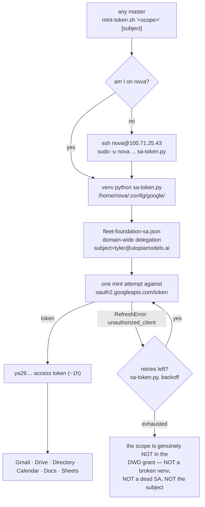

> Mirrored verbatim from `utopia-models/knowledge` `wi/components/google-workspace.md` by the allowlisted publish pipeline. Edit it there, not here.

```yaml
component: google-workspace
serves: all
runs-on: novaserver
adrs: []
owns:
  - wi/work/reference/UTOPIA-ORG-MAP.md
```

# google-workspace — one delegated service account, impersonating Tyler, for the whole fleet

## WHAT IT IS

The fleet's Google **capability layer**: a `fleet-foundation` service account with **domain-wide
delegation** over `utopiamodels.ai`, which mints an access token impersonating
`tyler@utopiamodels.ai` for any scope the Workspace admin console has already granted it.

The consequence is the one worth remembering: **no agent holds a Google credential.** There is nothing to
rotate per master, nothing to leak per box, and — per `doctrine/credentials.md` — no legitimate reason for
a run to ask Tyler for Google access.

It is distinct from `google-drive`, which is a **state store** (where a body of media lives, bound by
`_infra/drive-manifest.yaml`). This row is the **access**: the SA, the delegation, the scopes, and what
happens when a scope was never granted.

## HOW IT WORKS TODAY



**Two entry points, one mechanism.** `mint-token.sh "<scope>" [subject]` returns a raw token;
`google-workspace.sh` wraps the common verbs (`token`, `gmail-search`, `gmail-send`, `drive-list`,
`drive-download`, `drive-share`, `drive-upload`, `drive-mkdir`). Both live in each brain repo, and both
resolve to the same SA on nova — which is why `owns:` here names only the address book, not the
scripts.

🔴 **The token never reaches an argv.** Every authenticated call goes through `gcurl`, which hands the
token to `curl --config -` on **STDIN**. `/proc/<pid>/cmdline` is world-readable on this five-user box
while `/proc/<pid>/environ` is not, and this file was the single heaviest leak in that class — eleven
lines each putting a Workspace **admin** token on a command line (#6160).

🔴 **The mint IS the scope check — but ONE `unauthorized_client` is not.** There is no list of granted
scopes to consult, and a stale list would be worse than none. Ask for the scope: a token back means it is
granted, and the error is about the **grant**, never about the venv or the subject. Scopes are granted
individually, so a read-only variant is a *different* grant from its read-write parent.

🔴 **Google answers a GRANTED scope with `unauthorized_client` sometimes, and the two errors are
byte-identical** (#7383). So a single failed mint is NOT proof the scope is ungranted — that inference
needs the retries exhausted. `sa-token.py` retries with backoff for exactly this reason and prints, on
stderr, whether a recovery happened (*"succeeded on attempt N — the earlier failure was TRANSIENT"*) or
whether the retries ran out (*"after this many retries `unauthorized_client` means the scope is genuinely
NOT in the DWD grant"*). **Read that stderr line before concluding anything about the delegation.**

Nothing here states which scopes are granted, on purpose: the grant is Workspace-console state, it changes
without a commit, and a doc listing it rots the first time an admin edits the delegation.

## BOUND VALUES

<!--[[[cog
m.exists("wi/work/reference/UTOPIA-ORG-MAP.md")
m.units("google-workspace")
]]]-->
- ✅ `wi/work/reference/UTOPIA-ORG-MAP.md`
- 🔴 `google-workspace` — **no such row** in `wi/registry/components.yaml`
<!--[[[end]]]-->

The SA key and the venv are under `/home/nova/.config/google/`, off-repo and unreadable to other masters
(`0750` homes), so they are bound by the probe below and by nothing else. **The minter is no longer among
them:** `sa-token.py` at that path is a symlink to `scripts/sa-token.py` in `brain-nova`, tracked since
#7383 — a cross-repo file `cog` cannot bind, so the probe below is what grades it.

## DETERMINE CURRENT STATE

🔴 The mint IS the scope check — a token back means granted. **A failure means "not granted" only once
the retries are exhausted**, so keep stderr and read it:

```bash
# end-to-end health (mints an admin-scoped token and lists a user)
bash ~/.claude/scripts/google-cred-healthcheck.sh
# does the fleet hold a given scope? — the mint is the answer. 2>&1 is not optional: the retry verdict
# ("succeeded on attempt N ... TRANSIENT" vs "all N attempts failed") is on stderr.
bash ~/.claude/scripts/mint-token.sh "https://www.googleapis.com/auth/drive" 2>&1 | head -c 200
# exercise it
T=$(bash ~/.claude/scripts/mint-token.sh "https://www.googleapis.com/auth/drive")
curl -s -o /dev/null -w '%{http_code}\n' "https://www.googleapis.com/drive/v3/about?fields=user" \
  -H "Authorization: Bearer $T"
# how many attempts does the live minter make, and with what backoff? (the number is in the code,
# not in this doc — brain-nova is a different repo and cog cannot bind across it)
ssh nova@100.71.25.43 'grep -n "^BACKOFF" /home/nova/.config/google/sa-token.py'
```

## KNOWN BROKEN

- 🔴 **"All scopes granted" is false, and the fleet says it in the always-loaded prefix.**
  `doctrine/credentials.md` reads *"GOOGLE WORKSPACE (full admin — all scopes granted, never ask)"*.
  Measured this session:
  `bash ~/.claude/scripts/mint-token.sh "https://www.googleapis.com/auth/admin.directory.user.readonly"`
  → `google.auth.exceptions.RefreshError: ('unauthorized_client: Client is unauthorized to retrieve access
  tokens using this method, or client not authorized for any of the scopes requested.')`, while the
  read-**write** `https://www.googleapis.com/auth/admin.directory.user` mints a `ya29.` token in the same
  breath. The delegation is a scope list, not a blanket, and the `.readonly` variants are not on it — so a
  run that reaches for the safer scope fails and can read the failure as "no Google access at all".
- 🔴 **`unauthorized_client` is BOTH the ungranted-scope error and a transient Google flake, and they are
  byte-identical** (#7383). Measured on novaserver 2026-08-31: `inbox-agent.service` mints
  `https://mail.google.com/` on a 15-minute timer and over 14 days ran **1344 successful and 1 failed** —
  the one failure, at `16:00:26Z`, was this error; the **same scope** minted a token at `16:00:40Z` (14 s
  later), again at `16:01:01Z`, and 8/8 on a re-probe. Nothing about the delegation had changed. So the
  inference *"`unauthorized_client` ⇒ the scope was never granted"* — which this doc taught until #7383 —
  is false from a single sample, and a run that acts on it will report a live capability as missing.
  `sa-token.py` now retries with backoff and says on stderr which of the two it was. **The residual risk is
  the other direction:** a genuinely ungranted scope now costs the full backoff before it fails, so a
  probe that used to answer instantly takes ~17 s to say no.
- ⚠ **`google-cred-healthcheck.sh` is green for the same reason, and only just.** It probes
  `admin.directory.user` — the granted one — so `✓ google-cred: FULL admin access LIVE` is a true statement
  about *that* scope and an overstatement of the phrase "FULL". It is also wired to nothing on any box:
  see `credential-health`'s KNOWN BROKEN.
- ⚠ **Every path in this component is `nova`-shaped.** If `nova`'s home, venv or SA key is disturbed, every
  other box loses Google at once, because they all SSH-proxy to it. There is no second minter by design;
  know that it is a single point, not a redundancy.
- ⚠ **`UTOPIA-ORG-MAP.md` is a 2026-08-07 snapshot that says so itself** — *"states IDs, which are
  permanent, and CAPABILITIES, which are not"*. Trust its Drive IDs; it no longer carries a per-box
  capability table (that is now `wi/registry/capability-map.yaml`, with a probe per capability) — re-run a
  probe before trusting any capability line.
- ⚠ **There is no `google-workspace` row in `components.yaml`** — the capability appears on no registry
  surface, while `google-drive` (the store it unlocks) does.
