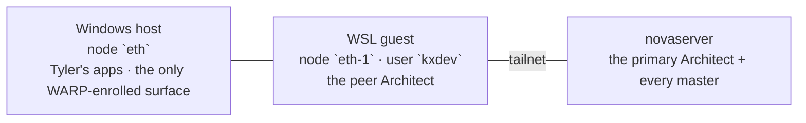

> Mirrored verbatim from `utopia-models/knowledge` `wi/components/host-eth.md` by the allowlisted publish pipeline. Edit it there, not here.

```yaml
component: host-eth
serves: all
runs-on: host-eth
adrs: []
owns:
  - eth
  - eth-1
```

# host-eth — Tyler's Windows laptop, and the Architect's peer host

## WHAT IT IS

Tyler's Windows laptop. Its WSL guest (user `kxdev`) runs **the Architect's peer copy**: the same
agent as the primary on novaserver (`architect`, knowledge#10285; see `agent-architect.md`), kept so
Tyler can still talk to the Architect when novaserver is down (knowledge#10499, decisions 3 and 5 —
which reversed #10314's plan to wipe WSL). **No master and no dispatch runs here**, and lane `agent` is
undispatchable. Windows stays on the tailnet and on WARP.

Access, as of 2026-10-29 (#10314): the laptop's old agent key `NTTr` (kxdev@ETH → every novaserver
account) is **revoked**; Tyler's terminal key `tyler-laptop-wsl@ETH` replaces it and reaches every
novaserver account. The other direction is unchanged: novaserver accounts still ssh to `kxdev@` the WSL
node (the two helpers in KNOWN BROKEN depend on it). The peer's clones and plugin are stale until
#10499's P7 (bootstrap.sh on ETH) runs.

It is a **workstation**: it sleeps, it roams, and a timeout to it is usually not a fault. One thing
still makes it fleet-relevant: it is **the only WARP-enrolled surface in the fleet**, so it is the only
box where a Cloudflare Gateway policy can apply at all.

## HOW IT WORKS TODAY

Two tailnet nodes carry the `eth` name: `eth` (the Windows host) and `eth-1` (the WSL guest that runs
the peer Architect). They are **one machine** with one power state.



**Nothing about this box is in this repo.** No script, unit or config here belongs to it — the peer
Architect's config is its brain repo, the same one novaserver's `architect` runs. That is why
`owns:` names the tailnet nodes and nothing else: the partition still has to say which component this
machine belongs to, even when the machine ships no file.

## BOUND VALUES

Deliberately empty of assertions. **This component owns no path in this repo**, so there is nothing
`docs-cog.sh` can re-derive.

## DETERMINE CURRENT STATE

From novaserver, liveness only — and **`tailscale ping`, never ICMP `ping`**:

```
tailscale status | grep -E '\seth(-1)?\s'
tailscale ping -c 1 --timeout 5s <the eth address from that output>
```

## KNOWN BROKEN

- 🔴 **ICMP `ping` reports this box as unreachable while it is fully reachable.** `tailscale ping`
  answers; ICMP does not. Anything that concludes "the laptop is down" from ICMP is wrong by
  construction.
- ⚠ **Two fleet helpers reach Tyler's files through the WSL guest**, so they work only while the
  laptop is awake: the screenshot fetch hook
  (`_infra/ansible/roles/master/files/hooks/fetch-windows-filepath.py`, `/srv/win-fetch/laptop.conf` →
  `kxdev@` the WSL node) and `net/work/print/flyer-build/print-flyer` (`PRINT_HOST` →
  `kxdev@100.103.62.104`). Probe: `ssh -o BatchMode=yes -o ConnectTimeout=8 kxdev@100.103.62.104 hostname`
  from a novaserver account.
