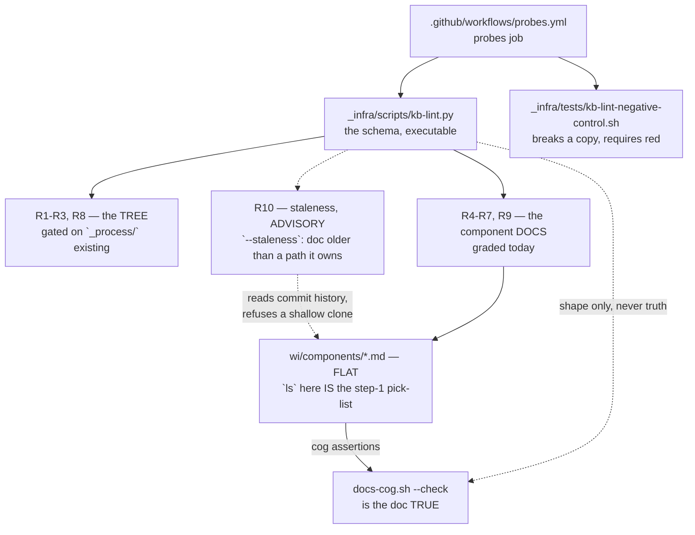

> Mirrored verbatim from `utopia-models/knowledge` `wi/components/knowledge-base.md` by the allowlisted publish pipeline. Edit it there, not here.

```yaml
component: knowledge-base
serves: all
runs-on: github.com
adrs: [7313, 182, 6044, 6554]
owns:
  - _infra/scripts/kb-lint.py
  - _infra/tests/kb-lint-negative-control.sh
  - wi/components
  - wi/work/specs/7313-kb-rebuild/spec.md
  - wi/work/specs/7313-kb-rebuild/plan.md
```

# knowledge-base — the KB's information architecture, and the lint that IS its schema

## WHAT IT IS

The **shape** of the knowledge repo: which directories exist, what a component doc must look like, and
what `ls` of a directory is allowed to mean. `knowledge-repo` is the git object store; this is the
information architecture stored in it. If it stops holding, nothing breaks loudly — the tree simply
drifts back into a place where step 1 of planning has no pick-list, which is the condition ADR-7313 was
written to end.

## HOW IT WORKS TODAY

**The schema is executable, and there is no second copy of it.** There is no `SCHEMA.md`:
`_infra/scripts/kb-lint.py` *is* the schema, because the rebuilt `wi/` top level is a closed set of
seven names and a document describing the rules would have to be an eighth name or hide inside
`wi/components/`, where a reader would take it for a component. One place, executable, nothing to
disagree with.



**Two checks, and neither substitutes for the other.** `kb-lint.py` is a CONSISTENCY gate: filename ==
`component:`, the five sections present, `HOW IT WORKS TODAY` under its cap, every `owns:` path
resolving. Whether a doc is *true* is `docs-cog.sh --check`'s job, and it is a different component
(`doc-integrity`). Nothing mechanical checks whether a component doc's prose is accurate — the
hand-written exemplars are the only mitigation, which is why they are load-bearing.

**A third reading, and it is advisory: `kb-lint.py --staleness` (R10, #8530).** A component doc is
reported when a repo path in its own `owns:` has a commit newer than the doc's last commit. That is the
nearest mechanical signal to "the prose fell behind the code", and it is deliberately not a rule: a
newer commit is a reason to re-read, not proof of a wrong doc, so the report prints its rows and exits 0.
There is no threshold to tune. It reads commit history, so it refuses a shallow clone outright (a
dispatched worktree and a default `actions/checkout` are both shallow) and prints the one command that
deepens it. `probes.yml` runs it after a blobless deepen and writes the rows to the job summary.

**Four rules are gated, loudly.** R1 (the root's three files), R2 (a portfolio's five names), R3 (`wi/`'s
seven names) and R8 (`_process/_generated/unreachable.md` empty) all describe a tree that P3 (#7316) has
not built yet. Wiring them as unconditional failures would put `guard.yml` red on `main` from the day the
linter merged until P3 lands, and a permanently-red gate is one the fleet learns to scroll past. So they
are gated on ONE structural predicate — **`_process/` is a directory** — which is a fact about the tree
rather than a flag anybody flips. A skipped rule is the classic vacuous pass, so every skip prints a `–`
line naming what is missing, the summary states how many rules could not be graded, and
`--require-rebuilt` turns "not yet rebuilt" into a failure.

**The flat rule is an invariant, not tidiness.** `ls wi/components/` IS the step-1 pick-list, so a
subdirectory in it does not make the list untidy — it makes the list WRONG. R4 refuses subdirectories and
refuses anything that is not `*.md`. Grouping is PLAN-260's question and deliberately not this one's.

🔴 **THE PREFIX RULE.** A prefix is allowed ONLY where the class is already declared somewhere real. Two
qualify: `agent-*` (the classes in `organization.yaml`) and `site-*` (one per live Vercel project).
Everything else keeps its own name. Inventing a prefix to group things is the same judgement as inventing
a subfolder, and it is refused for the same reason.

**A component doc is an INDEX, not a container.** Its ADRs live in `decisions/` and are reached by the
`adrs:` field; its code lives in the repo, reached by `owns:`. `owns:` is one FLAT list that deliberately
mixes kinds — a repo path beside a unit name beside a port — because its job is to be the search index
that partitions the org: every real thing the fleet runs belongs to exactly one component doc, or is
named in the residue with a reason. R9 grades only the entries that are repo-relative paths; an entry
with no `/` is a unit or a port and has nothing to resolve, and an absolute path is refused outright
because 0750 master homes make it answer by *who ran the check*.

**The `HOW IT WORKS TODAY` cap is on the SECTION, not the file.** A doc too long to read stops being
read, which defeats writing sixty-six of them. `BOUND VALUES`, `owns:` and `KNOWN BROKEN` are reference
material and grow as long as they are true.

**The rule for off-git facts:** state a fact only if it is in-git (bindable by `cog`) or structural.
Everything else gets the PROBE, never the answer — a doc that says "run this to see the routes" cannot
rot; one listing the routes rots on the next deploy.

## BOUND VALUES

The tree's current contents are a fact about a working directory and are read by the command below, not
stated here. What CI holds is the schema file itself, its negative control, and the two numbers this doc
asserts about the schema: the section cap and the size of the closed `wi/` name set.

<!--[[[cog
m.exists("_infra/scripts/kb-lint.py _infra/tests/kb-lint-negative-control.sh")
m.exists("wi/work/specs/7313-kb-rebuild/spec.md wi/work/specs/7313-kb-rebuild/plan.md")
m.calls(".github/workflows/probes.yml", "_infra/scripts/kb-lint.py _infra/tests/kb-lint-negative-control.sh")
m.calls(".github/workflows/probes.yml", "--staleness")
m.calls("_infra/tests/kb-lint-negative-control.sh", "--staleness")
m.value("100", "_infra/scripts/kb-lint.py", r"HOW_IT_WORKS_MAX = (\d+)")
m.value("_process", "_infra/scripts/kb-lint.py", r'rebuilt = \(root / "(\w+)"\)\.is_dir\(\)')
]]]-->
- ✅ `_infra/scripts/kb-lint.py`
- ✅ `_infra/tests/kb-lint-negative-control.sh`
- ✅ `wi/work/specs/7313-kb-rebuild/spec.md`
- ✅ `wi/work/specs/7313-kb-rebuild/plan.md`
- ✅ `_infra/scripts/kb-lint.py` — still called by `.github/workflows/probes.yml`
- ✅ `_infra/tests/kb-lint-negative-control.sh` — still called by `.github/workflows/probes.yml`
- ✅ `--staleness` — still called by `.github/workflows/probes.yml`
- ✅ `--staleness` — still called by `_infra/tests/kb-lint-negative-control.sh`
- ✅ `100` — still live in `_infra/scripts/kb-lint.py` (`HOW_IT_WORKS_MAX = (\d+)`)
- ✅ `_process` — still live in `_infra/scripts/kb-lint.py` (`rebuilt = \(root / "(\w+)"\)\.is_dir\(\)`)
<!--[[[end]]]-->

## DETERMINE CURRENT STATE

```
python3 _infra/scripts/kb-lint.py
```

Read-only, exits 0 when every gradable rule passes, and prints a `–` line for every rule it could not
grade. To refuse a green that only covers the gradable half:

```
python3 _infra/scripts/kb-lint.py --require-rebuilt
```

Which component docs are older than the code they own (advisory, always exit 0, needs full history):

```
git fetch --filter=blob:none --unshallow origin     # only if `git rev-parse --is-shallow-repository` says true
python3 _infra/scripts/kb-lint.py --staleness
```

## KNOWN BROKEN

- 🔴 **`kb-lint.py --require-rebuilt` is red on `main`, on R2, and the cause is outside `wi/`.** Two
  directories at the repo root, `reports/` and `research_notes/`, are graded as portfolios because
  anything at the root that is not `_`-prefixed or `wi` is one, and neither holds the five names.
  Measured 2026-10-04 (#8530): those two are the only findings left after every `wi/`-owned one was
  cleared, and they also stop the negative control at its first live-tree step. Specs under `net/` cite
  files in both, so moving them is a change with its own reference sweep, not a lint fix. Re-read with
  the command above rather than trusting this line.
- ⚠ **Two of the plan's open items are still open and touch the id set this component partitions.**
  `wi/work/specs/7313-kb-rebuild/plan.md` records them: the 67-id list holds one component
  twice (`agent-master` / `master-agent` are the same thing pre- and post-rename, so the distinct target
  is 66), and `occ-redirect` is listed IN the tree while the artifact's own relevance measurement names
  it OUT. Both are the Architect's call — changing a count in an acceptance criterion is not a master's
  — and both are recorded rather than silently applied.
- ⚠ **`R4 flat`'s pass line is computed from the global finding list.** `check_components_flat()` ends in
  `if not r.bad:` rather than a count taken before it ran, so a finding raised by an *earlier* rule
  suppresses R4's ✅ line even when the directory is perfectly flat. It cannot produce a false PASS —
  only a missing OK — so it is cosmetic, and it is recorded here rather than fixed because
  `_infra/scripts/kb-lint.py` is outside this phase's scope fence.
