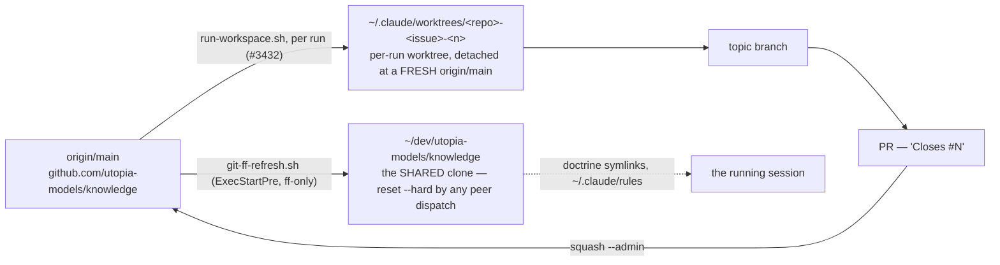

> Mirrored verbatim from `utopia-models/knowledge` `wi/components/knowledge-repo.md` by the allowlisted publish pipeline. Edit it there, not here.

```yaml
component: knowledge-repo
serves: all
runs-on: github.com
adrs: [814, 3293, 3347, 3511, 6044]
owns:
  - knowledge
  - .gitattributes
  - .gitignore
  - .gitleaks.toml
  - .lychee.toml
  - .pre-commit-config.yaml
  - _infra/scripts/git-ff-refresh.sh
  - _infra/scripts/dev-tree-check.sh
  - _infra/scripts/check-lineage-rewind.sh
```

# knowledge-repo — the git object store the whole fleet reads from

## WHAT IT IS

`github.com/utopia-models/knowledge`, private: the one repository every agent grounds in, and the
repository the board's issues live in (ADR-3293). Stop it and there is no doctrine, no registry, no
spec, no queue — the fleet does not degrade, it stops.

This doc is the **git** half: clones, worktrees, branches, refs, merges. What the tree *means* — the
directory shape, the component-doc schema, the lint that holds it — is `knowledge-base`.

## HOW IT WORKS TODAY

**Two kinds of working copy, and confusing them destroys work.** Each master has ONE long-lived clone
at `~/dev/utopia-models/knowledge`, shared by every process on that account. A dispatched run never
works it: `run-workspace.sh` cuts a `git worktree` per run, detached at a freshly fetched `origin/main`,
under `~/.claude/worktrees/<repo>-<issue>-<n>/`. That exists because on #3432 two dispatches to one
master shared the clone and the second one's `reset --hard origin/main` pre-flight silently deleted the
first one's mid-run work. The clone is still reset out from under you at any moment; the worktree is not.



🔴 **The clone and the worktree are BOTH live, for different things.** `~/.claude/rules/bundle.md` — one
symlink, aimed at that box class's compiled bundle — points into the *clone*, so the doctrine a session
loads comes from there while the files it edits come from the worktree. A doctrine change is therefore visible to the next session, not to the running one.

**Refreshing is fast-forward-only, deliberately.** `git-ff-refresh.sh` is the `ExecStartPre` of
`reconcile-board.service` and refuses anything that is not a fast-forward, so a scheduled job can never
rewrite a master's tree. The per-run worktree does not use it — it re-fetches instead, which is why a
worktree's base is current at creation and stale minutes later.

**Nothing gates `main`** (ADR-3511): branch protection and rulesets both 403 on this plan tier, in every
repo. Every check is advisory, direct push to `main` is allowed, and a PR is for collaboration rather
than permission. The merge is always available: `gh pr merge <n> --squash --admin`.

**Merges are squashes.** That has one consequence people keep rediscovering: a squash writes a NEW
commit, so the topic branch never becomes an ancestor of `main`. `git branch --merged` therefore finds
nothing to prune, and nothing else prunes either — see KNOWN BROKEN.

**A force-push to `main` is the failure git cannot show you.** On 2026-08-04 `brain-cloud`'s `main` went
back 37 commits and two dispatched runs rebuilt on the rewound lineage doing exactly what their brief
said (#4279). `check-lineage-rewind.sh` reads the server-side activity log — the one witness a
force-push cannot rewrite — and exits non-zero on an unhealed rewind. Run it before branching in any
repo other than this one.

**Binaries are allowed; the git↔Drive boundary is a written rule, not a check** (#4638 deleted the
`no-binaries` job). git takes the single file a document cannot be read without; Drive takes bodies of
media, referenced by manifest key. The one mirror rule is absolute: never mirror a Drive folder into git.

**The one hard stop is a secret in a tracked file**, and it is the only thing in this repo that is
genuinely fatal rather than advisory. `guard.yml`'s `secret-scan` job and `.gitleaks.toml` are
`ci-knowledge`'s; the config file lives here because git reads it.

## BOUND VALUES

The repo's SIZE, its branch count and what is on `origin/main` right now are all off-git facts about a
server — they get the probes below, never a number here. What CI can hold is that the git-level
configuration this doc describes is still on disk, and that the refresher still points at the clone path
the whole fleet assumes.

<!--[[[cog
m.exists(".gitattributes .gitignore .gitleaks.toml .lychee.toml .pre-commit-config.yaml")
m.exists("_infra/scripts/git-ff-refresh.sh _infra/scripts/dev-tree-check.sh _infra/scripts/check-lineage-rewind.sh")
m.calls("_infra/scripts/git-ff-refresh.sh", "dev/utopia-models/knowledge")
]]]-->
- ✅ `.gitattributes`
- ✅ `.gitignore`
- ✅ `.gitleaks.toml`
- ✅ `.lychee.toml`
- ✅ `.pre-commit-config.yaml`
- ✅ `_infra/scripts/git-ff-refresh.sh`
- ✅ `_infra/scripts/dev-tree-check.sh`
- ✅ `_infra/scripts/check-lineage-rewind.sh`
- ✅ `dev/utopia-models/knowledge` — still called by `_infra/scripts/git-ff-refresh.sh`
<!--[[[end]]]-->

## DETERMINE CURRENT STATE

```
bash _infra/scripts/dev-tree-check.sh
```

Grades THIS box's `~/dev` against reality: every clone matches its remote's current name, no two share a
remote, every remote resolves, and `knowledge` is at `origin/main`. `--fleet` runs it on all five boxes
through the nova hop. Advisory, like everything else — it reports, it never gates.

For the server side, which no local command can answer:

```
gh repo view utopia-models/knowledge --json pushedAt,diskUsage,defaultBranchRef
git ls-remote --heads origin | wc -l
bash _infra/scripts/check-lineage-rewind.sh utopia-models/knowledge
```

## KNOWN BROKEN

- 🔴 **Nothing deletes a merged branch, and the ordinary idiom cannot.** Measured this session:
  `git ls-remote --heads origin | wc -l` → `23`, and of the 22 non-`main` heads **zero** are ancestors
  of `origin/main` — because every merge is a squash. So `git branch --merged` reports nothing to
  prune however long the branch has been dead. The oldest tip is `recover/6454-nova-wt-3303` at
  `2026-07-30`, 32 days old; 8 of the 22 have no PR at all and 2 have a CLOSED one. This is untidiness,
  not danger — but it means a branch name is never evidence that work is live, and a run that greps for
  one will find corpses.
- 🔴 **The repo root is not the closed set anything claims it is.** `git ls-files | grep -v /` returns
  **12** entries today, four of them spent one-shot output that should have been deleted with the run
  that wrote it: `BLOCKER-6249-ADJUDICATION.md`, `VERIFICATION-6337.md`, `.close-6564.md`,
  `plan-registry-audit.html`. `kb-lint.py`'s R1 will fail on exactly this, and is deliberately gated OFF
  until P3 (#7316) rebuilds the tree — so the rule that would catch it is, correctly, not yet graded.
- ⚠ **`repos.md`'s "six `brain-*` repos" is seven.** `gh repo list utopia-models --limit 60 --json name
  -q '.[]|select(.name|startswith("brain-"))|.name' | wc -l` → `7` (brain-agent, brain-agent-dust,
  brain-agent-sf, brain-cloud, brain-nova, brain-poppi, brain-win). The count belongs to `brain-repos`;
  it is recorded here because `reference/win/repos.md` — this component's predecessor doc — states it.
