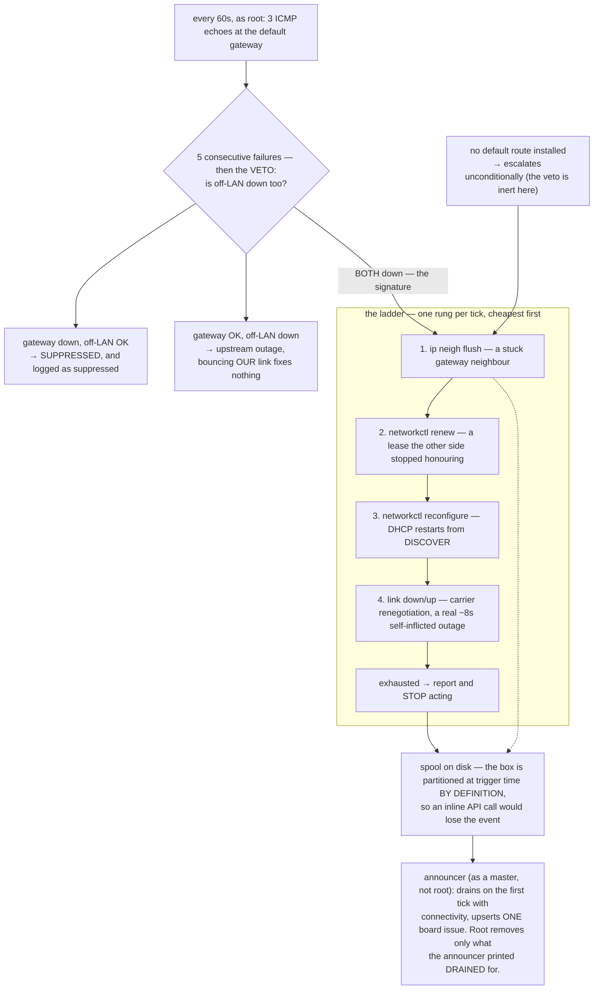

> Mirrored verbatim from `utopia-models/knowledge` `wi/components/novaserver-route-watchdog.md` by the allowlisted publish pipeline. Edit it there, not here.

```yaml
component: novaserver-route-watchdog
serves: all
runs-on: novaserver
adrs: [5568]
owns:
  - _infra/scripts/novaserver-route-watchdog.sh
  - _infra/scripts/novaserver-route-watchdog-announce.sh
  - _infra/systemd/novaserver-route-watchdog.service
  - _infra/systemd/novaserver-route-watchdog.timer
  - novaserver-route-watchdog.service
  - novaserver-route-watchdog.timer
```

# novaserver-route-watchdog — the on-box half, the one that can actually fix it

## WHAT IT IS

A root system unit on novaserver that asks one question every 60 seconds — *can this box still reach
its default gateway?* — and, when the answer has been no for five consecutive minutes, walks a
four-rung recovery ladder and then announces on the board every single thing it did.

It is the **remediation** half of novaserver's L3-blackout failure mode. The **detection** half is
deliberately off-box, on a hosted runner, because a partitioned box cannot report its own partition
— and that includes its own systemd timers, its notifier and its self-hosted Actions runner.

## HOW IT WORKS TODAY

🔴 **The trigger is an ACTIVE probe because every passive signal read healthy through a total
outage.** Through a 7h32m blackout, carrier stayed up, receive errors stayed zero, the address and
default route stayed installed, and `systemd-networkd` logged nothing at all. Only putting a packet
on the wire and waiting sees this fault. That is the load-bearing design constraint: no
`systemctl`-visible signal can be the trigger here, and every rung deliberately forces more of a
fresh DHCP transaction than the one before it.



**The veto is what stops this becoming the outage.** A router that forwards fine while ignoring ICMP
addressed to itself is a real and common state; acting on it would bounce a healthy box's link on a
schedule. In the *no default route* branch the veto is structurally inert and correctly so — with the
local subnet still on-link the gateway ping *succeeds* without a default route, and the same missing
route guarantees the off-LAN targets are unreachable, so no false-positive class exists there.

**It names the layer it failed at, and announces a heal after `exhausted`.** The probe reads
`/sys/class/net/$DEV/carrier`; at `0` the event reason is prefixed `no carrier on <dev> (L1 link down: cable,
switch port or router)`, because no rung can restore a carrier the far end is not providing (#10451).
`exhausted` stamps an `exhausted-at` state file, so the next healthy tick spools `recovered … healed without
any rung` instead of logging a false "transient" and announcing nothing.

**There is deliberately no reboot rung, and deliberately no restart policy on `tailscaled`.** The
network daemon was never the broken component — it had no route to its coordination server because
the host had no route to anything. A reboot destroys every in-flight dispatched run to fix an
otherwise healthy box. If all four rungs fail, the correct outcome is the status quo ante: the
off-box watchdog files, a human power-cycles, and this unit says `exhausted` in its journal.

**Every cap is a measurement, and the caps are hard.** The failure threshold was chosen from the
LAN's measured ambient probe-failure rate, not from caution; the per-boot ladder cap exists because
a watchdog that can loop forever is a second outage. Past the cap the unit keeps probing and
reporting and **stops acting**.

**It cannot fight the off-box detector, by construction.** The ladder completes in ~9 minutes; the
off-box alert threshold is 20. A self-heal that works lands before the alert fires; one that fails
leaves it free to fire on schedule. Do not shorten either toward the other without reading both.

**🔴 Installing is what ships this component.** The unit execs `/usr/local/sbin/…`, never the repo
clone — a concurrent dispatch resets that clone out from under running processes, and a watchdog
that vanishes mid-checkout reports nothing during the minutes it matters. **So a merged PR here
changes nothing on the box until someone installs it.** Drift is made *observable*, not prevented:
diff the installed copies against the repo (both are `0755 root root`, so any account can read them).

**🔴 This unit reads `inactive (dead)` when it is perfectly healthy, and it is invisible to
`--user`.** It is a `oneshot` — between ticks `inactive (dead)` *is* its healthy state, and the only
thing that reads liveness is the **timer**. And it is a root *system* unit, so `systemctl --user`
reports "not found" for a unit `systemctl list-timers` shows firing on schedule. Both halves of that
are how one half of this component was once deleted as dead from a box where it was running every
60 seconds.

## BOUND VALUES

<!--[[[cog
m.exists("_infra/scripts/novaserver-route-watchdog.sh _infra/scripts/novaserver-route-watchdog-announce.sh _infra/systemd/novaserver-route-watchdog.service _infra/systemd/novaserver-route-watchdog.timer")
m.units("novaserver-route-watchdog")
m.value("5", "_infra/scripts/novaserver-route-watchdog.sh", r'RWD_FAIL_THRESHOLD:=(\d+)')
m.value("3", "_infra/scripts/novaserver-route-watchdog.sh", r'RWD_MAX_LADDERS:=(\d+)')
m.value("3600", "_infra/scripts/novaserver-route-watchdog.sh", r'RWD_COOLDOWN_SEC:=(\d+)')
m.value("60s", "_infra/systemd/novaserver-route-watchdog.timer", r'OnUnitActiveSec=(\S+)')
]]]-->
- ✅ `_infra/scripts/novaserver-route-watchdog.sh`
- ✅ `_infra/scripts/novaserver-route-watchdog-announce.sh`
- ✅ `_infra/systemd/novaserver-route-watchdog.service`
- ✅ `_infra/systemd/novaserver-route-watchdog.timer`
- ⚙️ `system:novaserver-route-watchdog.service` — ExecStart target proven daily by `verify-unit-execstart.py` (#4742)
- ✅ `5` — still live in `_infra/scripts/novaserver-route-watchdog.sh` (`RWD_FAIL_THRESHOLD:=(\d+)`)
- ✅ `3` — still live in `_infra/scripts/novaserver-route-watchdog.sh` (`RWD_MAX_LADDERS:=(\d+)`)
- ✅ `3600` — still live in `_infra/scripts/novaserver-route-watchdog.sh` (`RWD_COOLDOWN_SEC:=(\d+)`)
- ✅ `60s` — still live in `_infra/systemd/novaserver-route-watchdog.timer` (`OnUnitActiveSec=(\S+)`)
<!--[[[end]]]-->

Every number this doc leans on is bound to the file that defines it. The *installed* copy is not
bindable from here — that is the gap the diff in DETERMINE CURRENT STATE covers, and it is a real
gap, not an oversight.

## DETERMINE CURRENT STATE

Liveness is the **timer**, never the service:

```
systemctl list-timers novaserver-route-watchdog.timer --all
systemctl is-enabled novaserver-route-watchdog.timer
```

State, world-readable so this works as any account — `rung`/`fail-count` `0` means idle (a non-zero `exhausted-at` means the last ladder exhausted and no healthy tick has announced the heal yet), `ladders`
below the cap means still armed, an empty `spool/` means nothing undelivered:

```
head -c99 /var/lib/novaserver-route-watchdog/{ladders,rung,fail-count,exhausted-at}
ls /var/lib/novaserver-route-watchdog/spool/
```

Installed-vs-repo drift, which nothing else reports:

```
sudo diff /usr/local/sbin/novaserver-route-watchdog          _infra/scripts/novaserver-route-watchdog.sh
sudo diff /usr/local/sbin/novaserver-route-watchdog-announce _infra/scripts/novaserver-route-watchdog-announce.sh
```

🔴 Any `journalctl` question about this unit needs `sudo`: without the `adm` group it exits 0
printing `-- No entries --`, so a count of triggers comes back `0` whether or not it ever fired.

## KNOWN BROKEN

- 🔴 **The registry row's `what_it_does:` ends with a shell command, stranded there by the deletion
  of the `verify:` field.** Measured:
  ```
  $ grep -n 'verify-unit-execstart.py' wi/registry/components.yaml
  21:#                 runs `verify-unit-execstart.py --all` daily on the self-hosted novaserver runner and
  68:# on disk?* `lint.yml` runs `verify-unit-execstart.py --all` daily on the self-hosted novaserver runner.
  1034:      && python3 _infra/scripts/verify-unit-execstart.py system:novaserver-route-watchdog.service
  ```
  Line 1034 is inside this component's `what_it_does:` block scalar — a four-command `verify:` value
  that got folded into the prose when `verify:` was removed as *"70 commands, zero consumers"*. It is
  the **only** row in the file with this residue, so it reads as deliberate rather than as a leftover.
  The commands themselves are good; they belong in this doc's DETERMINE CURRENT STATE, where they
  now are, and not in a description field nothing runs.
- ⚠ **`ladders` is spent and nothing resets it but a reboot.** Measured this session:
  `head -c99 /var/lib/novaserver-route-watchdog/{ladders,rung,fail-count}` → `1`, `0`, `0`;
  `cat /proc/sys/kernel/random/boot_id` matches the unit's own `boot-id` file; `uptime -s` →
  `2026-08-09 18:52:00`. So one of the per-boot ladders is spent from a real save on this boot, and
  with a 21-day uptime that counter only falls on a reboot the box deliberately never performs on its
  own. Two ladders remain — healthy, but it is a budget that only ever decreases.
- ⚠ **Nothing on the box watches this watchdog.** It is a `oneshot`, so a crash mid-ladder retries at
  the next tick with all state on disk — but a masked timer or a clock jump goes unnoticed here. The
  off-box detector is the only backstop, and it alerts on a much coarser threshold.
- ⚠ **Rung 4 is a real ~8s LAN outage this unit inflicts on itself.** Anything mid-flight over the
  LAN takes the hit. That is the price of the rung that most resembles what actually worked, and it
  is why the ladder is ordered cheapest-first rather than most-effective-first.
- ⚠ **A drill leaves a real issue on the board.** Correctly — that is the thing being proven. Close
  it. And drill state must be redirected to its own tree, or exercising this detector spends the
  production ladder budget above and quietly disarms it.
