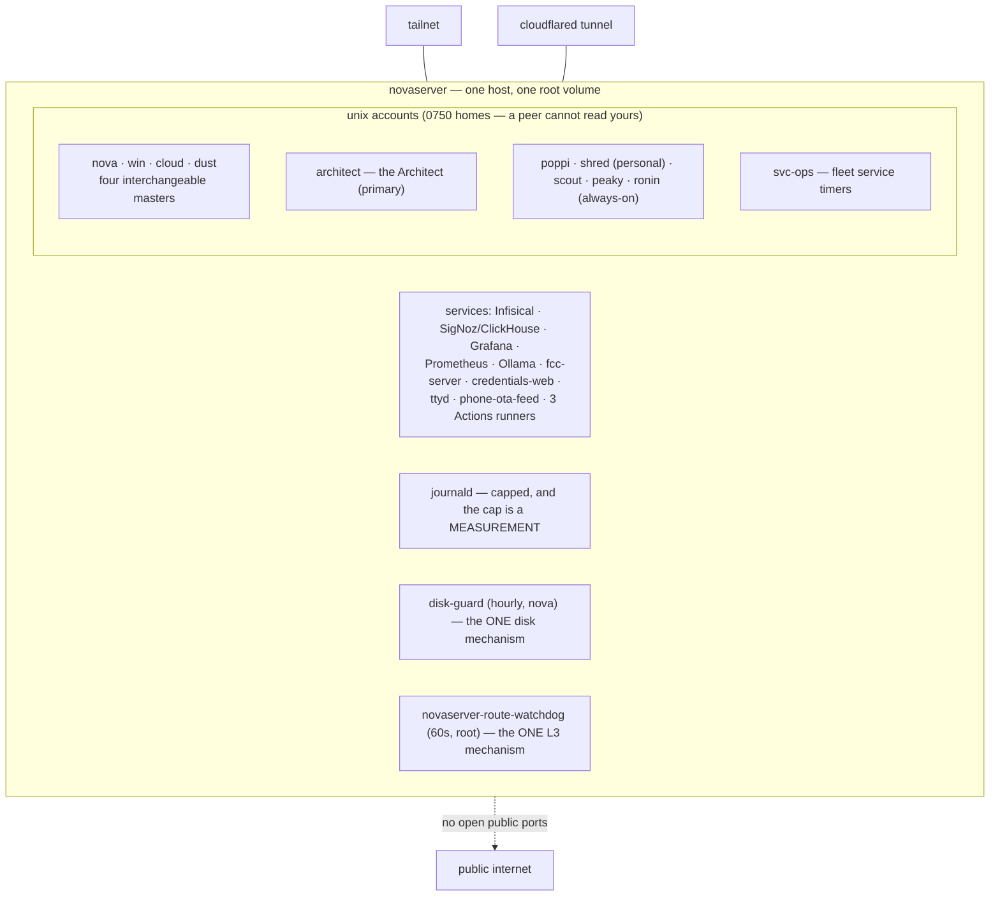

> Mirrored verbatim from `utopia-models/knowledge` `wi/components/novaserver.md` by the allowlisted publish pipeline. Edit it there, not here.

```yaml
component: novaserver
serves: all
runs-on: novaserver
adrs: [178]
owns:
  - _infra/systemd/journald-fleet-retention.conf
  - _infra/systemd/tmpfiles-tmp-retention.conf
  - novaserver
```

# novaserver — the always-on box

## WHAT IT IS

The one machine that is always on. Six unix accounts live here — four interchangeable masters plus
the personal and always-on agents — alongside the only secret store, the observability stack, all
three self-hosted Actions runners, and every fleet service that is not on Vercel.

**If this box is down, the fleet is down.** There is no second box: dispatch has nowhere else to
start a run, Infisical has nowhere else to answer from, and the board keeps accepting work that
nothing will pick up. That is why its two failure modes — the disk filling and the tailnet going
away — each have a component of their own (`disk-guard`, `novaserver-route-watchdog`).

## HOW IT WORKS TODAY

Ubuntu on a single LVM root volume, on the tailnet, with everything bound to either the tailnet
address or loopback. **Nothing here is published by opening a port** — public reach is Vercel or the
`cloudflared` tunnel, and both of those are separate components.



**Accounts are the isolation boundary, and it is real.** Master homes are `0750`, so `cloud` cannot
read `nova`'s user units and an `is-active` from the wrong account answers a different question. A
per-user probe must run scoped — `sudo -n -u <master> XDG_RUNTIME_DIR=/run/user/<uid> systemctl
--user …` — or it silently reports the caller's own systemd instance. Read the live account/uid map,
never a list: `getent passwd | awk -F: '$3>=1000 && $3<65534 {print $3, $1, $6}'`.

**The port map is OFF-GIT and it moves.** Ports come and go with preview servers and containers, so
this doc states none of them. Read the live set:

```
ss -tlnH | awk '{print $4}' | sort -u -t: -k2 -n
```

Two things that map is good for: a `100.71.25.43:PORT` binding is tailnet-only by design, and a
`127.0.0.1:PORT` binding is reachable only from the box (so a public hostname pointed at it must be
going through `cloudflared`).

**Journal retention is capped by journald itself, not by a cleanup script.** The drop-in this
component owns sets `SystemMaxUse` and `SystemMaxFileSize`; both numbers were sized from a measured
write rate rather than picked, and the file carries the arithmetic. A drop-in is inert until the
daemon re-reads it, so the authority on the effective value is journald's own line, not the file:

```
sudo journalctl --disk-usage
sudo journalctl -u systemd-journald -o cat --since '-2 min' | grep -m1 'System Journal'
```

**`/tmp` is aged by systemd-tmpfiles, and tmux sockets are exempt.** `tmpfiles-tmp-retention.conf` (owned here)
sets the `/tmp` age rule; its `x /tmp/tmux-*` line exempts every tmux server's socket directory. An idle server
leaves its socket untouched, so without the exemption the cleaner would delete the socket under a LIVE session:
it keeps running but `tmux attach`/`ls` and `persistent-sessions.sh` cannot reach it, and the next `start` opens a
duplicate (knowledge#10445). Read the age from the file, not from here.

**Disk is the live risk and it has exactly one mechanism.** `disk-guard` runs hourly on the `nova`
account, reclaims only regenerable space, and reports what it freed. **Extend it; never add a second
timer** — a resident health-check process is forbidden, and two reclaimers racing on one volume is
worse than one. Its script lives in nova's brain (`~/.claude/ops/disk-guard.sh`), not in this repo,
so its thresholds are read there and are deliberately not restated here.

**The box does not reboot itself.** Unattended-upgrades still installs, but the automatic reboot is
off: an unattended reboot destroys every in-flight dispatched run to patch an otherwise healthy box.
`/var/run/reboot-required` therefore accumulates and a human or an agent reboots deliberately. Read
the *effective* value, never a grep of the conf files — `sudo apt-config dump | grep -i
Automatic-Reboot` is the only authority, because the setting is split across two files and a grep of
one of them reads only commented-out lines.

## BOUND VALUES

<!--[[[cog
m.exists("_infra/systemd/journald-fleet-retention.conf")
m.value("6G", "_infra/systemd/journald-fleet-retention.conf", r"SystemMaxUse=(\S+)")
m.value("256M", "_infra/systemd/journald-fleet-retention.conf", r"SystemMaxFileSize=(\S+)")
]]]-->
- ✅ `_infra/systemd/journald-fleet-retention.conf`
- ✅ `6G` — still live in `_infra/systemd/journald-fleet-retention.conf` (`SystemMaxUse=(\S+)`)
- ✅ `256M` — still live in `_infra/systemd/journald-fleet-retention.conf` (`SystemMaxFileSize=(\S+)`)
<!--[[[end]]]-->

Only the journald cap is bindable from this repo. Everything else about this box — uptime, disk,
memory, the port map, the account list, the kernel — is a fact about a machine, not about a file, so
it gets the probe below and no number here.

## DETERMINE CURRENT STATE

```
uptime; df -h /; free -h; ss -tlnH | awk '{print $4}' | sort -u -t: -k2 -n; tailscale status | head -1
```

Disk first, always: a full root volume presents as a hundred unrelated bugs. `df -h /` against
`disk-guard`'s own threshold is the number that matters, not the absolute gigabytes.

## KNOWN BROKEN

- 🔴 **The volume is one point below the reclaim threshold and the doc that describes it is a year of
  old readings.** Measured this session: `df -h /` → `295G 251G 32G 89% /`, against
  `HIGH="${DISK_GUARD_HIGH:-90}"` in `~/.claude/ops/disk-guard.sh`. The superseded
  `reference/win/novaserver.md` states *"221G of 295G used, 79%, 62G free"* as its headline disk
  figure and *"75% — 72G free"* as the post-fix state. Both were true when written and neither is
  true now. This is why the section above states no disk number: a doc cannot hold a value that
  changes hourly, and the sequence 78% → 75% → 89% across three dated claims in one file is what
  that looks like when it is tried anyway.
- 🔴 **The registry's `where:` for this row names a kernel the box is not running.**
  `wi/registry/components.yaml` reads `Linux 6.8.0-136-generic`; `uname -r`
  on the box → `6.8.0-137-generic`. A kernel version in a registry field is a claim that unattended
  upgrades will falsify on their own schedule and that nothing re-derives.
- ⚠ **The superseded doc's port table has drifted and cannot be repaired, only replaced by a probe.**
  It lists `3020 · 3210` as the DMV preview servers; `ss -tlnH` this session shows neither, and shows
  `3123`, `3124` and `3289` instead. A port table is the canonical off-git fact: correct the day it
  is written, wrong on the next restart.
- ⚠ **`journalctl --list-boots` lies to anyone outside the `adm` group and does not say so.** It
  silently reports only the caller's own user journal, which is a strictly narrower window than the
  system journal that `fleet-notify` reads. `getent group adm` on this box shows exactly one master
  in it, so three of the four get the misleading answer. Use `sudo` for any journal question whose
  answer you intend to act on.
