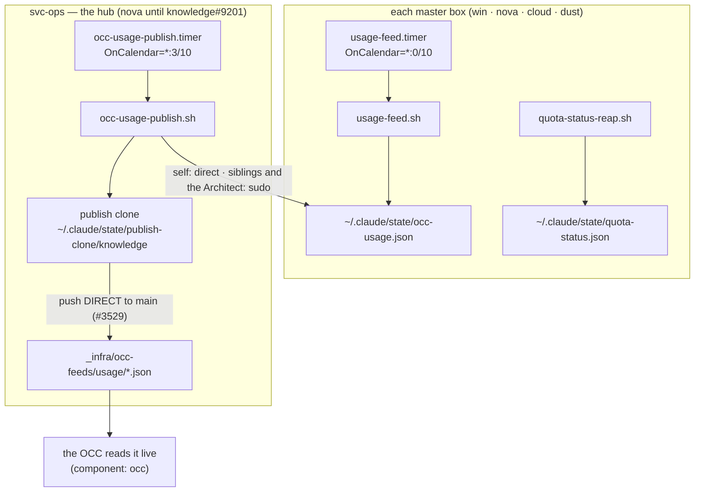

> Mirrored verbatim from `utopia-models/knowledge` `wi/components/occ-feed-publishing.md` by the allowlisted publish pipeline. Edit it there, not here.

```yaml
component: occ-feed-publishing
serves: all
runs-on: novaserver
adrs: [7147]
owns:
  - _infra/scripts/usage-feed.sh
  - _infra/scripts/occ-usage-publish.sh
  - _infra/scripts/quota-status-reap.sh
  - _infra/tests/occ-usage-publish-identity.sh
  - net/work/_tools/net-daily.py
  - _infra/systemd/usage-feed.service
  - _infra/systemd/usage-feed.timer
  - _infra/systemd/occ-usage-publish.service
  - _infra/systemd/occ-usage-publish.timer
  - usage-feed.timer
  - occ-usage-publish.timer
```

# occ-feed-publishing — how a box's own usage becomes a number on the OCC

## WHAT IT IS

The **transport** from a box's own state files to `_infra/occ-feeds/` on `main`, which the OCC reads
live. Two units, not one: every box measures itself; **one hub commits them all**.

🔴 **This doc used to describe TWO feeds. It is ONE, PLAN-321, 2026-09-23** — the net-activity feed is
REMOVED: the OCC section it fed was deleted (Tyler: "another thing for scout and you to maintain which is
consistently not accurate"), `occ-usage-publish.sh` no longer writes it, `_infra/occ-feeds/net-activity/`
is gone from git, and its 8-case test went with it (knowledge#7929 — it had been reporting 8/8 FAIL,
advisory and unread, for three days). `net-daily.py` still runs on scout's box for the daily review Sheet
tab (#6998); only its OCC-feed write is dead. The HISTORICAL description of that feed that used to sit
here is deleted — git history is the archive.

| feed on `main` | written by | collected from | cadence |
|---|---|---|---|
| `usage/<box>.json` — one per box | `usage-feed.sh` → `~/.claude/state/occ-usage.json` | every box in `BOXES` | box `*:0/10` → hub `*:3/10` |
| `net-funnel.json` + `net/work/pipeline/exports/funnel.csv` (knowledge#9573) | `net-funnel.py` → `~/.claude/state/sf/funnel/` | scout (`sudo:scout`); an invalid feed is skipped and named, never published | scout `*:47` → hub `*:3/10` |

Stop it and nothing goes down — the feeds simply freeze, and a frozen feed does not read as broken.
Its `resetsAt` stamps fall into the past, the reader floors both windows, and the card renders `0%`
— *idle* — for a box that is saturated. **That is this component's real failure mode: a false zero,
not an outage.**

The DATA those files carry, and how the OCC reads them, is `occ-feeds`. This doc is the machinery
that writes them.

## HOW IT WORKS TODAY



The net-activity feed (scout's `scout-daily.timer` → `occ-usage-publish.sh` → a second published file)
was REMOVED, PLAN-321, 2026-09-23.

**The hub exists because a box cannot publish its own feed.** Each generates fine; the old per-box
push was rejected and swallowed with `|| true`, so feeds froze on origin while every box looked
healthy locally.

**The PR hop is deleted.** `occ-usage-publish.sh` pushes straight to `main`, rebasing onto any
concurrent main and retrying once; a push failure exits non-zero so systemd records a failed unit and
`fleet-notify` files a board row. Measured over 931 logged cycles (2026-07-31): the old PR path
succeeded on first open (714/717) and failed on **every** re-push to an already-open PR (0/210), so
one missed merge froze the feed indefinitely. `grep -n 'publish DIRECT to main'
_infra/scripts/occ-usage-publish.sh`.

**Both timers use `OnCalendar`, offset from each other**: boxes write at `*:0/10`, the hub reads and
commits at `*:3/10`. The offset is the three minutes a box has to finish writing before the hub looks;
`OnCalendar` re-arms on wall clock so a `daemon-reload` blip cannot silently kill either.

**The hub never publishes from a working tree.** It clones from ORIGIN into
`~/.claude/state/publish-clone/knowledge`, `--single-branch --branch main` — never `--shared` from a
master's clone, which is shallow and produced an unrepackable object store that suppressed all future
`gc` (#5329). The clone holds nothing not already on origin, so the script **rebuilds rather than
repairs** on any `for-each-ref` failure.

**Three guards bound what gets published, each closing a different measured failure** (a fourth,
the net-activity shape validator, was removed with the feed itself, PLAN-321 2026-09-23):

| guard | what it refuses | why it exists |
|---|---|---|
| hollow-usage skip, ceilinged at `MAX_HOLLOW_SKIP_S` | overwriting priced usage with an empty read — but only for 6h | past a harness migration, hollowness is permanent; `win`'s feed froze for nine days (#5495) |
| `QUOTA_EXPIRY_JQ`, applied to BOTH the live read and the preserved copy | a quota marker past its own stated `resetsAt`, or of unreadable age | age is not truth: a marker can be young and over (#7268, #3530) |
| non-zero exit on push failure | a silent freeze | cron had no `OnFailure=`; win's dead cron job failed 4,140× in 14.4 days with zero board rows (ADR-7147) |

**Determine current state — read the COMMIT, then the two stamps inside a feed:**

```
$ git fetch origin -q && git log -1 --format='%ci %h' origin/main -- _infra/occ-feeds/usage/
2026-08-31 07:25:13 -0600 c7320472c
$ NOW=$(date -u +%s); for f in $(git ls-tree --name-only origin/main _infra/occ-feeds/usage/); do
    b=$(basename "$f" .json); git show "origin/main:$f" | jq -r --arg b "$b" \
      '[$b, .fetchedAt, ((.util.fetchedAtMs//0)|if .>0 then (./1000|todate) else "null" end)]|@tsv'; done
cloud    2026-08-31T13:20:07.357Z    null
```

(Measured on novaserver 2026-08-31T13:29Z — the commit timestamp is `-0600`, so `07:25:13 -0600` is
four minutes old, not six hours. Read the offset.) 🔴 **Outer `fetchedAt` is when the PUBLISHER ran;
inner `util.fetchedAtMs` is when the BOX measured.** A fresh outer stamp can wrap a days-old number,
and the 6h hollow ceiling keys on the outer one, so it cannot see that case. Read both or you have
read neither.

**Where a failed run says why:** `sudo -n -u svc-ops XDG_RUNTIME_DIR=/run/user/$(id -u svc-ops) journalctl --user -u occ-usage-publish --since '1 hour ago' | grep
-E 'FAIL|ERROR|WARN'`, run as `nova` (the unit is svc-ops'). `log()` writes to the file *and* stderr, which is the only
channel between this unit and anyone who can act on it; it redacts URL userinfo and `gh*_` tokens
because it is a public sink.

## BOUND VALUES

<!--[[[cog
m.exists("_infra/scripts/usage-feed.sh _infra/scripts/occ-usage-publish.sh _infra/scripts/quota-status-reap.sh")
m.exists("_infra/systemd/usage-feed.service _infra/systemd/usage-feed.timer _infra/systemd/occ-usage-publish.service _infra/systemd/occ-usage-publish.timer")
m.units("timer-usage-feed")
m.units("timer-occ-usage-publish")
m.value("*:0/10", "_infra/systemd/usage-feed.timer", r"OnCalendar=(\S+)")
m.value("*:3/10", "_infra/systemd/occ-usage-publish.timer", r"OnCalendar=(\S+)")
m.value("21600", "_infra/scripts/occ-usage-publish.sh", r"MAX_HOLLOW_SKIP_S:-(\d+)")
m.exists("_infra/tests/occ-usage-publish-identity.sh net/work/_tools/net-daily.py")
m.units("scout")
m.value("7", "net/work/_tools/net-daily.py", r"ACTIVITY_WINDOW_DAYS = (\d+)")
m.value("net-activity.json", "net/work/_tools/net-daily.py", r'"state", "([a-z-]+\.json)"')
]]]-->
- ✅ `_infra/scripts/usage-feed.sh`
- ✅ `_infra/scripts/occ-usage-publish.sh`
- ✅ `_infra/scripts/quota-status-reap.sh`
- ✅ `_infra/systemd/usage-feed.service`
- ✅ `_infra/systemd/usage-feed.timer`
- ✅ `_infra/systemd/occ-usage-publish.service`
- ✅ `_infra/systemd/occ-usage-publish.timer`
- ⚙️ `user@win:usage-feed.service` — ExecStart target proven daily by `verify-unit-execstart.py` (#4742)
- ⚙️ `user@nova:usage-feed.service` — ExecStart target proven daily by `verify-unit-execstart.py` (#4742)
- ⚙️ `user@cloud:usage-feed.service` — ExecStart target proven daily by `verify-unit-execstart.py` (#4742)
- ⚙️ `user@dust:usage-feed.service` — ExecStart target proven daily by `verify-unit-execstart.py` (#4742)
- ⚙️ `user@svc-ops:occ-usage-publish.service` — ExecStart target proven daily by `verify-unit-execstart.py` (#4742)
- ✅ `*:0/10` — still live in `_infra/systemd/usage-feed.timer` (`OnCalendar=(\S+)`)
- ✅ `*:3/10` — still live in `_infra/systemd/occ-usage-publish.timer` (`OnCalendar=(\S+)`)
- ✅ `21600` — still live in `_infra/scripts/occ-usage-publish.sh` (`MAX_HOLLOW_SKIP_S:-(\d+)`)
- ✅ `_infra/tests/occ-usage-publish-identity.sh`
- ✅ `net/work/_tools/net-daily.py`
- ⚙️ `user@scout:scout-agent.service` — ExecStart target proven daily by `verify-unit-execstart.py` (#4742)
- ⚙️ `user@scout:scout-daily.service` — ExecStart target proven daily by `verify-unit-execstart.py` (#4742)
- ✅ `7` — still live in `net/work/_tools/net-daily.py` (`ACTIVITY_WINDOW_DAYS = (\d+)`)
- ✅ `net-activity.json` — still live in `net/work/_tools/net-daily.py` (`"state", "([a-z-]+\.json)"`)
<!--[[[end]]]-->

## DETERMINE CURRENT STATE

```
git fetch origin -q && git log -1 --format='%ci %h' origin/main -- _infra/occ-feeds/usage/
```

Expect a commit inside the last ~10 minutes. 🔴 **Read the UTC offset** — a `-0600` stamp is six hours
younger than it looks, which has been misread as a dead pipeline.

Then read BOTH timestamps inside the feeds, because a fresh outer one can wrap a days-old number and
the 6h hollow ceiling keys on the outer stamp, so it cannot see that case:

```
NOW=$(date -u +%s); for f in $(git ls-tree --name-only origin/main _infra/occ-feeds/usage/); do
  b=$(basename "$f" .json); git show "origin/main:$f" | jq -r --arg b "$b" \
    '[$b, .fetchedAt, ((.util.fetchedAtMs//0)|if .>0 then (./1000|todate) else "null" end)]|@tsv'; done
```

🔴 There is no net-activity feed to check any more — removed PLAN-321, 2026-09-23. `git show
origin/main:_infra/occ-feeds/net-activity/summary.json` will 404; that is correct, not a break.

Exercise the publish branches without touching `main` or any box:
`bash _infra/tests/occ-usage-publish-identity.sh` (hermetic — a bare repo stands in for origin, a stub for
the `sudo` read; the script under test is the real one). It replaced `occ-sf-activity-publish.sh`, which
tested the net-activity feed PLAN-321 deleted and had therefore been reporting 8/8 FAIL, advisory and
unread, since 2026-09-23 (knowledge#7929).

🔴 **THE IDENTITY RULE THIS TRANSPORT TURNS ON.** A published feed's FILENAME is the box's **registry id**,
because that is what the OCC probes (`fleet-usage-feeds.ts` → `agentKeys()` over every non-human roster
record). The collector's `BOXES` table holds both halves of that on one line — `<registry id>=<transport>`
— and they are DIFFERENT things: the id is what the OCC reads, the transport is the unix user or ssh target
the file is read as. `"sf=sudo:sf"` conflated them, so PLAN-321's unix-user rename broke both at once and
neither said so: the transport pointed at a removed user (every cycle silently `skipped`) and the key wrote
a file nobody probes. Measured 2026-09-26T19:25Z — `/api/fleet-roster` returned 6 agents with the always-on
agent absent entirely, while `usage/sf.json` sat on main stamped ~12h stale. `agent` and `sshUser` are now
stamped from the key and the transport on publish, never passed through from the box's own claim about
itself.

🔴 **A box can have several hosts (knowledge#10560).** A `BOXES` source may be a comma list, tried IN ORDER; the
first feed that validates wins. The Architect is `agent=sudo:architect,ssh:kxdev@<laptop>`: novaserver's
`architect` user first, the ETH laptop only when novaserver's file is missing or invalid (its ssh read times out
and skips while the laptop's key stays revoked). `box_aka` maps `agent` → `architect`, the id that box's
`usage-feed.sh` self-declares; without it every cycle logged `skipped: agent` and `agent.json` froze on the
laptop's last feed. The publisher stamps `host` (from the transport) and `source` (the transport spec) on the
feed beside `agent` and `sshUser`, and the share step uses the host the feed came from this cycle, else the
primary.

🔴 **The publisher also GRADES a feed that carries a `liveness` block** (knowledge#10045, PLAN-413 P6). `LIVENESS_HEALTH_JQ`
in `occ-usage-publish.sh` writes `liveness.health` (`red`|`green`), `healthReasons` and `healthAt` from the raw numbers at publish
time — never copied from the box. Red on a stale `lastCycleAt` (a loop that reports `cycleSeconds` is graded on 3 × (`intervalSeconds` + `cycleSeconds`), knowledge#10239), a lane over its SLA while the window is open, `dead` > 0, a stale
source, or queue numbers over 5 min old; a block without a queue is graded on its loop alone, and a feed with no `liveness` passes
through unchanged. Test: `bash _infra/tests/occ-liveness-health.sh`.

When it has failed, the reason is only in the journal, on svc-ops' account (read it as `nova`):
`sudo -n -u svc-ops XDG_RUNTIME_DIR=/run/user/$(id -u svc-ops) journalctl --user -u occ-usage-publish --since '1 hour ago' | grep -E 'FAIL|ERROR|WARN'`.
🔴 Read the `skipped:` list in that output as a FAILURE, not as noise — a box named there produced nothing
and the run still exits 0.
For the writer half, on scout's:
`ssh nova@localhost "sudo -n -u scout env XDG_RUNTIME_DIR=/run/user/\$(id -u scout) journalctl --user -u scout-daily --since '1 hour ago'"`
— grep it for `occ-feed`, which every successful pass prints with the four counts it wrote.

## KNOWN BROKEN

- 🔴 **The registry row still describes the deleted PR hop.**
  `wi/registry/components.yaml`'s `timer-occ-usage-publish` row reads
  *"publishes them to main as one auto-merged PR"*. #3529 deleted that path; the script pushes direct.
  Measured 2026-08-31: `grep -n 'publish DIRECT to main' _infra/scripts/occ-usage-publish.sh` → line
  `413`. Nothing binds a `what_it_does:` field, which is exactly the gap `## BOUND VALUES` closes for
  the doc and leaves open for the registry.
- 🔴 **The same row says "five boxes"; there are seven feeds.**
  `ls _infra/occ-feeds/usage/*.json | wc -l` → `7` (`agent`, `cloud`, `dust`, `nova`, `poppi`, `sf`,
  `win`), measured 2026-08-31. The count is prose in a `what_it_does:` string and drifts every time an
  agent is added.
- 🔴 **`reference/win/occ-feeds.md` states `STALE_UTIL_MS = 30 min`; the live reader says 90.**
  Measured 2026-08-31 in the utopia clone: `grep -n 'STALE_UTIL_MS =' apps/web/lib/fleet-usage-feeds.ts`
  → `export const STALE_UTIL_MS = 90 * 60_000; // 90 min — sized to outlive Anthropic's 3600s
  retry-after`. It was widened by #6278 and the reference doc was not. A doc that states the bar wrong
  makes every staleness verdict written against it wrong in the *safe-looking* direction.
- ⚠ **The reader half of this pipeline is off-repo and cannot be bound here.** `fleet-usage-feeds.ts`
  lives in `utopia-models/utopia`; nothing in this repo goes red if its constants move. The
  `MAX_HOLLOW_SKIP_S` and `OnCalendar` assertions above cover the WRITER only.
- ⚠ **The hub is a single point of failure by design.** If svc-ops' `occ-usage-publish.timer` is dead every feed freezes
  together — which is also why one freshest stamp across the fleet is a valid heartbeat.
