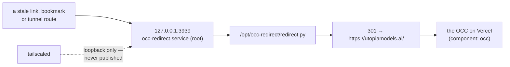

> Mirrored verbatim from `utopia-models/knowledge` `wi/components/occ-redirect.md` by the allowlisted publish pipeline. Edit it there, not here.

```yaml
component: occ-redirect
serves: all
runs-on: novaserver
adrs: []
owns:
  - occ-redirect.service
  - 127.0.0.1:3939
  - /opt/occ-redirect/redirect.py
```

# occ-redirect — a fifteen-line 301 to the real OCC

## WHAT IT IS

A redirect shim. The OCC used to be served from novaserver; it is a Vercel deployment now, and this
responder catches whatever is still pointed at the old origin and 301s it to the live surface.

🔴 **It is not a fallback.** It serves no OCC content and cannot stand in for the site if Vercel is
down. Its being up says nothing whatsoever about the OCC's health.

**This is the exemplar for a component whose machinery lives OFF-REPO**, and the spec's own
measurement says 53% of components are off-git-but-probeable with another 8% opaque, so most of the 67
will be some version of this shape. Not one entry in its `owns:` is a repo path: the script is
`/opt/occ-redirect/redirect.py`, the unit is `/etc/systemd/system/occ-redirect.service`, and the third
entry is a port. `kb-lint`'s R9 says so out loud rather than skipping quietly, and `cog_machinery`
REFUSES an absolute path outright — master homes are `0750`, so an out-of-repo stat answers by WHO ran
it. The temptation to resist is inventing a repo path so the doc looks better bound than it is.

## HOW IT WORKS TODAY



Every path gets the same answer; there is no routing and no state. Because it is bound to `127.0.0.1`
it is unreachable from the tailnet directly — what reaches it is something on the box, or a tunnel
route that terminates locally.

**Determine current state — one command, and it is the whole verification:**

```
$ curl -s -m5 -o /dev/null -w "%{http_code} -> %{redirect_url}\n" http://127.0.0.1:3939/
301 -> https://utopiamodels.ai/
$ ss -ltn 'sport = :3939'
LISTEN 0 5 127.0.0.1:3939 0.0.0.0:*
```

(Both run on novaserver, 2026-08-31. From off-box, prefix with
`ssh nova@100.71.25.43`.)

**The gotcha worth knowing:** if someone reports "the OCC looks empty but returns 200", check whether
they landed here rather than on Vercel. A 301 chain ending at a cached page looks exactly like a
broken OCC.

## BOUND VALUES

The runtime behaviour — the `301`, and the fact that anything is listening at all — is proven by the
probe above and by nothing in this repo. What CI can still hold is the registry binding that puts
this unit inside the daily `verify-unit-execstart.py` sweep, and the port, which the registry states:

<!--[[[cog
m.units("occ-redirect")
m.value("3939", "wi/registry/components.yaml", r"occ-redirect\.service · 127\.0\.0\.1:(\d+)")
]]]-->
- ⚙️ `system:occ-redirect.service` — ExecStart target proven daily by `verify-unit-execstart.py` (#4742)
- ✅ `3939` — still live in `wi/registry/components.yaml` (`occ-redirect\.service · 127\.0\.0\.1:(\d+)`)
<!--[[[end]]]-->

## DETERMINE CURRENT STATE

```
curl -s -m5 -o /dev/null -w "%{http_code} -> %{redirect_url}\n" http://127.0.0.1:3939/
```

Expect `301 -> https://utopiamodels.ai/`. From off-box, prefix with `ssh nova@100.71.25.43`. Add
`ss -ltn 'sport = :3939'` to separate "not listening" from "listening and answering wrong".

🔴 **The probe, never the answer.** This component is 100% off-git; the only durable thing this doc can
say about its behaviour is the command that asks it.

## KNOWN BROKEN

- 🔴 **No mechanism in this repo can tell you this service is answering.** `m.units()` proves the
  registry still binds it; `verify-unit-execstart.py` proves its ExecStart target exists on the box.
  Neither issues a request. The `301` in this doc is a reading taken by hand on the date stated above
  and it will age silently — that is a real gap, written down rather than papered over with a green
  check that measures something else.
- ⚠ **The port is bound to a doc-shaped field.** The `cog` assertion above reads
  `components.yaml`'s `where:` prose, which is the fleet's own record of where this runs but is still
  prose: change the port on the box without editing that row and nothing goes red.
