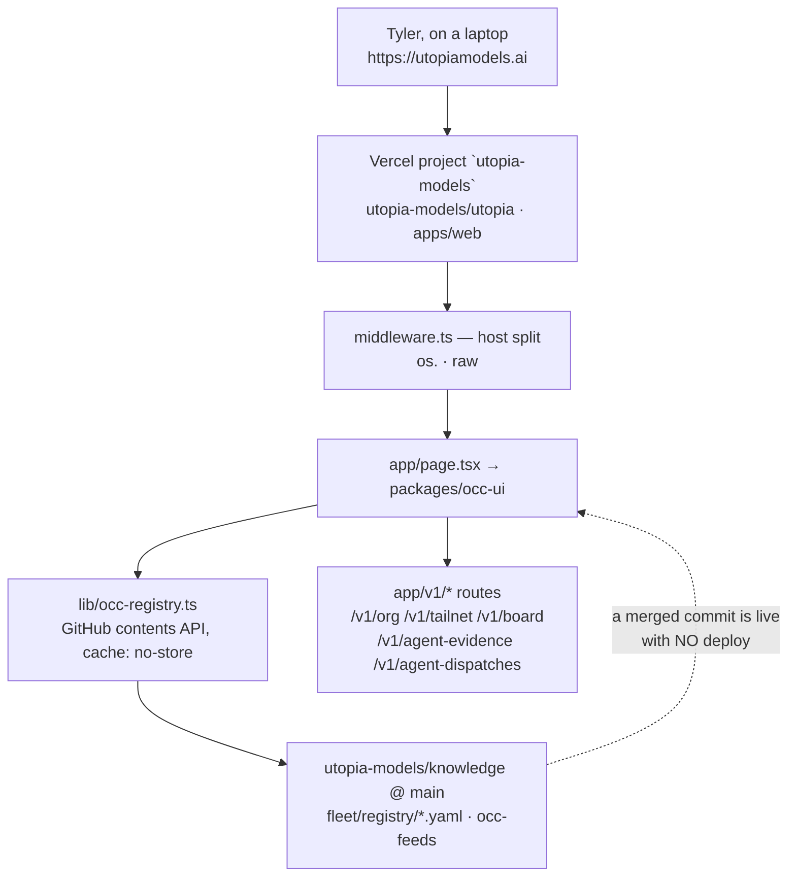

> Mirrored verbatim from `utopia-models/knowledge` `wi/components/occ.md` by the allowlisted publish pipeline. Edit it there, not here.

```yaml
component: occ
serves: all
runs-on: vercel
adrs: []
owns:
  - utopiamodels.ai
  - www.utopiamodels.ai
```

# occ — the Org Command Center, and the org's only read surface

## WHAT IT IS

The **Org Command Center**: `https://utopiamodels.ai`, the page Tyler opens to see what the fleet is
doing. It renders the board, the plan registry, every agent's usage and account, and the component
catalogue. Nothing else in the org presents that state to a human — if it stops, the only remaining
way to see the fleet is `gh` and `systemctl`.

🔴 **Its failure mode is not downtime, it is a lie.** Every section reads a feed or a repo file that
may be stale, and a stale value renders identically to a live one. Tyler measured **~20% of reads
wrong** (#7212); that number, not uptime, is what this component is judged on.

🔴 **The homepage is PUBLIC** — 200 unauthenticated. Never inline private fleet text into it. Link to
the private repo blob instead; GitHub gates that and Tyler opens it logged in.

🔴 **It is a LAPTOP surface.** Tyler opens it beside several shells to watch plans live. A layout
argument that begins *"he reads on a phone"* is citing `identity-and-scope.md` about the wrong
surface (Tyler, 2026-08-28).

**`owns:` names only hosts.** Not one entry is a repo path: the application code is in
`utopia-models/utopia`, and `cog_machinery` refuses an out-of-repo path outright. What this repo
*does* own is the OCC's INPUT — see BOUND VALUES.

## HOW IT WORKS TODAY

One Next.js app on one Vercel project, serving several hosts. The apex renders the OCC; sibling hosts
are split off in `apps/web/middleware.ts` before anything else runs (`os.` → the RTOS surface, `raw` → the RAW pages). **So "the OCC deployed" and "the RAW pages
deployed" are the same deployment** — one project, one build, one rollback.



**The one property that surprises everyone: a merged commit in `knowledge` changes the OCC without a
deploy.** `occ-registry.ts` reads this repo through the GitHub contents API at request time. There is
no build step to wait for and no cache to bust beyond `cachedRead`'s fresh/stale-on-error window.
Merge, wait out the cache, curl.

**Two layers of defence against a corpus reorg**, added because the registry directory has moved four
times and each move 502'd every `/v1` route: a known-prefix list tried current-first, then a git
tree-API self-heal that finds a registry file under **any** `fleet/registry` directory at any depth.
Read them at `apps/web/lib/occ-registry.ts` — `REG_PREFIXES` and `REG_DIR_SUFFIX`. 🔴 See KNOWN
BROKEN: this plan's own target tree defeats both.

**Determine current state — the surface is CLIENT-RENDERED, so a curl proves less than it looks:**

```
$ curl -sS -m20 -o /tmp/occ.html -w 'http=%{http_code} bytes=%{size_download}\n' https://utopiamodels.ai/
http=200 bytes=136621
$ grep -o '<title>[^<]*</title>' /tmp/occ.html
<title>Utopia — Org Command Center</title>
```

(Measured on novaserver, 2026-08-31.) The agent bars and several tiles load in `useEffect`, so the
number of `data-occ-section` markers in raw HTML is **not** the number of sections a browser shows —
grep it and you are counting the RSC payload, not the render. Anything about layout, emptiness or
colour is graded in a headless browser, never by curl.

**Which project actually serves a host** — the only authoritative answer, because `aliasAssigned` on
a deployment is historical:

```
curl -sS -H "Authorization: Bearer $VERCEL_TOKEN" \
  'https://api.vercel.com/v4/aliases/utopiamodels.ai?teamId=utopia-436cfb73' | jq .projectId
```

Measured 2026-10-06: `utopiamodels.ai` and `rawphones.com` both returned
`prj_6ToAWH9oYd7l01X2qNSzrSghFRBa` — the same project.

**What a section fetches** is read from the component, never from a page comment:
`grep -rn 'fetch(' packages/occ-ui/src/<Component>.tsx` in `utopia-models/utopia`. Per-section
behaviour (Planning, Execution, Utopia, World Infrastructure, the header, the topbar) is documented
one file per section in `wi/work/reference/occ/`.

## BOUND VALUES

The application is off-repo, so nothing here can bind its code. What CI **can** hold is the OCC's
INPUT CONTRACT — the three registry files `occ-registry.ts` fetches by name and the feed directory it
reads per request. Rename or move one of these and the OCC 502s a route with no deploy and no build
failure anywhere; that is precisely the class this block exists to make loud.

<!--[[[cog
m.exists("wi/registry/organization.yaml wi/registry/components.yaml wi/registry/businesses.yaml")
]]]-->
- ✅ `wi/registry/organization.yaml`
- ✅ `wi/registry/components.yaml`
- ✅ `wi/registry/businesses.yaml`
<!--[[[end]]]-->

## DETERMINE CURRENT STATE

```
curl -sS -m20 -o /tmp/occ.html -w 'http=%{http_code} bytes=%{size_download}\n' https://utopiamodels.ai/
```

Expect `http=200` and a body of ~130 KB carrying `<title>Utopia — Org Command Center</title>`.

🔴 **That is the whole of what curl can tell you.** The agent bars and several tiles load in
`useEffect`, so counting `data-occ-section` in raw HTML counts the RSC payload, not the render —
anything about layout, emptiness or colour is graded in a headless browser or it is not graded.

Which project actually serves the host (a deployment's `aliasAssigned` is historical and lies):

```
curl -sS -H "Authorization: Bearer $VERCEL_TOKEN" \
  'https://api.vercel.com/v4/aliases/utopiamodels.ai?teamId=utopia-436cfb73' | jq -r .projectId
```

## KNOWN BROKEN

- 🔴 **This plan's own target tree breaks the OCC's registry reads, and nothing would go red.**
  `apps/web/lib/occ-registry.ts` recovers from a corpus move two ways, and both key on the literal
  string `fleet/registry`: `REG_PREFIXES` lists four historical prefixes (`world-infrastructure/…`,
  `_org/…`, `fleet/registry`, `FLEET/registry`) and the tree-API self-heal matches
  `REG_DIR_SUFFIX = "fleet/registry"`. PLAN-256's target puts the registry at **`wi/registry/`**,
  which ends in neither. Measured 2026-08-31 in the utopia clone:
  `grep -n 'REG_DIR_SUFFIX' apps/web/lib/occ-registry.ts` → `REG_DIR_SUFFIX = "fleet/registry"`.
  **P3 (#7316) must land a matching edit in `utopia-models/utopia`, in the same wave**, or the OCC's
  `/v1/org` and the World Infrastructure section go blank the moment the move merges. The `cog` block
  above turns red on the move — that is the alarm, and it is in this repo, not that one.
- 🔴 **The `deploy` check on utopia PRs never fires** — that workflow startup-fails. A green PR is not
  a deployed OCC. Confirm prod by grepping the SERVED bundle for a marker string.
- ⚠ **Vercel's git-author check goes red on fleet PRs** (a master's commit email resolves to its
  GitHub login, not a Vercel-linked account). It is not a build failure: merge with
  `gh pr merge <n> --squash --admin`; the squash commit deploys fine.
- ⚠ **The registry row for this component names the wrong Vercel team.**
  `wi/registry/components.yaml`'s `occ` row's `where:` field still names the Vercel team `utopia`. The live slug is
  `utopia-436cfb73`, which the same file uses correctly in its `site-docs-wiki`
  row. Nothing binds a `where:` string.
- ⚠ **`reference/win/occ.md`'s probe uses `https://www.utopiamodels.ai` and greps `data-win-row`.**
  The canonical host is the apex, and the marker is client-rendered — the command can print `0`
  against a perfectly healthy page. The probe above replaces it.
