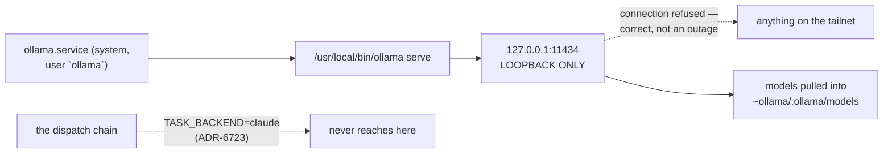

> Mirrored verbatim from `utopia-models/knowledge` `wi/components/ollama.md` by the allowlisted publish pipeline. Edit it there, not here.

```yaml
component: ollama
serves: all
runs-on: novaserver, a system unit running as the `ollama` user
adrs: [6723, 2165]
owns:
  - ollama.service
  - "127.0.0.1:11434"
```

# ollama — local models on novaserver, and nothing that calls them

🔴 **RETIRED 2026-10-30 (knowledge#10314, Tyler-approved disk cleanup).** `ollama.service` is stopped and
disabled and `/usr/share/ollama/.ollama/models` (8.2 GB) is deleted; `/usr/local/bin/ollama` and the unit file
remain. `curl 127.0.0.1:11434` now refuses. `deep-research.sh` (nova) fails loud with exit 2. Restoring it means
`systemctl enable --now ollama` plus re-pulling models. The rest of this page describes the pre-retirement state.

## WHAT IT IS

`ollama.service`, bound to `127.0.0.1:11434`: small local models for cheap, offline-capable work —
classification, embeddings, quick transforms — on a box with no GPU. If it stops, nothing in the
fleet changes: **no script, workflow, hook or unit in this repo calls it.**

🔴 **It is not a dispatch backend and cannot become one by configuration.** ADR-6723 makes the
fleet 100% Claude Code on Claude subscriptions; `dispatch.sh` passes the literal
`TASK_BACKEND=claude` and there is no per-master backend field for this to appear in. ADR-2165
already disqualified it on measurement, not preference — *"no GPU, 7 tok/s, 5-22 min prefill per
call, impossible at 350/day"*.

## HOW IT WORKS TODAY



One unit, one process, no repo artifact and no drop-in. Everything about it is read live — the
commands are in DETERMINE CURRENT STATE.

**The model list is off-git and this doc deliberately does not state it** — a `pull` or a prune
changes it with no commit anywhere, and the previous doc's list outlived two of its own facts. What
is worth knowing structurally is the *size class*: these are 1.5B-7B instruct and
embedding models, and that is a property of the box (no GPU), not of the list.

**Loopback is a design choice, not an oversight.** `ss -tlnp | grep 11434` shows
`LISTEN 127.0.0.1:11434`, so a caller on the tailnet gets a connection refusal. That is correct
behaviour. Any fleet use would be from a process on novaserver itself, or through an explicit
forward — never by rebinding the port.

**Where its cost lands.** It shares RAM with the SigNoz containers and four master harnesses on one
12-core box, and a loaded 7B model is the largest single thing it can add. Measure before blaming or
excusing it:

```bash
systemctl show ollama -p MemoryCurrent --value    # bytes; 0 or [not set] means nothing is loaded
```

## BOUND VALUES

<!--[[[cog
m.units("ollama")
]]]-->
- 🔴 `ollama` — no `units:` binding, so nothing proves its ExecStart target still exists (#4742)
<!--[[[end]]]-->

No file, port list or model count is bindable here — the unit is a distro install and the models are
on-disk state. The registry binding above is the only in-repo claim this component makes, and it is
the one that would catch the unit being removed.

## DETERMINE CURRENT STATE

```bash
systemctl is-active ollama
curl -s -m5 http://127.0.0.1:11434/api/tags | python3 -c \
  "import json,sys;[print(m['name'],m['details'].get('parameter_size'),m['size']) for m in json.load(sys.stdin)['models']]"
systemctl show ollama -p MemoryCurrent --value    # bytes; 0 or [not set] means nothing is loaded
```

The model list is off-git and changes with a `pull` or a prune, committing nothing — so it is read,
never recalled.


## KNOWN BROKEN

- 🔴 **No caller anywhere.** `grep -rn "11434\|ollama" --include='*.sh' --include='*.py'
  --include='*.mjs' --include='*.yml' _infra/ .github/` returns nothing. Under ADR-6723 that is the
  expected state; recorded here so the next reader does not spend a run looking for the consumer.
  🔴 Per the plan's own rule, low traffic is a deletion *candidate*, never a verdict — and unlike
  `signoz`, this one really does have zero inbound.
- ⚠ **A 1.5B-7B model used for reasoning-shaped work fails silently.** The output is confident,
  fluent and wrong, and it arrives with a `200`. That is the failure mode to design against if
  anything ever does call this.
- ⚠ **The old reference doc pins four model names and a date** (*"confirmed 2026-08-01"*). Model
  names are exactly the class of off-git fact that rots without announcing itself; this doc replaces
  the list with `GET /api/tags`.
