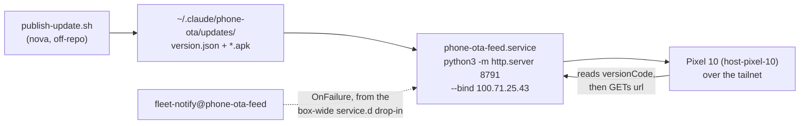

> Mirrored verbatim from `utopia-models/knowledge` `wi/components/phone-ota-feed.md` by the allowlisted publish pipeline. Edit it there, not here.

```yaml
component: phone-ota-feed
serves: all
runs-on: novaserver, a `Type=simple` user unit on nova's account, bound to the tailnet address
adrs: []
owns:
  - phone-ota-feed.service
  - "100.71.25.43:8791"
```

# phone-ota-feed — a static directory the RAW phone asks for updates

## WHAT IT IS

`python3 -m http.server` over `~/.claude/phone-ota` on nova's account, bound to the tailnet address.
It holds `publish-update.sh` and an `updates/` directory containing `version.json` and an APK. The
phone polls `version.json`, compares `versionCode`, and downloads the `url` it names.

**There is no application logic here at all** — it is a directory listing. `publish-update.sh` is
what puts a payload into `updates/`; this service only hands the file over when the phone asks.
RAW is parked, so nothing is publishing today; the service is the delivery half, kept alive.

## HOW IT WORKS TODAY



Read the served state rather than trusting any version written here — the whole point of the file is
that it changes without a commit, and the commands are in DETERMINE CURRENT STATE.

**It is supervised, and the manifest's integrity field is the phone's only defence.**
`Restart=always`/`RestartSec=5` bring it back after a crash or a reboot, and the box-wide
`service.d/50-onfailure.conf` drop-in gives it `OnFailure=fleet-notify@phone-ota-feed.service`, so a
unit failure upserts a board issue rather than going quiet. `version.json` carries a `sha256` for the
payload — a truncated or corrupt APK is caught by the phone comparing that hash, **not** by anything
on this side: `http.server` serves a half-written file with a cheerful `200`.

**Tailnet, deliberately, and with no auth whatsoever.** `--bind 100.71.25.43` means the phone can
reach it from anywhere Tyler is, including off the home network, while the public internet cannot.
But `http.server` has no auth, no TLS and no log worth reading, so **anything on the tailnet can
fetch anything in that directory** — never put a secret in `~/.claude/phone-ota`.

**A `200` on the listing proves the server, not the payload.** The three failures it cannot show you
are: a stale `version.json` the phone will correctly ignore, an APK whose hash no longer matches, and
an `updates/` directory nobody has published to in weeks. Check the file, not the port.

## BOUND VALUES

<!--[[[cog
m.units("phone-ota-feed")
]]]-->
- 🔴 `phone-ota-feed` — no `units:` binding, so nothing proves its ExecStart target still exists (#4742)
<!--[[[end]]]-->

Nothing else here is in-git: the unit, the served directory, `publish-update.sh` and the payload all
live on nova's account only. Every fact about them in this doc is a command, not an answer.

## DETERMINE CURRENT STATE

```bash
curl -s -m5 http://100.71.25.43:8791/ | grep -o 'href="[^"]*"'
curl -s -m5 http://100.71.25.43:8791/updates/version.json
ssh nova@100.71.25.43 'systemctl --user cat phone-ota-feed.service; systemctl --user is-active phone-ota-feed'
```

🔴 **A `200` from this server proves the bytes were served, never that they are whole.**
`http.server` will serve a half-written file cheerfully; the phone comparing `version.json`'s
`sha256` is the only integrity check in the path.


## KNOWN BROKEN

- 🔴 **`wi/work/reference/win/phone-ota-feed.md` says this service is unsupervised:**
  *"It has no supervision beyond the process itself; if the box reboots and nothing restarts it, the
  phone simply stops seeing updates, silently."* False today. Measured 2026-08-31:
  `cat /proc/<pid>/cgroup` → `…/app.slice/phone-ota-feed.service`, the unit carries
  `Restart=always`/`RestartSec=5`, and `systemctl --user list-units --all '*ota*'` shows
  `fleet-notify@phone-ota-feed.service` wired as its `OnFailure`. Acting on the old text would mean
  building supervision that already exists.
- 🔴 **No `units:` binding in the registry** (the generated block above), so the ExecStart target is
  outside `verify-unit-execstart.py`'s daily sweep — despite the unit being real, supervised and
  named in the registry row's own `where:` field.
- 🔴 **The unit carries `After=network-online.target`, which is a silent no-op in the systemd USER
  manager.** That target does not exist there (`LOAD=not-found`) — the exact defect #4118 diagnosed
  in `fcc-server.service` and removed from *that* unit while this one kept it. It is harmless here
  only because `http.server` binding a Tailscale address that is not yet up fails and gets restarted
  five seconds later; the ordering does nothing.
- ⚠ **`publish-update.sh` is untracked.** `git ls-files | grep publish-update` returns nothing: the
  only copy is in the served directory itself, which means the publisher is distributed by the same
  HTTP server it publishes through.
- ⚠ **The feed is stale, which is correct while RAW is parked.** `updates/version.json` reads
  `versionName 0.1.0`, `publishedAt 2026-07-06`, alongside a 60,938,188-byte `workstation.apk` last
  written 2026-07-06 (measured 2026-08-31). Recorded so a reader does not mistake an idle feed for a
  broken one — but nothing on this box would tell you either way.
