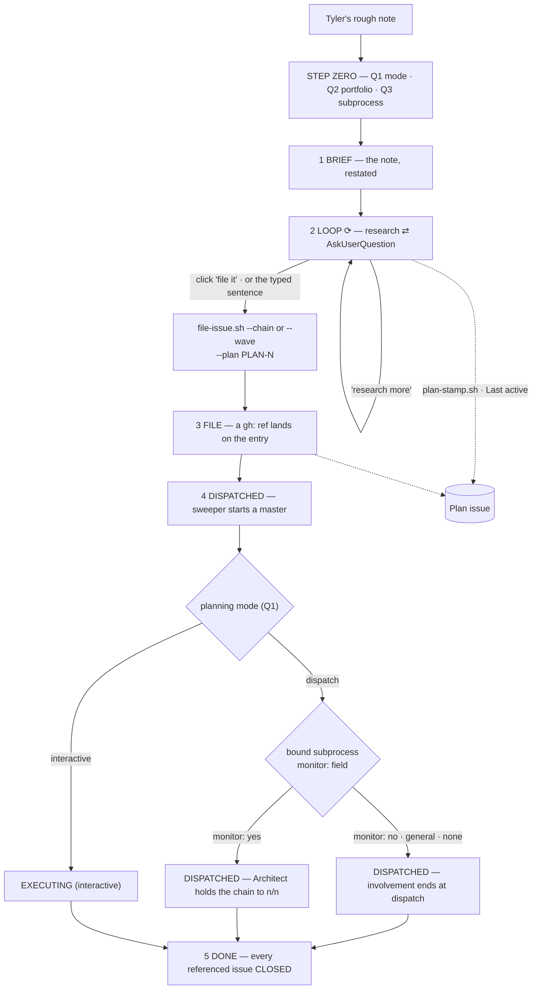

> Mirrored verbatim from `utopia-models/knowledge` `wi/components/planning-loop.md` by the allowlisted publish pipeline. Edit it there, not here.

```yaml
component: planning-loop
serves: all
runs-on: novaserver (the Architect, unix user `architect`)
adrs: [6798, 7781, 6925, 6926, 6929, 6932, 6933, 7126]
owns:
  - _process/steps/
  - _process/the-loop.md
```

# planning-loop — how a rough note becomes filed, dispatchable work

## WHAT IT IS

The five-step process Tyler and the Architect run together, and the vocabulary the whole fleet uses to
talk about work: **PLAN** above the board, **Feature** and **issue** on it. Stop it and masters keep
executing whatever is already filed, then run dry — nothing else in the fleet turns an intention into a
board issue.

Its one structural property is that **no step is reported**. Every step is derived from the Plan issue
and the board: 3-5 from its Features on every render, planning (steps 1-2) from the issue being open with
none filed. That is why a plan cannot lie about where it is: there is no field to lie in. The plan
registry that used to carry step-1/2 events was retired (ADR-10109).

## HOW IT WORKS TODAY

```
1 BRIEF · 2 LOOP⟳  ‖  3 FILE · 4 DISPATCHED · 5 DONE
                      ↑ planning ends, execution begins
```

| # | step | derived from |
|---|---|---|
| 1 | **BRIEF** — Tyler's rough note, restated. No research yet | `brief:<iso>` on the entry |
| 2 | **LOOP** ⟳ — research ⇄ questions, repeating | `agent:N` ≥ 1 |
| 3 | **FILE** — ≥1 issue exists for this plan | a `gh:` reference on the entry |
| 4 | **DISPATCHED** — a master is executing | ≥1 referenced issue OPEN |
| 5 | **DONE** | every referenced issue CLOSED |

**Planning is `step < 3`** — the OCC's Planning and Execution sections partition on that one number.



**Step zero asks three ORDERED questions** (ADR-6798): mode → portfolio → subprocess. Mode decides which
section of a catalogue exists at all; portfolio decides which catalogue. The two modes are `dispatch` ·
`interactive` (ADR-7781), and `interactive` is the whole name — never `blocked`, `needs-tyler` or
`manual`. **Whether a dispatch chain is watched is not a mode and not a question**: it is the bound
subprocess's `monitor: yes|no` frontmatter, and `general` / `none` are unwatched.

**Two things end LOOP, and both are read by a mechanism rather than remembered** (#6932). Every step-2
turn ends in an `AskUserQuestion` whose last two options are, in order, `research more` and
`file it, move to step 3`. Tyler either clicks the second — a click returns as a **tool result**, which
the per-turn injector structurally cannot see, so `plan-loop.sh` reads
`tool_response.answers` and only `answers` — or types *"Plan is good, proceed with step 3, file it."*
An approving remark is neither. **Neither exit advances the step**: filing does.

**The Plan issue is the only record of a planning session** (PLAN-405 P4, ADR-9839). /plan-start opens it
after its three answers (`plan-open.sh open`): label `planning`, the board's Portfolio · Mode · Recipe ·
Last active set, a `<project>/work/specs/<issue#>-<slug>/` skeleton published, and the issue written into
the session's state file `~/.claude/state/plan-issue/<sid>`. `plan-stamp.sh` keeps `Last active` at most
180 s stale; /plan-continue resumes from the issue alone (`plan-open.sh resume [N]`). Parked = label
`parked`; archived = closed as not planned. The plan registry that ran beside it was retired (ADR-10109).
/plan-close (`plan-open.sh close [N] [--check]`, Feature #10062) closes it: a dispatch plan needs every
Feature filed and dispatched and lists what still runs in one `<!-- plan-close -->` comment; an
interactive plan refuses (exit 3) while a sub-issue is open; a closed issue is left untouched.
/plan-park (`plan-open.sh park --unparks "<condition>"`) adds `parked` and writes the condition into the body.

**Filing is one command, and its shape is a real choice.** `--chain` LINEARIZES (task k `blocked_by`
k-1); `--wave` files parallel groups where each group waits on the whole of the previous one. A plan
whose design is five waves filed as a `--chain` has exactly one dispatchable issue. `file-issue.sh` now
REFUSES a `--chain` of ≥3 tasks whose bodies name no file in common and prints the `--wave` rewrite;
`--allow-serial` supplies the missing reason.

**The loop ends at dispatch** — unless the bound subprocess says `monitor: yes`, in which case the
Architect holds the chain to completion with a `Monitor` that exits at n/n. Steps 1-2 of the next plan
run concurrently with the execution of the last; the sweeper, the reaper and the announcer carry the tail. Watching a master is indistinguishable
from not trusting it.

🔴 **The step-4 MODE is not the planning mode**, and the two words collide. The planning mode is Q1 of
step zero and decides which subprocesses exist; the step-4 MODE is what the board shows. The mapping is
one table in the doctrine file this component owns.

## BOUND VALUES

Re-derived from the repo by `docs-cog.sh --check` on every PR.

<!--[[[cog
m.exists("_process/steps/ _process/the-loop.md")
m.calls("_process/steps/", "plan-loop.sh", "file-issue.sh", "--wave", "--chain")
m.value("3", "_infra/scripts/file-issue.sh", r'\[ "\$SHAPE_N" -ge (\d+) \]')
]]]-->
- ✅ `_process/steps/` — directory
- ✅ `_process/the-loop.md`
- ✅ `plan-loop.sh` — still called by `_process/steps/`
- ✅ `file-issue.sh` — still called by `_process/steps/`
- ✅ `--wave` — still called by `_process/steps/`
- ✅ `--chain` — still called by `_process/steps/`
- ✅ `3` — still live in `_infra/scripts/file-issue.sh` (`\[ "\$SHAPE_N" -ge (\d+) \]`)
<!--[[[end]]]-->


## DETERMINE CURRENT STATE

| question | command |
|---|---|
| where is plan N, really | `gh issue view <plan#> --repo utopia-models/knowledge` (its sub-issues + `Features:` line) |
| every open plan | `gh issue list --repo utopia-models/knowledge --label planning --state open` |
| what shape would this filing take | `bash _infra/scripts/file-issue.sh --help` |
| do the hooks that derive steps 1-2 exist on this box | `ls ~/.claude/plugins/cache/fleet-doctrine/fleet-doctrine/*/scripts/ \| grep -E 'plan-loop\|plan-stamp\|plan-open\|project-session'` |
| which plugin version is installed here | `jq -r '.plugins["fleet-doctrine@fleet-doctrine"][0].version' ~/.claude/plugins/installed_plugins.json` |
| is every box on `main`'s payload | `bash _infra/scripts/plugin-deploy-check.sh` |

The planning hooks (`project-session.sh`, `plan-loop.sh`, `userpromptsubmit-plan-issue.sh`) and the
Plan-issue scripts (`plan-open.sh`, `plan-stamp.sh`) ship in the **fleet-doctrine plugin**,
not in this repo — a different repo with its own version gate. Nothing about their content is stated
here; the probes above read them where they actually are.

## KNOWN BROKEN

- 🔴 **The doctrine file states a subprocess count that disk has already outgrown.**
  `_process/steps/` heads its table *"The 17 subprocesses, by mode then
  portfolio"*. Measured this session:
  `for d in */subprocesses/*/; do ls $d*.md; done | wc -l` → **18** — WI's `interactive/` has gained
  `wi-plan.md`, which appears in no cell of that table. The same section carries a 🔴 note saying the
  table *"SAID 12 AND DISK HELD 17"* and instructs the reader to re-derive rather than edit a cell; it
  has drifted again since. The count belongs to `subprocess-catalogue`, and this doc deliberately does
  not restate it.
- ⚠ **Nothing binds the two doctrine files to each other.** `planning-vocab.md` is the master-facing
  compaction of `planning-loop.md`, and a rule changed in one is not checked against the other — the
  `~/.claude/rules/planning-loop.md` symlink resolves to a *different file* per class, by design
  (#5341). A contradiction between them is invisible to CI and shows up as a master doing the
  Architect's job or vice versa.
- ⚠ **The loop's own machinery is not gradable from this repo.** Everything that derives steps 1-2 is in
  `utopia-models/fleet-plugins`, version-gated per box, so `docs-cog.sh` can bind the *doctrine* and
  never the *mechanism*. `plugin-deploy-check.sh` is the only thing that reads the population, and it is
  run by hand.
