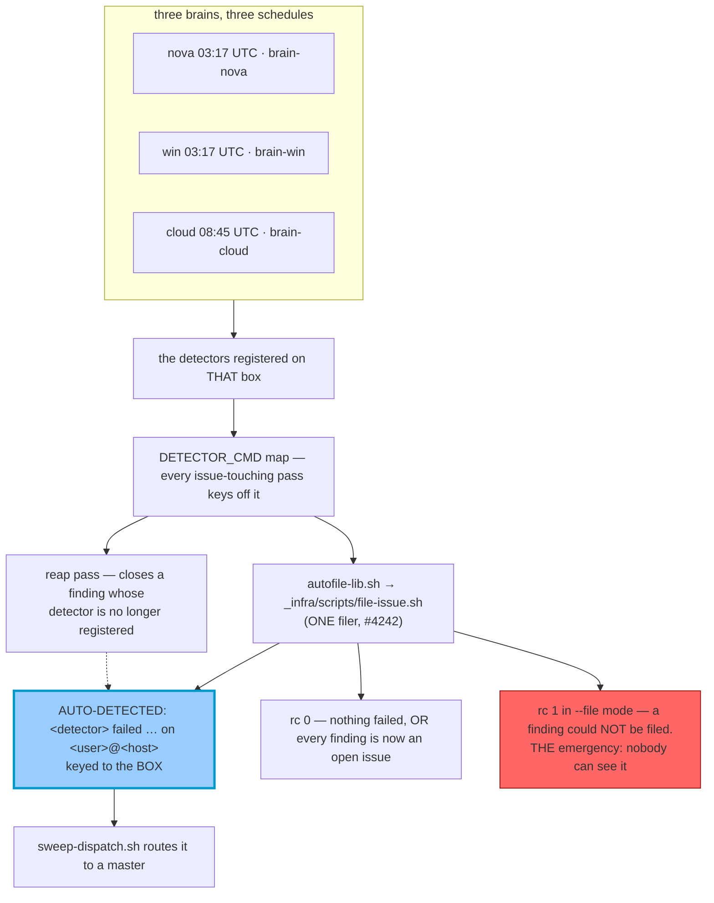

> Mirrored verbatim from `utopia-models/knowledge` `wi/components/proactive-audit.md` by the allowlisted publish pipeline. Edit it there, not here.

```yaml
component: proactive-audit
serves: all
runs-on: novaserver
adrs: [3977, 4177]
owns:
  - _infra/scripts/file-issue.sh
  - _infra/scripts/verify-credential-record.sh
  - _infra/scripts/verify-master-token-shape.sh
  - _infra/scripts/mechanism-liveness.sh
  - proactive-audit.service
  - proactive-audit.timer
```

# proactive-audit — the fleet's self-detection sweep

## WHAT IT IS

A daily per-brain drift / regression / identity / health sweep that **auto-files a board issue per
confirmed finding**, keyed to the box that found it. Stop it and nothing else in the fleet notices a
regression on a master: every other health mechanism watches a *service*, this one watches the *agent*.

The corollary is the thing to hold onto — because it writes to the board, **a bad check here
manufactures work**. A false positive becomes a real issue, gets dispatched, and burns a run.

## HOW IT WORKS TODAY

**Three boxes, three brains, three schedules, and the copies are not identical.** The script is
`~/.claude/scripts/proactive-audit.sh` in each box's own brain repo, so the timer runs whatever is on
that box's disk at fire time. Detector lists differ per brain, and a fix applied to one is applied to
none of the others.



**The issue key is `<user>@<host>`, not the detector id.** Three brains drifting the same way is three
issues, each fixed on its own box. When the key was the detector alone the boxes closed each other's
findings and flapped nightly (ADR-3977, auto-issue identity).

**The lane is DERIVED from the box** — the `organization.yaml` key whose
`agents.<lane>.location.filepath` *is* this brain — never a hardcoded literal. nova hardcoded `agent`
for weeks and `sweep-dispatch.sh` routes only `win|nova|cloud|dust`, so every finding nova filed was
born undispatchable, sitting `Todo` looking queued (#7276).

**Read the exit code as a claim about ROUTING, never about cleanliness** (ADR-3977, audit rc):
`0` = nothing failed *or* every confirmed finding is now an open issue — **go read the issues**;
`1` in `--file` mode = a finding could not be filed and nobody can see it; `1` outside `--file` mode is
ordinary CLI use. A red unit here does not mean the fleet drifted.

**Retiring a detector has two halves.** Deleting its `run` line takes the id out of `DETECTOR_CMD`, and
every issue-touching pass keys off that map — so the issues it already filed become unreachable by both
the close pass and the update pass. The reap pass closes that gap automatically: it parses the detector
id back out of each of this box's own open `AUTO-DETECTED` titles and closes any id no longer
registered, worded as *resolved by the deletion*.

**One detector is FLEET-scoped and lives on nova only** — `credential-record-drift`, which asks whether
every GitHub credential at `fleet-infra/prod` is recorded in `master-token-shape.yaml`. Infisical
answers identically from any box, so porting it would be the defect: three host-keyed issues for one
fact. Verified this session, `grep -l credential-record-drift …/proactive-audit.sh` → nova yes, win no,
cloud no.

**Diagnose a finding from the failing box's BRAIN REPO, not from your own box**, where the detector
passes. Master homes are `0750`; `brain-<agent>` mirrors that box's `~/.claude`, which is the real input
the detector ran on.

## BOUND VALUES

Only the instruments this component calls are in-git; the script itself, its detector list and its
schedule are all per-brain and off-repo, so they are named by the probe below rather than stated here.

<!--[[[cog
m.exists("_infra/scripts/file-issue.sh _infra/scripts/verify-credential-record.sh _infra/scripts/verify-master-token-shape.sh _infra/scripts/mechanism-liveness.sh")
m.units("timer-proactive-audit")
]]]-->
- ✅ `_infra/scripts/file-issue.sh`
- ✅ `_infra/scripts/verify-credential-record.sh`
- ✅ `_infra/scripts/verify-master-token-shape.sh`
- ✅ `_infra/scripts/mechanism-liveness.sh`
- ⚙️ `user@nova:proactive-audit.service` — ExecStart target proven daily by `verify-unit-execstart.py` (#4742)
- ⚙️ `user@win:proactive-audit.service` — ExecStart target proven daily by `verify-unit-execstart.py` (#4742)
- ⚙️ `user@cloud:proactive-audit.service` — ExecStart target proven daily by `verify-unit-execstart.py` (#4742)
<!--[[[end]]]-->

## DETERMINE CURRENT STATE

Which boxes carry it, and whether the timer is live:

```
bash _infra/scripts/mechanism-liveness.sh proactive-audit.sh
ssh nova@100.71.25.43 "sudo -u <box> XDG_RUNTIME_DIR=/run/user/\$(id -u <box>) \
  systemctl --user list-timers proactive-audit.timer --all --no-legend"
bash ~/.claude/scripts/proactive-audit.sh --dry-run    # runs the checks, files nothing
```

## KNOWN BROKEN

- 🔴 **`reference/win/timer-proactive-audit.md`'s own diagram contradicts its own prose.** The mermaid
  node reads *"the filer — file-issue.sh on nova and win, board-issue.sh on cloud"*, while the body four
  paragraphs above correctly records that #4242 retired the brain-local second filer. Measured this
  session on cloud: `grep -n "autofile-lib\|board-issue.sh" ~/.claude/scripts/proactive-audit.sh` →
  `13:source "$CLAUDE_HOME/scripts/autofile-lib.sh"` and no live `board-issue.sh` call. The registry row
  `timer-proactive-audit` carries the same dead claim in its `note:`.
- 🔴 **Every detector count in the old doc and registry row is drifted.** They state nova 6 / win 7 /
  cloud 11 (2026-08-04) and "nova is at 9 detectors". Measured 2026-08-31 with
  `grep -cE '^\s*run ' …/proactive-audit.sh`: **nova 6 · win 6 · cloud 7**. This is exactly why the
  count is not restated as a number here — it is per-brain, off-git, and unbindable.
- ⚠ **`mechanism-liveness.sh proactive-audit.sh` reports the mechanism as UNWIRED on every box** — the
  `WIRED-IN` column is `-` for win, nova and cloud, because the timer invokes the script by absolute
  path and no tracked file references it by name. The unit column correctly shows
  `proactive-audit.service(static)` on all three. Unwired here is a limitation of the liveness probe,
  not a dead mechanism; do not read it as one.
- ⚠ **The cadence is a backstop, not a monitor.** A regression can live 24 hours before it announces
  itself, and on `cloud` up to 24 hours from a *different* clock than nova's and win's.
