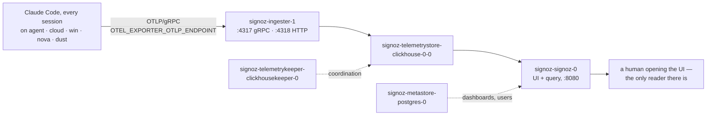

> Mirrored verbatim from `utopia-models/knowledge` `wi/components/signoz.md` by the allowlisted publish pipeline. Edit it there, not here.

```yaml
component: signoz
serves: all
runs-on: novaserver, five Docker containers from _infra/compose/signoz (roles/compose_stacks)
adrs: []
owns:
  - signoz-signoz-0
  - signoz-ingester-1
  - signoz-telemetrystore-clickhouse-0-0
  - signoz-telemetrykeeper-clickhousekeeper-0
  - signoz-metastore-postgres-0
  - "0.0.0.0:8080"
  - "0.0.0.0:4317"
  - "0.0.0.0:4318"
```

# signoz — the fleet's telemetry sink, and the one thing that already knows what every harness did

## WHAT IT IS

An OpenTelemetry backend: an OTLP collector, a ClickHouse store, and a UI. **It is the sink for the
Claude Code harness's own telemetry** — every master box's `~/.claude/settings.json` sets
`OTEL_EXPORTER_OTLP_ENDPOINT` at this box's `:4317`, so every session on every box ships logs and
metrics here as it runs.

If it stops, no dispatch fails and no board row moves — nothing in the dispatch path, the board, the
OCC or credentials reads it. What is lost is the only record of harness-level behaviour the fleet
keeps anywhere: turn counts, token counts, tool calls, per-agent volume.

🔴 **`clickhouse` is not a peer of this component; it is inside it.** The registry carries a separate
`clickhouse` row describing "SigNoz's columnar store" — that store is the
`signoz-telemetrystore-clickhouse-0-0` container listed in `owns.units` above. There is no other
ClickHouse on the box. Treating it as a sibling row is what makes the same process get counted twice
in every memory argument about novaserver.

## HOW IT WORKS TODAY



The compose project and the collector's config are code (knowledge#10605): `_infra/compose/signoz/compose.yaml`
plus the config tree beside it (`ingester/`, `telemetrystore/`, `telemetrykeeper/`), every image pinned to tag +
digest. `_infra/ansible/roles/compose_stacks` copies the directory to `/etc/fleet/compose/signoz/` and brings it
up there. It ran from `/home/nova/ops-infra/pours/deployment` until then. Read the live state rather than trusting
a line here. The commands are in DETERMINE CURRENT STATE.

**Who is actually sending, and how much** — the question every argument about this component turns
on, answered from its own store rather than from a grep of the repo (the senders are configured in
the *brain* repos, so a `knowledge`-repo grep finds nothing and reads as "no senders"):

```bash
docker exec signoz-telemetrystore-clickhouse-0-0 clickhouse-client -q "
  SELECT resources_string['agent.name'] AS agent, count() c, toString(max(fromUnixTimestamp64Nano(timestamp))) last
  FROM signoz_logs.distributed_logs_v2
  WHERE timestamp > toUnixTimestamp64Nano(now64() - INTERVAL 7 DAY)
  GROUP BY agent ORDER BY c DESC"
```

**The three signal classes are not equally alive, and that distinction is the whole triage.** Run the
counts before concluding anything:

```bash
docker exec signoz-telemetrystore-clickhouse-0-0 clickhouse-client -q \
  "SELECT count() FROM signoz_traces.distributed_signoz_index_v3 WHERE timestamp > now() - INTERVAL 7 DAY"
docker exec signoz-telemetrystore-clickhouse-0-0 clickhouse-client -q \
  "SELECT count() FROM signoz_logs.distributed_logs_v2 WHERE timestamp > toUnixTimestamp64Nano(now64() - INTERVAL 7 DAY)"
```

Measured 2026-08-31 on `cloud`: **0 traces, 405,819 logs, 14,150 metric samples in the last day.**
Zero traces is correct and expected — the harness emits logs and metrics, not spans. A trace count of
zero is therefore not evidence that nothing sends.

**The memory question.** `docker stats --no-stream` is the only honest answer; every written figure
in this repo's history has been wrong within weeks. Measured 2026-08-31: the five containers total
≈1.39 GiB, of which the ClickHouse store is ≈1.02 GiB.

**Reaching it.** `:8080`, `:4317` and `:4318` bind `0.0.0.0`, so the UI and both OTLP endpoints are
reachable from anywhere on the tailnet — that is what makes four other boxes able to export to it.
There is no auth in front of the OTLP ports.

## BOUND VALUES

<!--[[[cog
m.units("signoz")
]]]-->
- 🔴 `signoz` — **no such row** in `wi/registry/components.yaml`
<!--[[[end]]]-->

Nothing else here is bindable. The compose file and the collector config are in the repo, but this doc quotes
no value from them, and the containers and the counts above move every minute. That is why this doc states commands for them and
a value for none of them.

## DETERMINE CURRENT STATE

```bash
docker inspect signoz-signoz-0 \
  --format '{{index .Config.Labels "com.docker.compose.project.config_files"}} · {{.HostConfig.RestartPolicy.Name}}'
docker exec signoz-ingester-1 sed -n '/^receivers:/,/^exporters:/p' /etc/otel-collector-config.yaml
docker stats --no-stream
```

🔴 **Only `nova` is in the `docker` group** (`getent group docker`), so every command here must run
as that account. From any other master they fail with *"permission denied … /var/run/docker.sock"* —
which reads exactly like the stack being down.

```bash
ssh nova@100.71.25.43 'docker exec signoz-telemetrystore-clickhouse-0-0 clickhouse-client -q "
  SELECT resources_string['"'"'agent.name'"'"'] AS agent, count() c
  FROM signoz_logs.distributed_logs_v2
  WHERE timestamp > toUnixTimestamp64Nano(now64() - INTERVAL 7 DAY)
  GROUP BY agent ORDER BY c DESC"'
```

Ask that of **logs**, not traces: the harness emits logs and metrics, never spans, so a trace count
is zero on a perfectly healthy stack — and the store is the only place to ask, because the senders
are configured in the *brain* repos and a `knowledge` grep finds nothing, reading as "no senders".
The per-signal counts measured this way are in HOW IT WORKS TODAY.


## KNOWN BROKEN

- 🔴 **There is no `signoz` row in the registry**, so this component is in no sweep, has no `doc:`
  pointer and cannot be found from `components.yaml` at all. The generated block above is that gap,
  made loud. The nearest rows are `observability` (which describes SigNoz in its `name:` while
  actually owning Grafana/Prometheus/node-exporter) and `clickhouse` (which describes one container
  of this component as if it were a peer).
- 🔴 **PLAN-256's own DELETE rationale for this component is false on its central claim.** The
  committed artifact `https://github.com/utopia-models/knowledge/blob/b9b4874b1c5a5821b9b31b36cb3a0d8c4a765dc8/wi/work/plans/artifacts/plan-256.html` reads: *"nothing in the
  fleet references OTLP, port 4317/4318, or signoz anywhere — there is not one sender."* Measured
  2026-08-31 against the live store: **five senders, all writing within the same minute the query
  ran** — `1000xagent` 268,048 · `agent-cloud` 71,983 · `1000xwin` 31,519 · `1000xnova` 17,804 ·
  `agent-dmv` 16,727 log records over 7 days. The senders are configured in
  `~/.claude/settings.json` on each box (`OTEL_EXPORTER_OTLP_ENDPOINT=http://100.71.25.43:4317`),
  which is a *brain* repo — a grep of `utopia-models/knowledge` cannot see them, and that is exactly
  how the claim came to be made. **Deleting this stack today silently blinds five harnesses.**
- ⚠ **The `agent.name` values in the store are the pre-rename identities.** `1000xagent`,
  `1000xwin`, `1000xnova` and `agent-cloud` are what those boxes report; the registry's names are
  `agent`, `win`, `nova` and `cloud`. Any per-agent query has to translate. dust reported `agent-dmv`
  until 2026-10-29 and reports `agent-dust` from then (knowledge#10438), so a dust query over a window
  spanning that date needs both names.
- ⚠ **`clickhouse` and `observability` both partially claim this component** (see WHAT IT IS). Until
  the registry is reconciled, a reader looking up "the metrics stack" lands on a row that is one
  third of it.
