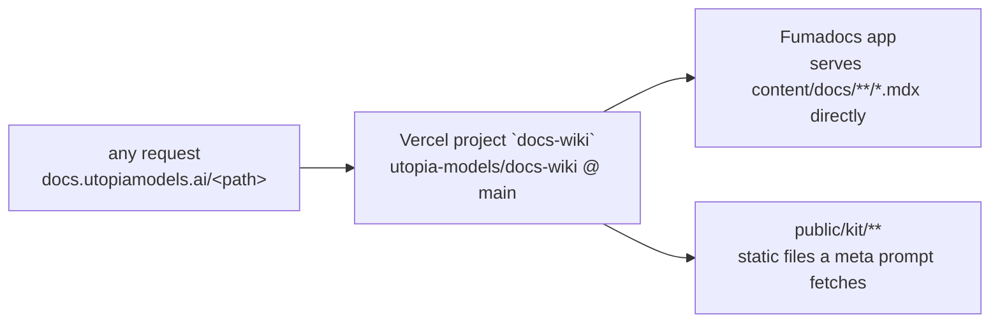

> Mirrored verbatim from `utopia-models/knowledge` `wi/components/site-docs-wiki.md` by the allowlisted publish pipeline. Edit it there, not here.

```yaml
component: site-docs-wiki
serves: all
runs-on: vercel
adrs: []
owns:
  - docs.utopiamodels.ai
```

# site-docs-wiki — `docs.utopiamodels.ai`, the fleet's public wiki

## WHAT IT IS

The fleet's public wiki: `docs.utopiamodels.ai`, a Fumadocs site (repo `utopia-models/docs-wiki`)
describing the fleet for outsiders — AI research models researching Tyler are a confirmed real
reader (Perplexity reads it directly for job-application research; PLAN-286).

🔴 **It was retired to a 301 on 2026-08-30, then UN-RETIRED on 2026-09-04** (PR #34, docs-wiki). Two
real, opposite states inside two weeks — read the live state, never a snapshot. See KNOWN BROKEN for
what that cost.

**The first screen is for a human, then for agents** (knowledge#9570). The homepage opens on "Who wrote
this, and what to read in two minutes", naming Tyler and linking the dispatch-runtime page, the public
repo and "What the numbers say"; the five agent prompts follow it. The nav's GitHub icon links the PUBLIC
`utopia-models/dispatch-runtime`, never this repo: `docs-wiki` is private and 404s for a logged-out reader.

```
curl -s https://docs.utopiamodels.ai/ | grep -o 'github.com/utopia-models/[a-z-]*' | sort -u   # expect dispatch-runtime only
```

## HOW IT WORKS TODAY

Content lives at `content/docs/<group>/*.mdx`, hand-curated — not one page per `wi/components/` entry
and not one per architectural pattern; `wi/work/reference/architectural-patterns.md` says why component
and pattern are different units. The groups change often (PLAN-299 added three in one day), so read
them rather than trusting a list:

```
$ gh api repos/utopia-models/docs-wiki/contents/content/docs/meta.json --jq .content | base64 -d
```

**Meta-prompt modules and `/kit/`.** Since PLAN-299 the site also serves school's module system,
fully public: `public/kit/` is the set of files a meta prompt tells a reader's agent to fetch, and
`kit/workflows/_src/build.py` generates module 01's ten tier templates (survey → tier → interview →
build). **An architectural-pattern module lives under `content/docs/patterns/<id>.mdx` with its kit
at `public/kit/patterns/<id>/`.** It reuses the kit generator — its own `_src/build.py` imports the
loader and the module-agnostic blocks — so it does not carry a second survey/tier/interview
mechanism. Pattern 14, decision discipline, was the first (knowledge#7761), dogfooded to completion on a client module. Stale generated tiers are one command:

```
$ for b in public/kit/workflows/_src/build.py public/kit/patterns/*/_src/build.py; do python3 "$b" --check; done
```



**Determine current state — one command:**

```
$ for p in / /docs/structure/architecture /llms-full.txt; do printf '%-32s ' "$p"; \
    curl -sS -m15 -o /dev/null -w '%{http_code}\n' "https://docs.utopiamodels.ai$p"; done
```

Expect `200` on every path, serving `docs-wiki` content directly — no redirect. A `301` means the
2026-08-30 retirement has recurred.

**Which project serves the host:**

```
$ curl -sS -H "Authorization: Bearer $VERCEL_TOKEN" \
    'https://api.vercel.com/v4/aliases/docs.utopiamodels.ai?teamId=utopia-436cfb73' | jq -r .projectId
prj_1rxHmBWTNRXgITkJtValFgrkpbJG      # project `docs-wiki`
```

**The load-bearing property:** the wiki is deliberately **UNGATED** — no auth wall, no login
redirect, no Vercel deployment protection (PLAN-178, Fork 2 — recorded in its spec,
`wi/work/specs/178-docs-wiki/spec.md`; no ADR file was written for it). A gate on this host is a
regression. That is also the pressure ADR-7289 refused to put on this repo when it sent the school to
a repo of its own.

**There is no exception.** A per-page `private: true` login gate (knowledge#8023/#8034) existed for
one day to hide the AI Vampire module; both were removed in knowledge#8043 (docs-wiki#59) — the
module's content was deleted with its portfolio and lives in git history. Probe that nothing gated came back:

```
$ curl -s -o /dev/null -w '%{http_code}\n' https://docs.utopiamodels.ai/login   # 404
$ gh search code --repo utopia-models/docs-wiki 'canRead' --json path --jq '.[].path'  # empty
```

**AI-facing surface:** `/llms-full.txt` is the plaintext form research models actually consume —
verify content there too, not only the rendered HTML (PLAN-286).

## USAGE MEASUREMENT

The same measurement as the work hub's (`site-work-hub.md`), ported in knowledge#8567. Many readers are
agents and crawlers that run no JavaScript, so reads are counted on the server.

- **Durable:** `proxy.ts` sends one Web Analytics `read` event per page, `.md` / `llms*.txt` fetch or
  `/resume.pdf`, with `path` and `reader` (`<link tag>|<user-agent class>`). It is read in the Vercel
  dashboard, project `docs-wiki`, Web Analytics → Events.
- **Immediate:** `bash scripts/usage.sh [hours]` in the repo reads Vercel's request log and prints reads
  by link tag, path, network and user-agent. The log is short-lived: run it with `168` and read the
  oldest row to see how far back it goes today.
- **Link tags:** `?r=<tag>` on every link to this site that is handed to a person. Where each tag is
  made: `net/README.md`, "Link tags".

```
$ curl -sS -H "Authorization: Bearer $VERCEL_TOKEN" \
    'https://api.vercel.com/v9/projects/docs-wiki?teamId=team_gq5tNzvoKbKNK0pyDJtAqqUU' | jq -c .webAnalytics
# `enabledAt` present = Web Analytics is on. To turn it on:
#   POST https://api.vercel.com/v1/web/insights/toggle?projectId=<id>&teamId=<team>   {"value":true}
```

## BOUND VALUES

<!--[[[cog
m.value("docs.utopiamodels.ai", "wi/registry/components.yaml", r"- id: site-docs-wiki\n    name: (\S+)")
]]]-->
- ✅ `docs.utopiamodels.ai` — still live in `wi/registry/components.yaml` (`- id: site-docs-wiki\n    name: (\S+)`)
<!--[[[end]]]-->

## DETERMINE CURRENT STATE

```
for p in / /docs/structure/architecture /llms-full.txt; do printf '%-32s ' "$p"; \
  curl -sS -m15 -o /dev/null -w '%{http_code}\n' "https://docs.utopiamodels.ai$p"; done
```

Expect `200` on every path. A `301` means the retirement has recurred — read `proxy.ts`: since
knowledge#8567 it exists again, as the usage measurement, and it must only ever return
`NextResponse.next()`.

To see the live page list: `gh api repos/utopia-models/docs-wiki/git/trees/main?recursive=true --jq '.tree[].path | select(startswith("content/docs/"))'`.

## KNOWN BROKEN

- 🔴 **This doc itself stated the RETIRED state as current for at least 8 days after it was reverted**
  (retired `c700ffe2` 2026-08-30, un-retired PR #34 2026-09-04, doc corrected 2026-09-12/PLAN-299).
  Whoever reads a component doc for current state has no way to know it is stale without re-running its
  own probe — which is what happened here: PLAN-286 (2026-09-05) ran the live curl itself rather than
  trusting this doc, and found the site alive; this doc was not fixed until PLAN-299 found the
  contradiction directly. **A component doc's own "as of" date is not re-checked by anything** — there
  is no staleness alarm on `wi/components/*.md`, only the discipline of fixing it when next read.
- ⚠ **No `## DETERMINE CURRENT STATE` output is committed anywhere** — each session re-runs the curl
  cold. That is correct per doctrine (off-git facts are probes, never stated answers) but means a
  reader who skips the probe and reads only prose has no signal the ground moved twice in two weeks.
