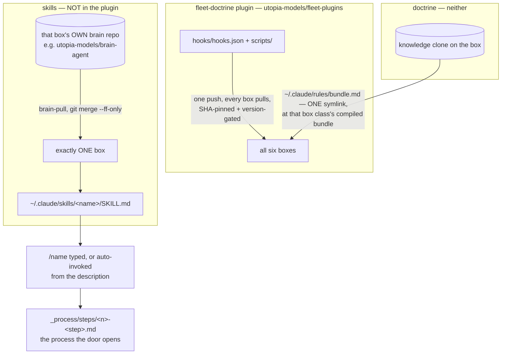

> Mirrored verbatim from `utopia-models/knowledge` `wi/components/skills-layer.md` by the allowlisted publish pipeline. Edit it there, not here.

```yaml
component: skills-layer
serves: all
runs-on: everywhere
adrs: []
owns:
  - brain-agent:skills
  - brain-agent-dust:skills
  - net/.claude/skills
```

# skills-layer — the per-box command surface, and the one thing the plugin does NOT distribute

## WHAT IT IS

The `/`-invokable commands an agent has: a directory per skill under `~/.claude/skills/`, each holding
a `SKILL.md` whose frontmatter `description` is what the model matches on for auto-invocation. It is
where the fleet's process *doors* live — `/plan-start`, `/execution-start`, `/feedback-loop` — so
removing it does not stop any master executing, but it removes every entry point the Architect uses to
start or continue a plan.

🔴 **Its defining property is negative: a skill reaches EXACTLY ONE BOX.** *"One push, every master
pulls"* is true of the plugin's hooks and scripts — and, since fleet-doctrine 0.93.0 (knowledge#9837,
PLAN-405 P2), of ONE skill: `/plan-start` ships IN the plugin (`skills/plan-start/`,
`disable-model-invocation: true`) and the brain-agent copy is deleted, because a same-named
`~/.claude/skills/` skill shadows a plugin skill on the bare `/name` (measured 2026-10-23). Every other
skill is still per-box.

🔴 **A PROJECT's skills never live in `~/.claude/skills/` — they live in `<project>/.claude/skills/` in this
repo** (knowledge#9928). A user-level skill is listed, name and description, in EVERY session on its box,
so five cleaning skills rode every wi session on the Architect's box. Claude Code attaches a NESTED
`.claude/skills/` — one below the session's cwd — the first time the model Reads a file under its parent
directory, and lists it from then on (measured on 2.1.302 and 2.1.307: absent from the startup listing, a
`dynamic_skill` attachment right after a Read of `8f444ccd79:cleaning/context.md`). 🔴 **It does NOT attach when the
cwd's own git repo gitignores the path** — the Architect's `~` is a repo with `.gitignore: *`, so there the Read
attaches nothing (`respectGitignore:false` does not change it; `--add-dir` does). `project-session.sh load`
prints a SKILLS section that asks for the Read AND lists each skill's `SKILL.md` — running a skill is reading
that file and following it, so a project session can use them on every box, and a wi session never sees
them. Outside `/plan-start`, `/add-dir ~/dev/utopia-models/knowledge/<project>` loads them as `/` commands. Probe: `ls */.claude/skills/`. The grader is `_infra/scripts/project-census.py --transcript <t>
--expect <project>`, which fails on another project's skill row.

**An account-level skill (`anthropic-skills:*`, from claude.ai) has no directory to nest**, so it cannot be
scoped per session. `skillOverrides` in the box's `settings.json` (`"user-invocable-only"`) takes it out of
the model's listing in every session while `/anthropic-skills:<name>` still runs when typed; a permission
`deny` on `Skill(...)` blocks the call but leaves the row listed (both measured 2026-10-23). Plugin skills
are not affected by `skillOverrides`.

## HOW IT WORKS TODAY



**Three delivery layers, three reaches, and conflating any two is the recurring error.** The plugin
ships *mechanism* to every box. Doctrine is *symlinked live* out of each box's `knowledge` clone, so a
rule change lands without a version bump — but **the symlink itself is tracked in that box's BRAIN
repo**, which is the third layer wearing the second layer's clothes and is where #7362 came from: the
link was repointed by hand on five boxes and committed on none, so every checkout restored nine
symlinks into a directory the rebuilt tree no longer has, and `sessionstart-pull-brain.sh` skipped its
auto-pull on the uncommitted deletions. **A repoint is not delivered until it is committed.** A **skill** ships in one brain repo and reaches one box, at
that box's next brain-pull — which is why `/upgrade-notes` sat on one box and off the Architect's for
all of PLAN-203.

**A skill belongs to the agent that owns the folder.** `~/.claude/` on a box is that agent's; a project
agent's skills, commands and rules never live there. A skill touching more than one file loads context
and shows a status table before any write, and `AskUserQuestion` is never step 1. Side-effect skills set
`disable-model-invocation: true`. The house verbs are **audit** (read-only), **self-enhance**
(autonomous), **update/fix** (scoped).

**A door is thin; the process is a frame.** `/execution-start` resolves which thing you mean and hands off
to its frame; the process lives in the frame, never in the door. `/plan-start` asks mode, project and
recipe, then `project-session.sh load` prints that ONE project's context, the recipe and
`_process/steps/plan-start-frame.md`, and writes `~/.claude/state/plan-issue/<session_id>` — the state the
`[session]` start-line hook re-reads on startup, resume, `/clear` and compaction. A master never types either.

🔴 **A fact a skill would ASSERT becomes a shell command that READS it.** In `SKILL.md`, a `!`
immediately followed by a backticked command runs in a shell before the content is sent and its output
replaces the placeholder — verified including with no `allowed-tools` and with
`disable-model-invocation: true`. A sentence stating a count, a path or a version is a sentence that
rots; the live read cannot.

🔴 **Master boxes have no user-level skills, and that is the current design, not a gap** (a project's
`<project>/.claude/skills/` attaches to a master's session only if it reads a file under that project). A
master reads its spec and its checklist; anything it needs from a process arrives written into the issue body at filing
time (see `subprocess-catalogue`).

**Why this doc's `owns:` names two repos and no path.** The partition has to name the real things, and
every real thing here is in a *different* repo — `brain-agent:skills` and `brain-agent-dust:skills`.
Written with a `/` they would be graded as repo-relative paths and fail R9 for being absent from a repo
they were never in; written as bare names they are correctly declined, the same way a unit or a port
is. `serves: all` is the enum's answer to "which portfolio", not a claim that a skill reaches every
box — it does not, and that is this component's whole first paragraph.

## BOUND VALUES

Nothing about this component is in this repo, so there is no number here to bind. What CAN be bound is
the in-git *pointers* at it: if a skill is renamed and the KB is not updated, these go red.

<!--[[[cog
m.calls("_process/steps/", "/plan-continue", "~/.claude/skills/execution-start/SKILL.md", "~/.claude/meta/workflow/start-planning.md")
m.calls("wi/subprocesses/dispatch/process.md", "plan-start", "execution-start", "execution-done", "plan-stop")
m.calls("_process/feedback-corpus.md", "/feedback-loop", "task-observer")
m.exists("_rules/a-skill-belongs-to-the-agent-that-owns-it.md")
]]]-->
- ✅ `/plan-continue` — still called by `_process/steps/`
- 🔴 `~/.claude/skills/execution-start/SKILL.md` — **NOT CALLED** by `_process/steps/`: present on disk, wired to nothing (#4742)
- 🔴 `~/.claude/meta/workflow/start-planning.md` — **NOT CALLED** by `_process/steps/`: present on disk, wired to nothing (#4742)
- ✅ `plan-start` — still called by `wi/subprocesses/dispatch/process.md`
- ✅ `execution-start` — still called by `wi/subprocesses/dispatch/process.md`
- ✅ `execution-done` — still called by `wi/subprocesses/dispatch/process.md`
- ✅ `plan-stop` — still called by `wi/subprocesses/dispatch/process.md`
- ✅ `/feedback-loop` — still called by `_process/feedback-corpus.md`
- ✅ `task-observer` — still called by `_process/feedback-corpus.md`
- ✅ `_rules/a-skill-belongs-to-the-agent-that-owns-it.md`
<!--[[[end]]]-->


## DETERMINE CURRENT STATE

Every fact about this component is off-git. There is nothing here to bind, so there is nothing here
stated as an answer.

| question | command |
|---|---|
| what does THIS box have | `ls ~/.claude/skills/` |
| what does a given box's brain repo carry | `gh api repos/utopia-models/<brain-repo>/contents/skills --jq '.[]\|select(.type=="dir").name'` |
| which brain repos carry any skills at all | run the above for `brain-agent` · `brain-agent-dust` · `brain-agent-sf` · `brain-win` · `brain-nova` · `brain-cloud` · `brain-poppi` — a 404 means the repo has no `skills/` |
| what one skill actually does | `gh api repos/utopia-models/<brain-repo>/contents/skills/<name>/SKILL.md --jq .content \| base64 -d` |
| does the plugin carry skills (it does not) | `gh api repos/utopia-models/fleet-plugins/contents/plugins/fleet-doctrine --jq '.[].name'` |
| which frames a door can open | `gh api repos/utopia-models/brain-agent/contents/meta/workflow --jq '.[].name'` |
| is a box on `main`'s plugin payload | `bash _infra/scripts/plugin-deploy-check.sh` |

🔴 **Grade the POPULATION, never one box.** "The fleet has skill X" is only ever true of boxes
individually, and four of them are not readable from any one master's account. A verification that read
one box and called the layer sound has already shipped once.

## KNOWN BROKEN

- 🔴 **Only two brain repos in the fleet hold a `skills/` directory at all.** Measured this session:

  ```
  for r in brain-agent brain-agent-dust brain-win brain-nova brain-cloud brain-agent-sf brain-poppi; do
    printf '%s: ' "$r"
    gh api "repos/utopia-models/$r/contents/skills" --jq 'length' 2>/dev/null | grep -E '^[0-9]+$' || echo 'no skills/ (404)'
  done
  brain-agent: 27
  brain-agent-dust: 51
  brain-win: no skills/ (404)
  brain-nova: no skills/ (404)
  brain-cloud: no skills/ (404)
  brain-agent-sf: no skills/ (404)
  brain-poppi: no skills/ (404)
  ```

  (`grep -E '^[0-9]+$'` is not decoration: `gh api` writes its 404 body to **stdout**, so a bare
  `|| echo` prints the JSON error and the fallback on one line.)

  (`brain-agent` counts 24 directories plus `README.md`, `README.md.backup-6491` and
  `SKILL-TEMPLATE.md`.) And on this box, `ls -la ~/.claude/skills` → *"No such file or directory"*. So
  the layer's real population is **two boxes**, and the 51 on dust's are reachable by nobody else. Any
  plan that says "ship a skill to the fleet" is describing a mechanism that does not exist.
- 🔴 **`brain-agent` carries a backup file inside the skills directory.**
  `README.md.backup-6491` sits beside the skills, in the same directory the loader walks. It is not a
  skill and nothing prunes it; doctrine's own rule is *delete, don't archive — git history is the
  archive*.
- ⚠ **The two boxes' skill sets have diverged with nothing measuring the gap.** 24 against 51 named
  skills, no shared manifest, no linter, no index. There is no command that answers *"which skills
  exist in the fleet"* — the probe table above is seven separate reads because that single command has
  never existed.
