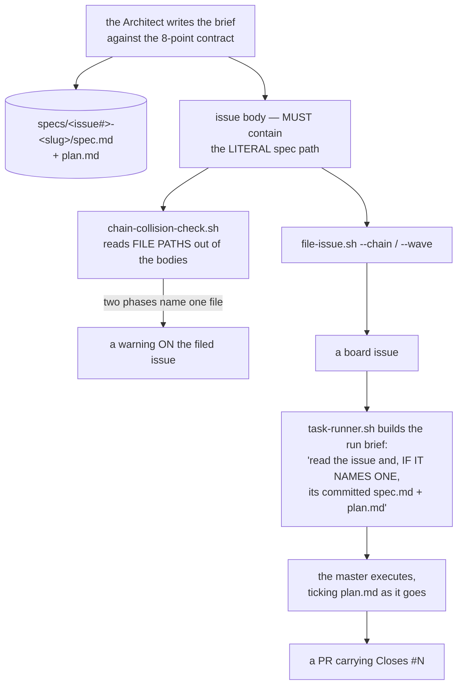

> Mirrored verbatim from `utopia-models/knowledge` `wi/components/spec-plan-brief-format.md` by the allowlisted publish pipeline. Edit it there, not here.

```yaml
component: spec-plan-brief-format
serves: all
runs-on: knowledge
adrs: []
owns:
  - _process/spec-contract.md
  - wi/work/specs/DECISION-TEMPLATE.md
  - _infra/scripts/chain-collision-check.sh
```

# spec-plan-brief-format — the brief that lives beside the work

## WHAT IT IS

The committed shape a dispatched master is handed: `spec.md` (objective · acceptance · scope ·
grounding), `plan.md` (phases → checkbox items, which **are** the live work state), and optionally
`decisions/` beside them. Post-rebuild dispatch runs 7/7 against a ~20% baseline, and the delta is
**brief quality, not model quality** — which is the whole reason this is a component and not a
convention.

Stop it and a master receives an issue title, a body, and no contract: it re-derives the target from the
repo, which is exactly the ~20% baseline.

## HOW IT WORKS TODAY

```
<portfolio>/specs/<issue#>-<slug>/
├── spec.md        objective · acceptance · scope fence · grounding
├── plan.md        phases → checkboxes.  🔴 THESE ARE THE WORK STATE
└── decisions/     ADR-shaped records, only where the choice is expensive to reverse
```



🔴 **The issue body MUST contain the literal spec path.** The runner reads a spec only *"if it names
one"* — an unnamed spec does not exist to the master. There is no `--spec` flag: the path is prose in
the body, which is why it is the most trivially omitted line in the pipeline and the highest-leverage
one.

🔴 **`plan.md` checkboxes ARE the work state**, not a report written afterwards. Tick `[ ] → [~] → [x]`
and commit as you go: a context reset, a peer takeover and Tyler all read that one file, and one master
has finished another's capped run from it alone.

**The 8-point contract** (`_process/spec-contract.md`, agent-box audience — a
master reads a spec, only the Architect writes one):

1. **Values, never snapshots** — say how to DETERMINE current state and what must be TRUE when done.
   This includes **the files the phase will CHANGE**; *"the hook"* is not a path.
2. **Acceptance names a live artifact to exercise**, plus the POPULATION and the NEGATIVE case.
3. **Grounding enumerated** — which CLAUDE.md, which registry file, which prior spec.
4. **Scope fence** — what NOT to touch.
5. **Phases sized to ~80 turns**, grounding reads included.
6. **Target repo named** when it is not `knowledge`.
7. **Irreversible work flagged** → DRAFT PR and stop.
8. **Ground every reference THIS session** — a spec can cite dead machinery in good faith.

**Point 1's file list is what makes the same-file check possible.** `chain-collision-check.sh` runs at
filing time — the cheapest possible moment — and emits three findings: `COLLIDE` (two phases name one
path), `ANAPHORA` (a later phase says *"the hook"* and never names the path an earlier one bound to that
noun), and `BLIND` (a phase names no file at all, so nothing about it can be checked). Two of #4506's
three phase bodies never wrote their target down, which is why `ANAPHORA` exists: a literal path
detector could not see the collision, and neither could a reader of the plan document those phases
cited. Findings are never failures — it exits 0 whenever the bodies were read, and 2 only on a usage
error. Grounding citations are deliberately EXCLUDED (`*/specs/*`, `spec.md`, `plan.md`, `CLAUDE.md`),
because doctrine requires every body to name its spec path and a check that fires on 100% of chains is
noise.

**A criterion grades the ARTIFACT, never the issue's own state.** *"This issue is closed by the PR that
records the answers"* is false at every moment a verifier can measure it. The children-closure variant
reads like a real criterion and is the same defect. Where a human curates the data a surface renders,
grade the **invariant**, never a count — one Feature was made un-completable because Tyler was editing
the store through the very admin page it shipped. And a criterion whose only satisfier is **elapsed
time** dispatches masters at work that does not exist.

**Decision records go beside the work**, from `wi/work/specs/DECISION-TEMPLATE.md`, and only
where the choice is expensive to reverse or a future reader will re-litigate it. Superseding one edits
the old record's `Superseded-by` header **in the same commit** — a silently-invalidated decision is the
fleet's most repeated failure.

## BOUND VALUES

Re-derived from the repo by `docs-cog.sh --check` on every PR.

<!--[[[cog
m.exists("_process/spec-contract.md wi/work/specs/DECISION-TEMPLATE.md _infra/scripts/chain-collision-check.sh")
m.calls("_infra/scripts/task-runner.sh", "specs/", "spec.md", "plan.md")
m.calls("_infra/scripts/file-issue.sh", "chain-collision-check.sh")
m.value("8", "_process/spec-contract.md", r"the (\d+)-point contract")
]]]-->
- ✅ `_process/spec-contract.md`
- ✅ `wi/work/specs/DECISION-TEMPLATE.md`
- ✅ `_infra/scripts/chain-collision-check.sh`
- ✅ `specs/` — still called by `_infra/scripts/task-runner.sh`
- ✅ `spec.md` — still called by `_infra/scripts/task-runner.sh`
- ✅ `plan.md` — still called by `_infra/scripts/task-runner.sh`
- ✅ `chain-collision-check.sh` — still called by `_infra/scripts/file-issue.sh`
- ✅ `8` — still live in `_process/spec-contract.md` (`the (\d+)-point contract`)
<!--[[[end]]]-->


## DETERMINE CURRENT STATE

| question | command |
|---|---|
| how many spec directories exist | `ls -d */specs/*/ \| wc -l` |
| which are missing half the brief | `for d in */specs/*/; do [ -f "$d/spec.md" ] && [ -f "$d/plan.md" ] \|\| echo "$d"; done` |
| does a filed chain collide on a file | `bash _infra/scripts/chain-collision-check.sh body1.md body2.md …` — TAB-separated `COLLIDE` / `ANAPHORA` / `BLIND` on stdout |
| what a specific brief obliges | `cat <portfolio>/specs/<issue#>-<slug>/spec.md` |
| does an issue name its spec | `gh issue view <n> --repo utopia-models/knowledge --json body --jq '.body' \| grep -o '[a-z0-9-]*/specs/[^ ]*'` |

## KNOWN BROKEN

- 🔴 **Fewer than half the spec directories hold both halves of the brief.** Measured this session:

  ```
  ls -d */specs/*/ | wc -l                                    → 186
  ls */specs/*/spec.md | wc -l                                → 106
  ls */specs/*/plan.md | wc -l                                → 109
  (dirs holding BOTH)                                         → 100
  ```

  So 86 of 186 spec directories are missing `spec.md`, `plan.md`, or both, while doctrine states the
  brief is the pair. Nothing lints the shape — `kb-lint.py` grades `wi/components/`, not `*/specs/` —
  so a half-brief is indistinguishable from a complete one until a master opens it.
- 🔴 **Nothing checks that an issue body names its spec, and the failure is silent by construction.**
  `task-runner.sh` reads a spec *"if it names one"*; a body that names none produces a run brief with
  no contract and no warning. `_infra/scripts/file-issue.sh` carries no `--spec` flag — measured:
  `grep -c '\-\-spec\b' _infra/scripts/file-issue.sh` → `0` — so there is no place a check could
  attach without parsing prose. The Feature this doc was written under hit exactly that: #7313-#7318
  named only a `claude.ai` artifact URL no dispatched master can open, and a master had to extract a
  committed brief from a 235 KB HTML rendering before any phase could run.
- ⚠ **`decisions/` is present in 16 of 186 spec directories.** That is consistent with the two-test
  guard (a record only where the choice is expensive to reverse), and it is equally consistent with
  records simply not being written. The two are indistinguishable from outside the session that made
  the choice, which is the known cost of a discipline with no linter.
