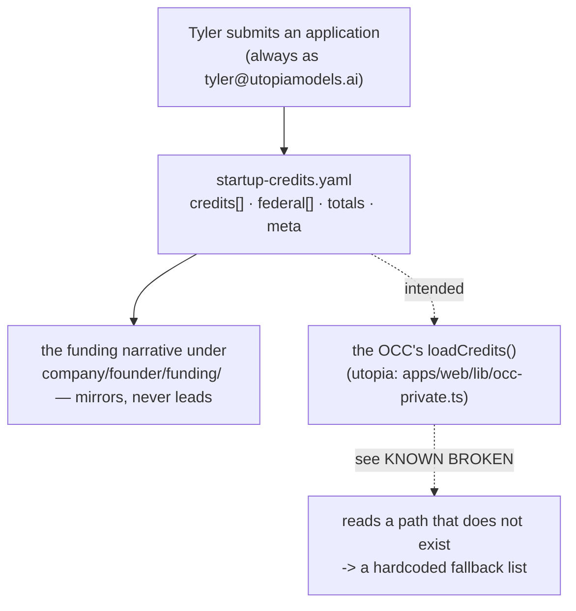

> Mirrored verbatim from `utopia-models/knowledge` `wi/components/startup-credits.md` by the allowlisted publish pipeline. Edit it there, not here.

```yaml
component: startup-credits
serves: all
runs-on: knowledge-repo
adrs: []
owns:
  - wi/registry/startup-credits.yaml
```

# startup-credits — the non-VC money, tracked as structure instead of prose

## WHAT IT IS

The org's tracker for **startup credit and perk programs**: Cloudflare for Startups, PostHog, AWS
Activate, Anthropic's Claude for Startups, Neon, Microsoft Founders Hub, GCP, Stripe, Google Workspace,
Mercury and the SaaS perks — plus a separate `federal:` track for the non-dilutive grant applications.

It exists as a machine-parseable registry rather than a folder of markdown because the same facts were
scattered across four documents under `wi/work/company/founder/funding/` and disagreed with
each other. One file, one shape: `provider · amount_usd · status · date · via · notes`, with a
`totals:` block and a `meta:` header.

🔴 **It is not `vendor-accounts`.** That row is the accounts the org **holds and pays for**; this one is
money **granted or applied for**. A vendor can appear in both, and the two answer different questions.

## HOW IT WORKS TODAY



**The schema is the contract**, and three of its fields carry rules that are easy to lose:

- `status:` is one of `submitted · in_progress · approved · queued · done · optional`. The OCC's parser
  coerces anything else to `queued`, so an invented status disappears silently rather than erroring.
- `expiry:` is `null` **until approved**, then set to the credit's use-by date. Most startup credits lapse
  12–24 months after grant; the field exists so the org spends before that, not after.
- `meta.canonical_email` is `tyler@utopiamodels.ai` for **every** program, so credits stay attributable to
  one identity.

🔴 **The golden rule, recorded in the file's own header:** for any *"new users only / X% off first year"*
perk, claim it **from the Stripe Atlas Perks tab → the vendor link** first. Creating the vendor account
directly forfeits the perk, and that is not recoverable.

## BOUND VALUES

<!--[[[cog
m.exists("wi/registry/startup-credits.yaml")
m.value("160000", "wi/registry/startup-credits.yaml", r"infra_credits_target_usd: (\d+)")
m.value("tyler@utopiamodels.ai", "wi/registry/startup-credits.yaml", r"canonical_email: (\S+)")
m.units("startup-credits")
]]]-->
- ✅ `wi/registry/startup-credits.yaml`
- ✅ `160000` — still live in `wi/registry/startup-credits.yaml` (`infra_credits_target_usd: (\d+)`)
- ✅ `tyler@utopiamodels.ai` — still live in `wi/registry/startup-credits.yaml` (`canonical_email: (\S+)`)
- 🔴 `startup-credits` — **no such row** in `wi/registry/components.yaml`
<!--[[[end]]]-->

The per-provider amounts and statuses are deliberately **not** bound: they are claims about an external
console, and binding them would assert that a hand-edited field matches a world nobody re-reads.

## DETERMINE CURRENT STATE

**Nothing automates any of this.** There is no timer, no API and no probe: no vendor in the list exposes a
credit-balance endpoint the fleet could read, so `status` and `amount_usd` are hand-maintained against
each vendor's own console. That makes this component **genuinely opaque**, not merely off-git — the one
honest probe is the file's own freshness:

```bash
# what the registry says, and how old the claim is
python3 -c "import yaml;d=yaml.safe_load(open('wi/registry/startup-credits.yaml'));\
print(d['meta']['updated'], len(d['credits']), d['totals']['headline'])"
# when was it last actually edited?
git log -1 --format='%ad %h %s' -- wi/registry/startup-credits.yaml
# does the OCC path this file is meant to be read through resolve?
gh api repos/utopia-models/knowledge/contents/_org/fleet/registry/startup-credits.yaml --jq .name
```

## KNOWN BROKEN

- 🔴 **Its one machine consumer reads a path that does not exist.** `apps/web/lib/occ-private.ts` in the
  `utopia` repo declares `const REG = "_org/fleet/registry"` and calls
  `fetchRepoFile(KNOWLEDGE_REPO, "_org/fleet/registry/startup-credits.yaml")`. This repo has no `_org/`
  directory — the registry is `wi/registry/` — and
  `gh api repos/utopia-models/knowledge/contents/_org/fleet/registry/startup-credits.yaml` returns
  **404 Not Found**. The same file's `ORG_REGISTRY_PATH` uses the correct
  `wi/registry/…` prefix, so `REG` is simply a stale sibling. `loadCredits()`
  therefore always takes its `CREDITS_FALLBACK` branch: a **hardcoded list and headline compiled into the
  OCC bundle**, which would render as live data.
- 🔴 **`loadCredits()` has no caller.** `grep -rn 'loadCredits' --include='*.ts' --include='*.tsx'` across
  the whole `utopia` repo returns exactly one line — its own definition. So the registry's purpose
  ("machine-parseable, site-surfaceable, can render on the OCC") is unmet twice over: wrong path, and no
  page.
- 🔴 **The registry is months behind the applications it tracks.** `meta.updated` is `2026-07-04` and the
  newest `date:` on any row is `2026-06-27`, while PLAN-194's parked document records *"Four applications
  were submitted on 2026-08-16 and none has resolved yet."* Those four submissions are not in the file.
- ⚠ **`expiry:` is set on 0 of 11 rows.** Correct today — nothing is `approved` — but it means the lapse
  guard the schema describes has never once been exercised, and the first approval is when it must not be
  forgotten.
- ⚠ **PLAN-194 ("actually use the credits we hold") is PARKED**, deliberately, by Tyler on 2026-08-16, and
  releases on the first approval email or PostHog's 14 September change, whichever is sooner. Do not
  re-derive that decision from this doc.
- ⚠ **There is no `startup-credits` row in `components.yaml`**, so the runway tracker appears on no
  registry surface.
