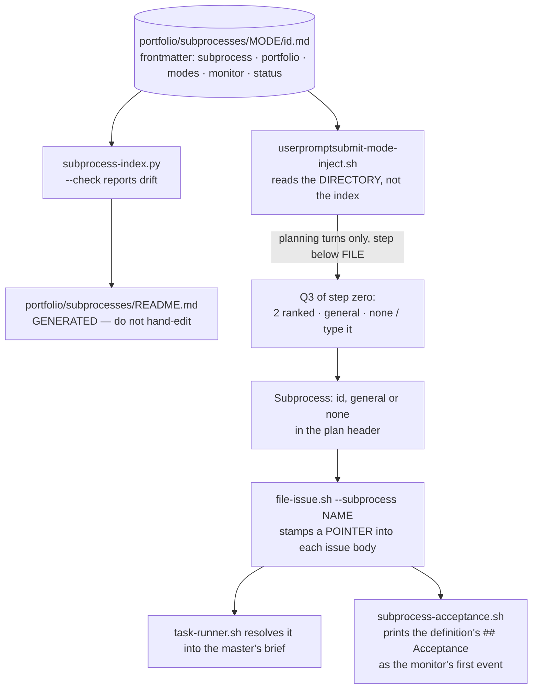

> Mirrored verbatim from `utopia-models/knowledge` `wi/components/subprocess-catalogue.md` by the allowlisted publish pipeline. Edit it there, not here.

```yaml
component: subprocess-catalogue
serves: all
runs-on: knowledge
adrs: [6798, 7781]
owns:
  - _infra/scripts/subprocess-index.py
  - _infra/scripts/subprocess-acceptance.sh
  - wi/subprocesses/
  - dmv-research/subprocesses/
  - net/subprocesses/
```

# subprocess-catalogue — the extra required steps a KIND of work has

## WHAT IT IS

A per-portfolio catalogue of named processes, each declaring what a plan of that kind must READ, must
WRITE, and is graded on. It is Q3 of step zero, after mode and portfolio, and it is the only way a
process written on the Architect's box reaches a dispatched master: `file-issue.sh` stamps the chosen
subprocess into the issue body at filing time, and `task-runner.sh` resolves the definition into the
master's run brief.

Stop it and the process docs become unreadable by the fleet they govern — every frame lives in one
box's home, and a master would receive only whatever the issue body happened to spell out.

`serves: all` is the enum's answer to "which portfolio"; the live population is narrower — only `wi`,
`dmv` and `net` have a catalogue, and the injected line is silent for the other two: `govcon`
deliberately, and `talent` (added 2026-10-01) because it has none yet.

## HOW IT WORKS TODAY

🔴 **THE DIRECTORY IS THE ROUTING, not the generated index** (`<portfolio>/subprocesses/README.md`,
once `SUBPROCESSES.md`). The index is for humans. The hook
reads the filesystem — until plugin 0.53.0 it ran a `sed` over that file's first column, which could
not see the `## <mode>` headings the file is grouped by, and would have kept offering every id in the
portfolio while looking exactly as correct as before. A first-column parser over a generated table
fails silently by construction.

```
<portfolio>/subprocesses/<mode>/<id>.md
```

🔴 **ONE SUBPROCESS LIVES IN EXACTLY ONE MODE.** `modes:` in the frontmatter is **SINGULAR** — one
value, never a list — and it must equal the parent directory name. No copies, no per-mode branch inside
a definition, no inheritance. `subprocess-index.py --check` fails on a disagreement, so a wrong mode is
a broken build rather than a prose claim nothing reads.

🔴 **TWO MODES, AND `dispatch` DEFINITIONS SAY WHETHER THE CHAIN IS WATCHED** (ADR-7781). The mode
directories are `dispatch/` and `interactive/`. Every `dispatch` definition carries `monitor: yes` or
`monitor: no`; an `interactive` one carries none. Monitor-or-not is read from the bound definition,
never asked at step zero — `--check` fails on a missing or invalid value, and on the field appearing
outside `dispatch`.



**Mode is the first axis** because it decides which section of a catalogue exists at all; portfolio then
decides which catalogue. The injected line is **per-catalogue, not per-id** — it names the folder for
the recorded mode and every id under it — and it fires on planning turns only, because an execution turn
would pay for a line with no reader.

🔴 **`general` and `none` are different answers and both are legitimate.** `general` means the ordinary
planning loop applies; `none` means do not route this at all. Forcing a choice between real ids is how a
*wrong* subprocess gets followed — worse than none, because the work follows it. Q3 is always asked,
including for a portfolio with no catalogue, which answers `general`.

🔴 **Subprocesses never ship to a master box.** A master reads its spec and its checklist; anything it
needs from a subprocess arrives written into the issue body at filing time. A design that ships a
subprocess folder to win · nova · cloud · dust is out of scope by construction.

**A subprocess is ONE process plus a per-portfolio checklist**, not five variants of one text. WI's
`doc-update` means *"name the doc this WIN change invalidates, and update it in the same chain"* — the
shape is universal, the portfolio-specific step is which doc.

**The generator is discovery-based, never a hardcoded portfolio list**, so a portfolio with no
`subprocesses/` gets no index rather than an empty one.

## BOUND VALUES

Re-derived from the repo by `docs-cog.sh --check` on every PR.

<!--[[[cog
m.exists("_infra/scripts/subprocess-index.py wi/subprocesses/ dmv-research/subprocesses/ net/subprocesses/")
m.value("dispatch", "_infra/scripts/subprocess-index.py", r"MODES = \('([a-z-]+)'")
m.calls("_infra/scripts/subprocess-index.py", "monitor", "interactive", "subprocesses")
m.calls("wi/subprocesses/", "_infra/scripts/subprocess-index.py")
]]]-->
- ✅ `_infra/scripts/subprocess-index.py`
- ✅ `wi/subprocesses/` — directory
- ✅ `dmv-research/subprocesses/` — directory
- ✅ `net/subprocesses/` — directory
- ✅ `dispatch` — still live in `_infra/scripts/subprocess-index.py` (`MODES = \('([a-z-]+)'`)
- ✅ `monitor` — still called by `_infra/scripts/subprocess-index.py`
- ✅ `interactive` — still called by `_infra/scripts/subprocess-index.py`
- ✅ `subprocesses` — still called by `_infra/scripts/subprocess-index.py`
- ✅ `_infra/scripts/subprocess-index.py` — still called by `wi/subprocesses/`
<!--[[[end]]]-->


## DETERMINE CURRENT STATE

| question | command |
|---|---|
| every id, by mode and portfolio | the one-liner below |
| how many exist right now | `ls */subprocesses/*/*.md \| wc -l` |
| does any index disagree with disk | `python3 _infra/scripts/subprocess-index.py --check` |
| which portfolios have a catalogue at all | `ls -d */subprocesses/` |
| what a definition obliges | `cat <portfolio>/subprocesses/<mode>/<id>.md` |

```bash
for d in */subprocesses/*/; do
  echo "$(echo "$d" | cut -d/ -f3) | $(echo "$d" | cut -d/ -f1) | $(ls "$d"*.md | xargs -n1 basename | sed 's/.md$//' | tr '\n' ' ')"
done | sort
```

🔴 **Do not write the id list into a doc.** The doctrine file's own table said 12 while disk held 17,
then 17 while disk held 18 — twice, under a heading claiming it was *"generated from disk"*. The
one-liner above is the answer; this doc states no count for the same reason.

## KNOWN BROKEN

- 🔴 **`wi/subprocesses/dispatch/process.md` names a hook that was retired
  four days before this doc was written.** Its trigger list reads
  *"Fleet-doctrine hooks: `userpromptsubmit-mode-inject.sh` · `posttooluse-plan-step-emit.sh` ·
  `pretooluse-plan-shape-gate.sh` · `stop-no-permission-ask.sh`"*. Measured this session:

  ```
  ls ~/.claude/plugins/marketplaces/fleet-doctrine/plugins/fleet-doctrine/scripts/ | grep shape
  (no output)
  grep -n "plan-shape-gate" ~/.claude/plugins/marketplaces/fleet-doctrine/plugins/fleet-doctrine/test/hook-integrity.sh
  152:#   · `pretooluse-plan-shape-gate.sh` — RETIRED 2026-08-27 (knowledge#6963, plan PLAN-233). It checked a
  ```

  The script is gone from the marketplace clone's `scripts/` and from `hooks/hooks.json`; only the
  test's provenance comment remains. A trigger list naming a dead hook does not misfire — it simply
  fails to route a change to a hook that is actually there.
- 🔴 **`--check` exits 0 while printing twelve warnings.** Measured this session:
  `python3 _infra/scripts/subprocess-index.py --check; echo rc=$?` → `rc=0`, having printed one
  *"## Acceptance section contains no **NEGATIVE:** line"* (`dmv-research/agency-rip.md`) and eleven
  *"Line-number citation detected"* across `money-path` · `device` · `rip` · `doc-update`. Those are
  ADVISORY by design, but the exit code is the only thing CI reads, so the advisories accumulate with
  nothing that ever forces them down.
- ⚠ **The generated index (`<portfolio>/subprocesses/README.md`) exists for three portfolios and the other
  two are indistinguishable from broken.** `govcon` has no catalogue deliberately (and `talent`, added 2026-10-01, has none yet), and the absence of a file is how that is
  encoded — so "deliberately has none" and "the generator never ran for it" look identical on disk. The
  only disambiguator is the doctrine sentence saying so.
