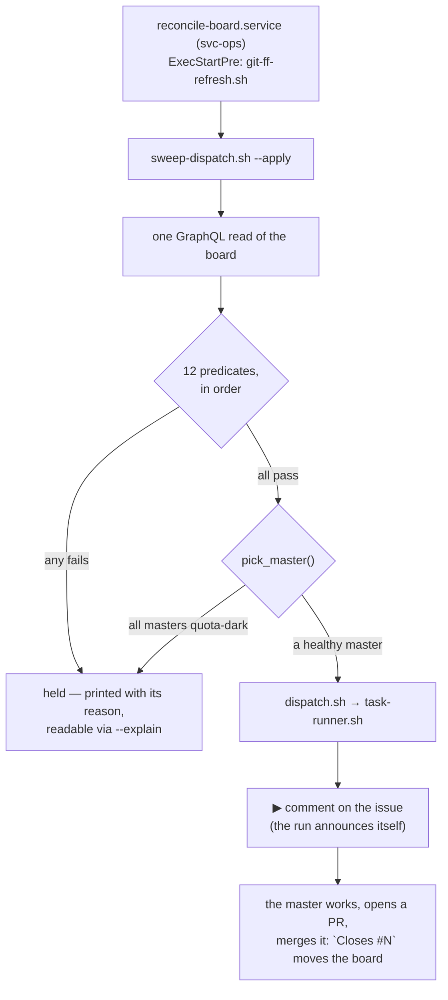

> Mirrored verbatim from `utopia-models/knowledge` `wi/components/sweeper.md` by the allowlisted publish pipeline. Edit it there, not here.

```yaml
component: sweeper
serves: all
runs-on: novaserver
adrs: [3415, 3562, 4800, 6924, 7167]
owns:
  - _infra/scripts/sweep-dispatch.sh
  - _infra/scripts/dispatch.sh
  - _infra/systemd/reconcile-board.service.d/10-sweep-dispatch.conf
  - reconcile-board.service
```

# sweeper — the only thing in the fleet that starts work

## WHAT IT IS

The fleet's **scheduler**, and the only consumer of `Status=Todo` that exists. It reads the board,
picks the oldest eligible issue, picks a master, and shells out to `dispatch.sh`. It never closes an
issue and never closes a Feature — it only starts runs.

Before it existed (#3418) every scheduled job in the fleet *observed* the board and none *acted* on
it: the scheduler was a human typing `dispatch.sh`. That is the one sentence that explains why this
component is load-bearing out of proportion to its size — remove it and the board stops being a
queue and becomes a list.

## HOW IT WORKS TODAY

It rides a timer that already existed. `reconcile-board.service` (nova's account until 2026-10-19; the unix user `svc-ops` since knowledge#9201, the same machine) already woke on a cycle and
already read this board; the drop-in adds one `ExecStart` line to it, so there is no sweeper timer
and no sweeper service to find — `systemctl --user cat reconcile-board.service` shows the whole
mechanism (ADR-3415).



The twelve predicates, numbered as the script numbers them:

| # | predicate | what it is defending |
|---|---|---|
| 1 | `Status=Todo` | the board is the queue; nothing else is |
| 2 | Lane routable to a novaserver master (blank counts) | a lane this box cannot reach is not one it may dispatch |
| 3 | parent Feature is OPEN, or there is none | never drive a sub-issue of a closed Feature |
| 4 | every native `blockedBy` is CLOSED | #3693 — without it #3641 would have been dispatched into #3637's live file |
| 5 | no live `task-<n>-*` unit on any box | the real anti-double-dispatch check, probed per cycle |
| 6 | last run-marker ∉ { ▶, ✔, ⛔, ⚠ } | ▶ a run holds it · ✔ it shipped · ⛔ a human-only step was declared · ⚠ a clean no-op |
| 7 | ▶-count below the attempt cap | the burn-loop guard, counted from the issue's OWN ▶ comments — no state file |
| 8 | no ⏸ comment | the cap's terminal latch, matched on the GLYPH alone (it once matched prose and re-parked #3737) |
| 9 | no human is on it | a non-master assignee, a hold label, or `test-fixture` (#3782/#3789 burned two full runs on throwaway probes) |
| 10 | the master is not unhealthy | `pick_master()`'s one gate: not in `ALL_UNHEALTHY`, which is quota-derived |
| 11 | zero OPEN sub-issues | a grouper is not the work, its children are (#4063: Feature #4034 and its own sub-issue went to nova 12 seconds apart) |
| 12 | not a parentless issue with no sub-issues at all, filed in the last 15 minutes | a Feature is created before its children: #8659 was dispatched 44 seconds after filing, 84 seconds before its first child existed (#8670). Self-releasing, so a Feature that really has no children waits 15 minutes and then runs |

**Predicate 7 is the only cap left in the whole component.** There is no per-master, fleet-wide,
per-cycle or per-account concurrency cap: `SWEEP_MAX_PER_MASTER` / `SWEEP_MAX_INFLIGHT` /
`SWEEP_MAX_PER_CYCLE` were **deleted** by #6962 rather than raised, and `DISPATCH_ACCOUNT_CAP` by
#7162. Setting any of those four in the environment today does nothing at all. They bounded *useful*
starts while the failure they were filed against — an API-outage burn loop — is already bounded by
predicate 7 and the quota cooldown, which bound *wasted* ones.

**Reading it without running it:** `_infra/scripts/sweep-dispatch.sh --explain` prints one line per
candidate issue with the predicate that held it. When the queue looks stuck, that output is the
answer; four separate investigations in August 2026 went looking for a broken mechanism while this
command had been printing the cause every cycle.

**Turning it off needs no code edit, from either end:** `touch ~/.claude/state/SWEEPER-OFF` in svc-ops' home (the account the sweep runs as: `sudo -n -u svc-ops touch ~svc-ops/.claude/state/SWEEPER-OFF` from `nova`),
or open a board issue titled `SWEEPER: OFF` — the second is reachable from Tyler's phone.

## BOUND VALUES

Every number and path this doc states, re-derived from the repo by `docs-cog.sh --check` on every PR.
A claim that outlives the thing it names turns this block red on the PR that broke it — which is the
entire reason the block is here rather than a "verified:" date nobody re-checks.

<!--[[[cog
m.exists("_infra/scripts/sweep-dispatch.sh _infra/scripts/dispatch.sh _infra/systemd/reconcile-board.service.d/10-sweep-dispatch.conf")
m.units("sweeper")
m.value("3", "_infra/scripts/sweep-dispatch.sh", r"SWEEP_MAX_ATTEMPTS:-(\d+)")
m.value("15", "_infra/scripts/sweep-dispatch.sh", r"SWEEP_FEATURE_SETTLE_MINUTES:-(\d+)")
]]]-->
- ✅ `_infra/scripts/sweep-dispatch.sh`
- ✅ `_infra/scripts/dispatch.sh`
- ✅ `_infra/systemd/reconcile-board.service.d/10-sweep-dispatch.conf`
- ⚙️ `user@svc-ops:reconcile-board.service` — ExecStart target proven daily by `verify-unit-execstart.py` (#4742)
- ✅ `3` — still live in `_infra/scripts/sweep-dispatch.sh` (`SWEEP_MAX_ATTEMPTS:-(\d+)`)
- ✅ `15` — still live in `_infra/scripts/sweep-dispatch.sh` (`SWEEP_FEATURE_SETTLE_MINUTES:-(\d+)`)
<!--[[[end]]]-->

## DETERMINE CURRENT STATE

```
_infra/scripts/sweep-dispatch.sh --explain
```

Read-only, no `--apply`. One line per `Status=Todo` issue with the predicate that held it — the answer
to "why is the queue stuck", printed every cycle whether or not anybody reads it.

For the schedule it rides, `sudo -n -u svc-ops XDG_RUNTIME_DIR=/run/user/$(id -u svc-ops) systemctl --user cat reconcile-board.service`, run as `nova`
(svc-ops' home is 0750).

## KNOWN BROKEN

- 🔴 **The registry row for this component still states the deleted caps.**
  `wi/registry/components.yaml`'s `sweeper` row reads *"Caps default to 6
  in-flight runs per master, 24 fleet-wide, 8 starts per cycle"*. Measured this session:
  `grep -c 'SWEEP_MAX_INFLIGHT\|SWEEP_MAX_PER_MASTER\|SWEEP_MAX_PER_CYCLE' _infra/scripts/sweep-dispatch.sh`
  → `0`. The three variables do not exist. Nothing binds that `note:` field, which is exactly the gap
  `## BOUND VALUES` closes for the doc and leaves open for the registry.
- ⚠ **The cadence is not bindable in this repo.** The interval lives in `reconcile-board.service`'s
  `[Timer]`, which is off-repo on svc-ops' account; the drop-in this component owns only appends an
  `ExecStart`. So this doc deliberately states no cadence number — a `cog` assertion pointed at the
  drop-in would bind a *comment*, and a bound comment is a claim about prose, not about behaviour.
  Read it live: `sudo -n -u svc-ops XDG_RUNTIME_DIR=/run/user/$(id -u svc-ops) systemctl --user cat reconcile-board.service`.
