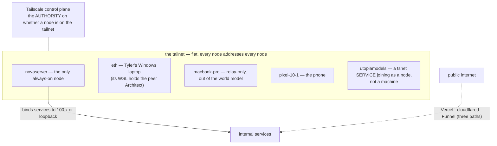

> Mirrored verbatim from `utopia-models/knowledge` `wi/components/tailscaled.md` by the allowlisted publish pipeline. Edit it there, not here.

```yaml
component: tailscaled
serves: all
runs-on: everywhere
adrs: [178]
owns:
  - tailscaled.service
```

# tailscaled — the private network the whole fleet lives on

## WHAT IT IS

The mesh VPN every fleet device is a node of. It is the reason **nothing internal is exposed to the
public internet**: an internal service binds to its host's tailnet address or to loopback, and
public reach is a separate, deliberate act through Vercel, the `cloudflared` tunnel, or Tailscale Funnel on named paths.

If this stops, the fleet does not degrade gracefully — the Architect cannot reach novaserver, `gh`
and `git` fail from every master, and the phone becomes uncommandable. It is the one dependency with
no fallback path.

## HOW IT WORKS TODAY

A flat mesh: every node can address every other node directly by its `100.x` address, with the
coordination server brokering and a DERP relay carrying traffic when a direct path cannot be
established. There is no gateway, no hub, and no per-service firewall rule to maintain — reachability
is membership.



**The ACL policy file lives in git: `_infra/tofu/tailscale/policy.hujson`, owned by OpenTofu**
(`tailscale_acl`, knowledge#10618). Change it there and run `bash _infra/tofu/tofu.sh tailscale apply`;
an admin-console edit is drift and shows up on the next `plan`. The `tofu` workflow plans it on every PR
touching `_infra/tofu/`.

**Funnel is the third deliberate public path, and it is scoped to named paths.** The policy file grants
the `funnel` node attribute only to novaserver (`100.71.25.43`), and the serve config on
`https://novaserver.tail4016d7.ts.net` mounts three paths, each authenticated by its own service:

| path | → | who authenticates it |
|---|---|---|
| `/quo/webhook` | comms-ingest `127.0.0.1:8790` | Quo's HMAC (knowledge#8995) |
| `/vollna` | ronin's vollna-feed `127.0.0.1:8796` | its own token (wi/components/ronin.md) |
| `/a2a` | atlas's A2A endpoint `127.0.0.1:8797` | a bearer token per peer fleet (wi/components/atlas.md, knowledge#10740) |

Turning Funnel on took three things: the tailnet's `httpsEnabled` setting, that `nodeAttrs` entry, and
`tailscale set --operator=nova`. A mount is added with `tailscale funnel --bg --set-path=/<path> http://127.0.0.1:<port>/<path>`.
Read what is exposed with `ssh nova@localhost tailscale funnel status` — that output, not this table, is the truth; any
mount there that is not in this table is a new public surface, so treat it as one.

**🔴 `tailscale status` run ON a box cannot tell you that box is off the tailnet.** This is the
component's single most important property. During a 7h32m blackout on novaserver, local
`tailscale status` printed a normal-looking table the whole time while every peer had lost the box.
The authoritative view is the **control plane's** `lastSeen`, read from anywhere else — which is
also why the fleet's blackout detector is deliberately off-box: a partitioned box cannot report its
own partition, and that includes its systemd timers and its self-hosted Actions runner.

**🔴 ICMP `ping` is not a liveness test for a tailnet peer — `tailscale ping` is.** Measured this
session from novaserver: `ping -c1 -W3` failed against the ETH laptop's node, the MacBook and the
phone; `tailscale ping` pongs from the first in 3ms over a direct path and the second in 205ms over
a DERP relay. Two of those three "unreachable" nodes were fully reachable. Any sweep that grades
tailnet membership by ICMP produces false outages.

**Not every node is a machine.** One node is a `tsnet` application that joins the tailnet as its own
peer. A roster row is a *node*, and a node is not evidence of hardware.

**A node reporting `offline, last seen …` is normal for anything that sleeps** — a phone roams, a
laptop closes. Prolonged offline is worth exactly one check, not indefinite patience and not an
alarm.

**Tailscale is not Cloudflare WARP.** WARP/Gateway policies bind to an enrolled *device identity*,
and the only WARP-enrolled surface in the fleet is Tyler's Windows laptop. A Gateway policy can
never apply on novaserver, so do not test one on the other and do not explain a novaserver failure
with a WARP rule.

**The committed roster is a SNAPSHOT with a separate owner.** `fleet-refresh-tailnet` writes
`wi/registry/tailnet.json` from live status on a timer; that generator is its
own component. What matters here is the reading rule: **the JSON's `online` flag is one box's peer
opinion at one instant**, not a fleet-neutral fact, and the file ages silently. If the age matters,
run `tailscale status`; if it does not, read the JSON and say which it is.

## BOUND VALUES

<!--[[[cog
m.units("tailscaled")
]]]-->
- ⚙️ `system:tailscaled.service` — ExecStart target proven daily by `verify-unit-execstart.py` (#4742)
<!--[[[end]]]-->

Nothing else here is bindable from this repo, deliberately. The node list, every address, and every
online flag are facts about a live network — the moment one is written into this doc it is a claim
with no path back to ground truth. The whole component is the probe below.

## DETERMINE CURRENT STATE

```
tailscale status
tailscale ping -c 1 --timeout 5s <peer address>
bash _infra/tofu/tofu.sh tailscale plan -detailed-exitcode   # 0 = live ACL matches git
```

And, when the question is *"is THIS box on the tailnet"* — which local status cannot answer — read
the control plane's `lastSeen` for the node **from a different box**, with
`fleet-infra/TAILSCALE_API_TOKEN` from Infisical against
`api.tailscale.com/api/v2/tailnet/-/devices`.

## KNOWN BROKEN

- 🔴 **The committed roster carries a device the fleet decided to stop modelling, and has since the
  decision.** `tailnet.json` holds six devices including `MacBook Pro`; #6244 removed that machine
  from both registries and the exclusion was added to `_infra/scripts/fleet-refresh-tailnet.sh`, but
  the installed unit execs a different script (nova's brain copy) that has no exclusion at all. Full
  measurement in `host-macbook-pro.md` — recorded there because the finding is about that device's
  removal, not about the network.
- ⚠ **The superseded doc's node table names one peer "unidentified" and it is not.**
  `wi/work/reference/win/tailscaled.md` describes the `utopiamodels` node as *"purpose
  not established"*. Measured this session:
  ```
  $ curl -s -m8 http://100.92.117.107/metrics
  forbidden: read_metrics grant required
  $ curl -s -m8 -o /dev/null -w '%{http_code}' http://100.92.117.107/
  302
  ```
  A **Tailscale grant** error, not an application 403, on a node whose port 22 refuses and whose
  root path redirects: that is a `tsnet` application joining the tailnet as its own node, not a
  machine with a mystery on it. A node table in a doc is the canonical rotting artifact — this doc
  states no node list for that reason.
- ⚠ **The blackout that motivated the off-box detector was NOT a tailscaled fault, and `Restart=` on
  this unit would not have helped.** The link stayed up and error-free with nothing addressed to the
  host — an L3 reachability failure one layer below this component. Restarting the daemon would have
  reproduced the same failure in a fresh process. Remediation belongs to
  `novaserver-route-watchdog`; detection belongs off-box. Do not attach a restart policy here to
  "fix" a network fault.
- ⚠ **`tailscaled`'s own journal is the fleet's best netlink tap, and almost nothing knows it.** Its
  `monitor: RTM_*` lines record route and address changes to the second, on a box where
  `systemd-networkd` at its default log level recorded nothing at all through two separate L3 faults.
  When the question is *"what happened to the link"*, read this unit's journal first.
